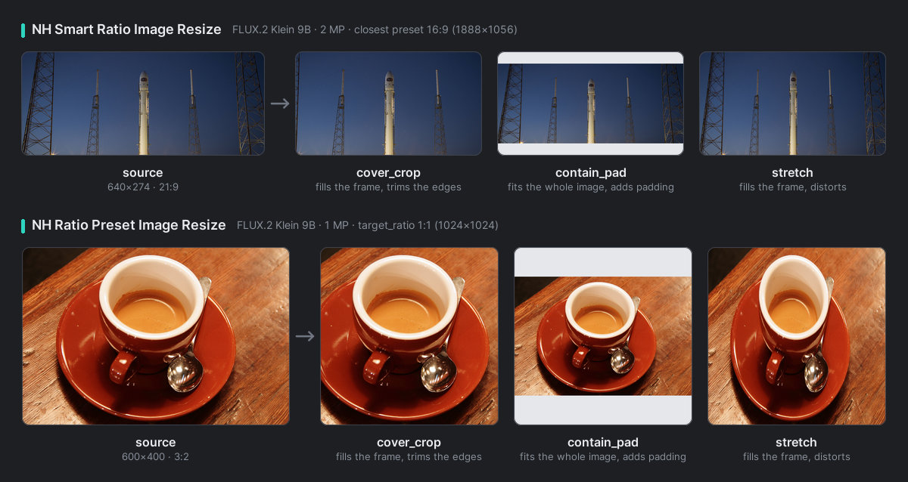
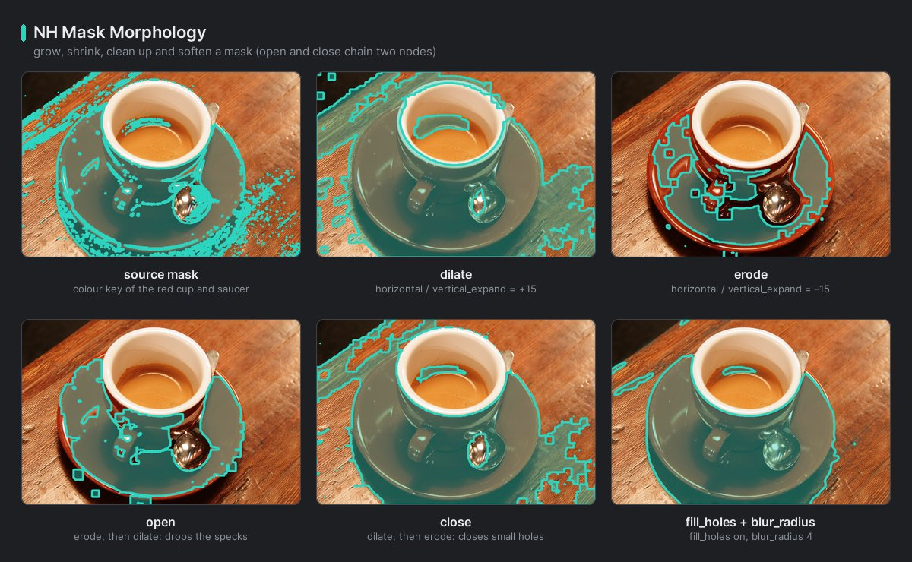

<p align="center"></p>

<p align="center">
  <a href="https://registry.comfy.org/nodes/nh-nodes"></a>
  <a href="https://github.com/jetthuangai/NH-Nodes/actions/workflows/tests.yml"></a>
  <a href="LICENSE"></a>
  <a href="docs/en/README.md"></a>
</p>

<p align="center"><b>English</b> · <a href="docs/vi/README.md">Tiếng Việt</a></p>

# NH-Nodes for ComfyUI

**75 production-focused nodes** for ComfyUI: load and save image sets with their metadata, tile and composite large
images, pick the right resolution for current models and put results back into the original frame, refine masks,
segment garments and faces (also in half-body and group photos), get the mask of anything you name with SAM 3 from a
short formula such as `person - bag` or `background`, build VTON masks, route workflows with lazy switches, generate
prompts, and test many LoRAs or models from one node.

Every node is documented with a visual card, its inputs and outputs, and examples — in
[English](docs/en/README.md) and [Vietnamese](docs/vi/README.md).

## Highlights

<table>
  <tr>
    <td width="50%"><a href="docs/en/resolution.md"></a><br>
      <b>Resolution done right</b> — presets for FLUX.2, Qwen-Image and Z-Image, cover / contain / stretch resizing, and an
      exact round trip back to the original frame.</td>
    <td width="50%"><a href="docs/en/image-compose.md"></a><br>
      <b>Large images</b> — split into overlapping tiles, process them, and blend them back seamlessly; deep-zoom preview
      for images too big for the canvas.</td>
  </tr>
  <tr>
    <td><a href="docs/en/vision.md"></a><br>
      <b>Segmentation</b> — name what you want (people, windows, the sky) or write a formula such as
      <code>person - bag</code> or <code>background</code>, and SAM 3 returns the mask, with crisp edges on small and
      medium objects even in 4K–8K photos, and shows it on the node; garment and face-part masks from SegFormer models
      that parse faces and people close up; VTON garment masks with pose and parsing.</td>
    <td><a href="docs/en/mask.md"></a><br>
      <b>Mask tools</b> — fast grow / shrink on the CPU or the GPU, hole filling, soft edges, bounding boxes and
      aspect-ratio matching.</td>
  </tr>
  <tr>
    <td><a href="docs/en/image-compose.md"></a><br>
      <b>Compositing</b> — layouts, layer stacks with alpha, labelled grids and side-by-side comparisons.</td>
    <td><a href="docs/en/logic.md"></a><br>
      <b>Workflow logic</b> — lazy If/Else and switches that run only the chosen branch, safe math, counters, lists and
      prompt tools.</td>
  </tr>
</table>

## Installation

**ComfyUI Manager** — search for `NH-Nodes`, install, restart ComfyUI.

**Comfy CLI**

```bash
comfy node install nh-nodes
```

**Manual**

```bash
cd ComfyUI/custom_nodes
git clone https://github.com/jetthuangai/NH-Nodes.git
cd NH-Nodes
python -m pip install -r requirements.txt
```

Restart ComfyUI afterwards. Requirements: a recent ComfyUI (tested with 0.41) and Python 3.10+. **SAM3 Segment** has
more requirements, listed below.

### Optional: VTON and segmentation models

- **VTON Ultimate Processor** needs ONNX Runtime, which is not installed automatically (the CPU wheel would overwrite an
  existing GPU build). Install one of them into ComfyUI's Python:
  `python -m pip install onnxruntime-gpu` (NVIDIA) or `python -m pip install onnxruntime` (CPU).
- **Garment Segment**, **Portrait Segment** and **VTON** download their models from Hugging Face on first use (pinned
  revisions, only the needed files). Garment Segment and Portrait Segment also fetch YuNet, a 230 KB face detector
  (MIT) that runs on the CPU. To keep models elsewhere, add these keys to `extra_model_paths.yaml`:

  ```yaml
  my_models:
      base_path: D:/ai-models/
      nh_nodes: NH-Nodes/            # SegFormer models (garment, face parsing) and the YuNet face detector
      vton_mask: ComfyUI-Vton-Mask/  # VTON pose + parsing ONNX models
      sam3: sam3/                    # SAM 3 checkpoint (you download sam3.pt yourself)
  ```
- **Requirements for SAM 3** (SAM3 Segment only): an NVIDIA GPU with CUDA, Meta's `sam3` package and the `sam3.pt`
  checkpoint. NH-Nodes installs and downloads none of them: you install the package yourself and request the weights
  from Meta. The steps, and what to do if another SAM 3 pack is already installed, are in
  [Before you start with SAM 3](docs/en/vision.md#before-you-start-with-sam-3).

## Quick start

| Goal | Chain | Guide |
|---|---|---|
| Upscale or refine a huge image piece by piece | Load Image → **Image Tile** → your sampler/upscaler per tile → **Image Untile** | [image-compose](docs/en/image-compose.md#image-tile-nh) |
| Generate at the model's native size, then restore the original framing | Load Image → **NH Smart Ratio Image Resize** → edit → **NH Restore Image Geometry** | [resolution](docs/en/resolution.md) |
| Inpaint only the clothes | Load Image → **Garment Segment** → **Mask Morphology** (grow) → inpaint | [vision](docs/en/vision.md) |
| Mask every person, window or the sky in a large photo, or everything except the person | Load Image → **SAM3 Segment** (`concepts`: `window`, `person - bag` or `background`) → mask → edit or inpaint; add **Segs Select** to pick single instances | [vision](docs/en/vision.md#sam-3-workflows) |
| Compare many LoRAs, one per queue | **Counter** → **Load LoRA Model Index** (index) → sampler → **Image Label** (prints the LoRA name) → Save Image | [loaders](docs/en/loaders.md) |
| Run one of two branches without executing the other | condition → **If/Else** (lazy) → … | [logic](docs/en/logic.md#ifelse-nh) |

## Node catalog

| Group | Nodes | Guide |
|---|---|---|
| Image — load & save | Load Image Info, Load Images Folder, Load images matching, Save Image Path, NH Save Large Image | [EN](docs/en/image-io.md) · [VI](docs/vi/image-io.md) |
| Image — compose | Image Tile, Image Untile, Image Grid Composite, Layer Layout Composite, Layer Stack Composite, Image Compare, Image Label, Image Resize Unit | [EN](docs/en/image-compose.md) · [VI](docs/vi/image-compose.md) |
| Image — large preview | NH Large Image Preview, NH Large Image Compare, NH Large Preview Cache Manager | [EN](docs/en/image-preview.md) · [VI](docs/vi/image-preview.md) |
| Image — mask-based retouch | NH Mask-Aware Resize, NH Agnostic Image Generator, NH Simple Face Paste | [EN](docs/en/image-retouch.md) · [VI](docs/vi/image-retouch.md) |
| Resolution | NH Smart Resolution Picker, NH Smart Ratio Image Resize, NH Ratio Preset Image Resize, NH Remove Resize Padding, NH Restore Image Geometry | [EN](docs/en/resolution.md) · [VI](docs/vi/resolution.md) |
| Mask | Mask Morphology, Mask Properties, NH Create Box Mask, NH Mask Aspect Ratio Match | [EN](docs/en/mask.md) · [VI](docs/vi/mask.md) |
| Vision | Garment Segment, Portrait Segment, SAM3 Segment, Segs Select, Segs Compose, Segs To Masks, Segs To Impact SEGS, Segs Preview | [EN](docs/en/vision.md) · [VI](docs/vi/vision.md) |
| VTON | VTON Ultimate Processor | [EN](docs/en/vton.md) · [VI](docs/vi/vton.md) |
| Logic | Compare, Logic Gate, If/Else, Switch N, Any Switch, Any Branch Switch, Gate Switch, Value Match Index, Math Eval, Random Choice | [EN](docs/en/logic.md) · [VI](docs/vi/logic.md) |
| Text | Prompt Template, Prompt Scheduler, String Operations, Prompt Join, Text Split, Regex Extract, Text Index, Text Concatenate, Text Split Lines, Text Random Line | [EN](docs/en/text.md) · [VI](docs/vi/text.md) |
| Batch & lists | Batch Index, Batch Merge, Counter, List Create, List Index, List Filter, Any List Split | [EN](docs/en/batch-lists.md) · [VI](docs/vi/batch-lists.md) |
| Loaders | Load LoRA Model Index, Load LoRA Clip Index, Load Diffusion Model Index, Load VAE Index, Load Clip Index | [EN](docs/en/loaders.md) · [VI](docs/vi/loaders.md) |
| Utils | Multi-Slider (FLOAT/INT), Boolean Switch, Pack Universal, Unpack Universal, Universal Slider Builder *(deprecated)* | [EN](docs/en/utils.md) · [VI](docs/vi/utils.md) |

All nodes live under **NH-Nodes** in the node menu; search by name or by node id (for example `NH_ImageTile`).

## Documentation

- **Guide:** [English](docs/en/README.md) · [Tiếng Việt](docs/vi/README.md)
- **PDF guides:** [English](https://github.com/jetthuangai/NH-Nodes/releases/latest/download/NH-Nodes-Guide-EN.pdf) ·
  [Tiếng Việt](https://github.com/jetthuangai/NH-Nodes/releases/latest/download/NH-Nodes-Huong-dan-VI.pdf)
- **Changelog:** [docs/CHANGELOG.md](docs/CHANGELOG.md) — read it when updating: some fixes change outputs on purpose.

## License

NH-Nodes' own code is [MIT](LICENSE). Some features rely on third-party code or models with other terms — see
[THIRD_PARTY_NOTICES.md](THIRD_PARTY_NOTICES.md):

- **VTON Ultimate Processor** and **Portrait Segment** are for **non-commercial use only** (CC BY-NC-SA 4.0 code and
  parsing models; non-commercial face-parsing model).
- **Garment Segment**'s model does not declare a licence.
- **SAM3 Segment** uses Meta's SAM 3 under the SAM License: royalty-free, with no non-commercial clause, but it bars
  military or warfare, nuclear, espionage, and gun or illegal-weapon uses. The weights and the `sam3` package are not
  included; you get them from Meta.

## Development

- Layout: `core/` holds shared helpers and model backends (no nodes); `nodes/<category>/` mirrors the menu, and every
  module there that defines `NODE_CLASS_MAPPINGS` is registered automatically; `web/` holds the frontend extensions.
- Tests and lint (run from the ComfyUI root / the pack folder):

  ```bash
  python -m pytest custom_nodes/NH-Nodes/tests -q
  ruff check .
  ```
- Docs assets are generated from the live code: `docs/_tools/build_node_cards.py` (node cards) and
  `docs/_tools/build_examples.py` (example images), both run from the ComfyUI root.

## Author

[jetthuang.com](https://jetthuang.com) · [Hugging Face](https://huggingface.co/nhathoangfoto) ·
[Support via PayPal](https://paypal.me/nhathoangfoto). If NH-Nodes helps your work, a ⭐ on GitHub is appreciated.
