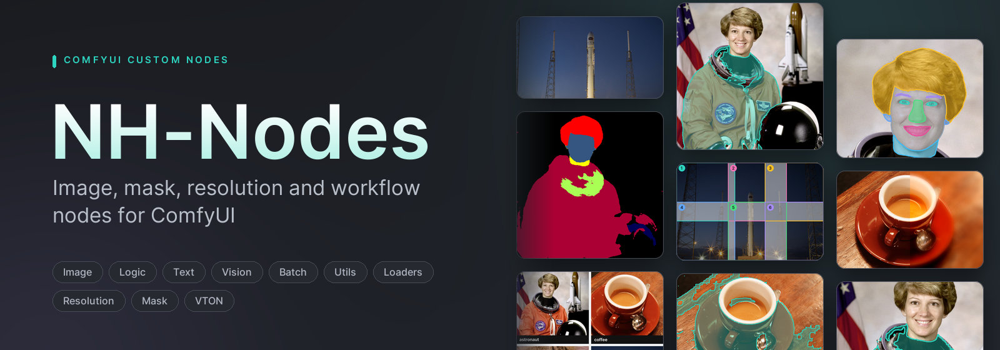
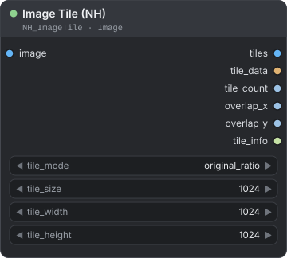

<b>English</b> · <a href="../vi/README.md">Tiếng Việt</a> · <a href="../../README.md">Project page</a>

# NH-Nodes guide

NH-Nodes adds **76 nodes** to ComfyUI for photo and production work: loading and saving image sets, tiling and compositing,
resolution management for current models, mask tools, garment, portrait and body-part segmentation (the skin, hair and
clothes of people by name), SAM 3 masks for anything you can name from a short formula, VTON masks, logic routing, prompt
and text tools, batch helpers and indexed model loaders.

This guide explains every node — what it is for, each input and output, and how it behaves in the details that matter.
Installation and a quick start are on the [project page](../../README.md#installation).

> **Requirements for SAM 3:** SAM3 Segment needs an NVIDIA GPU with CUDA, Meta's `sam3` package and the `sam3.pt`
> checkpoint, which you install and download yourself. Every other node works without them. Setup:
> [Before you start with SAM 3](vision.md#before-you-start-with-sam-3).

## Reading a node card

Every node section starts with a card drawn from the node's real definition:

- **Title bar** — the display name, then the node id (type it in the node search) and its menu group under `NH-Nodes`.
- **Dots on the left** are inputs you connect, **dots on the right** are outputs. The colour shows the data type:
  IMAGE blue, MASK green, LATENT pink, MODEL purple, CLIP yellow, VAE red, numbers (INT, FLOAT) light blue,
  text (STRING) light green, BOOLEAN rose, any type (`*`) grey, and NH-specific data (tile data, resize data, instances…) amber.
- **Rounded rows** are widgets with their default value. `opt` marks an optional input; `≡` after an output means it
  returns a list.
- A **green** dot in the title is an ordinary node; **orange** marks an output node, which runs even when nothing is
  connected to it.

## Node groups

| Group | Page | Nodes |
|---|---|---|
| Image — load & save | [image-io](image-io.md) | Load Image Info · Load Images Folder · Load images matching · Save Image Path · NH Save Large Image |
| Image — compose | [image-compose](image-compose.md) | Image Tile · Image Untile · Image Grid Composite · Layer Layout Composite · Layer Stack Composite · Image Compare · Image Label · Image Resize Unit |
| Image — large preview | [image-preview](image-preview.md) | NH Large Image Preview · NH Large Image Compare · NH Large Preview Cache Manager |
| Image — mask-based retouch | [image-retouch](image-retouch.md) | NH Mask-Aware Resize · NH Agnostic Image Generator · NH Simple Face Paste |
| Resolution | [resolution](resolution.md) | NH Smart Resolution Picker · NH Smart Ratio Image Resize · NH Ratio Preset Image Resize · NH Remove Resize Padding · NH Restore Image Geometry |
| Mask | [mask](mask.md) | Mask Morphology · Mask Properties · NH Create Box Mask · NH Mask Aspect Ratio Match |
| Vision | [vision](vision.md) | Garment Segment · Portrait Segment · Body Segment · SAM3 Segment · Segs Select · Segs Compose · Segs To Masks · Segs To Impact SEGS · Segs Preview |
| VTON | [vton](vton.md) | VTON Ultimate Processor |
| Logic | [logic](logic.md) | Compare · Logic Gate · If/Else · Switch N · Any Switch · Any Branch Switch · Gate Switch · Value Match Index · Math Eval · Random Choice |
| Text | [text](text.md) | Prompt Template · Prompt Scheduler · String Operations · Prompt Join · Text Split · Regex Extract · Text Index · Text Concatenate · Text Split Lines · Text Random Line |
| Batch & lists | [batch-lists](batch-lists.md) | Batch Index · Batch Merge · Counter · List Create · List Index · List Filter · Any List Split |
| Loaders | [loaders](loaders.md) | Load LoRA Model Index · Load LoRA Clip Index · Load Diffusion Model Index · Load VAE Index · Load Clip Index |
| Utils | [utils](utils.md) | Multi-Slider (FLOAT) · Multi-Slider (INT) · Boolean Switch · Pack Universal · Unpack Universal · Universal Slider Builder *(deprecated)* |

## Concepts used throughout

- **Images and masks.** An `IMAGE` is a batch of pictures with values from 0 to 1 (RGB, sometimes RGBA); a `MASK` is a
  batch of single-channel maps where 1 is inside and 0 is outside, with soft values in between. Most NH nodes process
  every item of a batch; an input with a single item is reused for every item of a larger batch.
- **Lazy branches.** The switches (If/Else, Switch N, Any Switch, Random Choice) only ask ComfyUI for the branch they pick,
  so the other branches — even a second sampler — are never executed. Gate-style nodes *block* a branch instead: nodes
  after a blocked output are skipped, nothing fails.
- **Seeds are literal.** Every seeded node gives the same result for the same seed, including seed 0. Use ComfyUI's
  *control after generate* to vary it.
- **Paths.** Folder inputs accept absolute paths or paths relative to ComfyUI's `input`/`output` folders; details are on
  [image-io](image-io.md#paths-and-file-types).
- **Resize data.** The resolution nodes return a `resize_data` record of how an image was cropped or padded, so a result
  can be put back into the original frame with [NH Restore Image Geometry](resolution.md#nh-restore-image-geometry).
- **Instances.** SAM3 Segment returns every thing it finds as its own instance, with a label, a score and a mask, in an
  `NH_SEGS` value. Garment Segment, Portrait Segment and Body Segment return the parts they find (hair, top, lips…) in
  the same type. The Segs nodes pick instances, combine them with a formula and turn them into masks, and Segs Compose
  mixes the instances of several of these nodes; see [Instances: the NH_SEGS type](vision.md#instances-the-nh_segs-type).
- **Licences.** All nodes are MIT except the parts listed in [THIRD_PARTY_NOTICES](../../THIRD_PARTY_NOTICES.md):
  VTON Ultimate Processor and Portrait Segment are for **non-commercial** use, and so is Garment Segment, where NVIDIA's
  licence defines that as research or evaluation only. Body Segment uses Meta's Sapiens2 under the Sapiens2 License, which
  has no non-commercial clause but prohibits surveillance, biometric processing, identifying people, deepfakes and other
  uses. SAM3 Segment uses Meta's SAM 3 under the SAM License, which has no non-commercial clause but bars military,
  nuclear, espionage, and gun or illegal-weapon uses; you install the package and download the checkpoint yourself.

## More

- [Changelog](../CHANGELOG.md) — what changed in each release, including behaviour changes.
- [Logic gate diagram](../logic_gate_diagram.html) — a visual truth-table sheet for the Logic Gate node (download and open
  it in a browser).
- [Third-party notices](../../THIRD_PARTY_NOTICES.md) — licences of bundled code, downloaded models, Sapiens2 and SAM 3.
