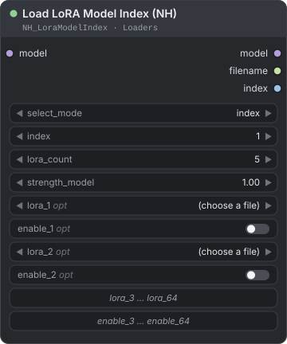
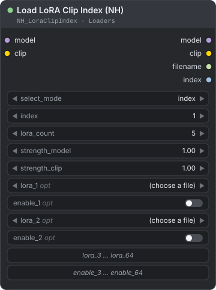
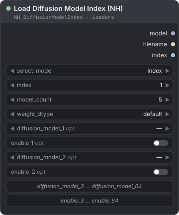
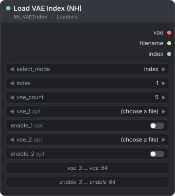
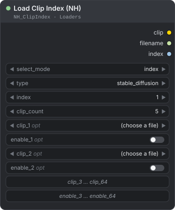

[← Back to guide](./README.md)

# Loaders

Five loader nodes that each hold up to 64 model files and load exactly one of them, chosen by number or by an on/off toggle. Use them to switch LoRAs, diffusion models, VAEs or text encoders from a single node, by hand or automatically with a `Counter (NH)`. Find them under **NH-Nodes → Loaders** in the node menu.

Read [How the indexed loaders work](#how-the-indexed-loaders-work) first. It covers what the five nodes share: slots, `index` and `boolean` selection, what happens when nothing is selected, and what stays in memory.

**On this page**

| Node | Use it to |
|---|---|
| [Load LoRA Model Index (NH)](#load-lora-model-index-nh) | Apply one LoRA from a list of up to 64 to a `MODEL` |
| [Load LoRA Clip Index (NH)](#load-lora-clip-index-nh) | Apply one LoRA from a list to a `MODEL` and a `CLIP` |
| [Load Diffusion Model Index (NH)](#load-diffusion-model-index-nh) | Load one diffusion model from a list |
| [Load VAE Index (NH)](#load-vae-index-nh) | Load one VAE from a list |
| [Load Clip Index (NH)](#load-clip-index-nh) | Load one CLIP or text-encoder file from a list |

---

## How the indexed loaders work

All five nodes share the same controls and rules. Read this section once; the node sections below only list what is different.

### Slots

Each loader has up to 64 slots. A slot is a file list plus an on/off toggle (`enable_N`). The count widget sets how many slots are shown and used, and its default is 5. Slots above the count are hidden and ignored, but they keep their file, so raising the count brings them back.

| Node | Count widget | File lists | Files come from |
|---|---|---|---|
| `Load LoRA Model Index (NH)` | `lora_count` | `lora_1` … `lora_64` | `models/loras` |
| `Load LoRA Clip Index (NH)` | `lora_count` | `lora_1` … `lora_64` | `models/loras` |
| `Load Diffusion Model Index (NH)` | `model_count` | `diffusion_model_1` … `diffusion_model_64` | `models/diffusion_models` and `models/unet` |
| `Load VAE Index (NH)` | `vae_count` | `vae_1` … `vae_64` | `models/vae` |
| `Load Clip Index (NH)` | `clip_count` | `clip_1` … `clip_64` | `models/text_encoders` and `models/clip` |

The lists also include folders added in `extra_model_paths.yaml`. To see files you added while ComfyUI is running, refresh the node definitions (press `R`). The `update …` button at the bottom of each node only redraws which slots are visible. It does not rescan the folders.

### Choosing a slot: `select_mode`

| | `index` (default) | `boolean` |
|---|---|---|
| You choose with | the `index` number, where 1 is the first slot | the `enable_N` toggles |
| Shown on the node | `index` | the toggles of the visible slots (`index` is hidden) |
| Good for | automation: wire a `Counter (NH)`, a `Value Match Index (NH)` or a `Multi-Slider (INT)` into `index` | quick manual switching: tick the slot you want |
| Several toggles on | — | the lowest-numbered one inside the count is used (the node's interface keeps only one on at a time) |

### When nothing is selected

Nothing is selected when:

- in `index` mode, `index` is below 1 or above the count;
- in `boolean` mode, no toggle inside the count is on;
- the chosen slot has no file.

In that case the node loads nothing and:

- its `model`, `clip` or `vae` output is **blocked** (ComfyUI calls this an `ExecutionBlocker`). Every node that needs that output is skipped silently, with no error message, so the run can finish without producing an image;
- `filename` is empty and `index` is `-1`. These two outputs are not blocked.

> **Note:** A new node has empty slots. Choose a file in the slot you select, or nothing after the loader will run.

### What stays in memory

ComfyUI runs a node again whenever one of its inputs changes. A loader has up to 64 file lists and 64 toggles, so editing any slot, even one you are not using, counts as a change. To keep that from reloading a big file every time, the loaders reuse what they loaded:

- **`Load Diffusion Model Index (NH)`, `Load VAE Index (NH)` and `Load Clip Index (NH)`** hand back the model that ComfyUI still holds. Editing a slot that is not selected returns the model already in memory and reads no file. The model is loaded again when you select a different file, change `weight_dtype` (diffusion model) or `type` (CLIP), or the file on disk is replaced.
- **The node does not hold on to the model itself.** It keeps only a weak reference, so ComfyUI's own cache decides how long the model lives. When ComfyUI's default RAM-pressure cache frees the model because memory runs short, the next run loads it from disk again. With `--cache-classic` (which `--high-ram` switches on) the node keeps an ordinary reference, because that cache drops an output as soon as the workflow no longer needs it.
- **Only one model is kept per node.** Loading another file releases the previous one first, so two large models never sit in memory together. Cycling A, B, A therefore loads from disk each time. Clearing ComfyUI's execution cache releases the kept model too: use **Unload Models and Execution Cache** (called **Free model and node cache** in ComfyUI-Manager).
- **The LoRA nodes** keep the last LoRA file in memory and apply it to the incoming `model` on every run. The file is read again only when you select a different LoRA.

### Driving `index` automatically

| Source | What it gives you |
|---|---|
| `Counter (NH)` | One slot per queue. Set its `start` to `1`. See [Batch & Lists](./batch-lists.md). |
| `Value Match Index (NH)` | The 1-based position of a value that matches your input, or `-1` when nothing matches (which selects nothing). See [Logic](./logic.md). |
| `Multi-Slider (INT)` | A slot number you set by hand on a compact panel. See [Utils](./utils.md). |

---

## Load LoRA Model Index (NH)

<p align="center"></p>

Applies one LoRA, chosen from up to 64 slots, to a `MODEL`.

**Use it when** you want to compare several LoRAs on the same prompt without rewiring, or keep your favourite LoRAs together in one node.

| Input | Type | Default | Description |
|---|---|---|---|
| `select_mode` | COMBO | `index` | How a slot is chosen: `index` or `boolean`. |
| `model` | MODEL | — | The model to apply the LoRA to. |
| `index` | INT | `1` | The slot to use in `index` mode. 1 is the first slot. Range 1 to 64. |
| `lora_count` | INT | `5` | How many slots are shown and used. Range 1 to 64. |
| `strength_model` | FLOAT | `1.0` | How strongly the LoRA changes the model. Range -100 to 100, step 0.01. A negative value reverses its effect. `0` skips the LoRA. |
| `lora_1` … `lora_64` | COMBO | empty | Optional. The LoRA file for each slot, for example `my_style.safetensors`. |
| `enable_1` … `enable_64` | BOOLEAN | `false` | Optional. The on/off toggle of each slot, used in `boolean` mode. |

| Output | Type | Description |
|---|---|---|
| `model` | MODEL | The model with the LoRA applied. Blocked when nothing is selected. |
| `filename` | STRING | The LoRA file name as shown in the slot list. Empty when nothing is selected or when `strength_model` is `0`. |
| `index` | INT | The slot that was used, or `-1` when nothing is selected. |

**How it works**

- With `strength_model` at `0` the LoRA is not loaded. `model` passes through unchanged and `filename` is empty. It is a quick way to switch a LoRA off while keeping its slot.
- The node applies the LoRA to the model that comes in, so put it after `Load Checkpoint` and before the sampler.
- Slot choice, empty selection and memory work as described in [How the indexed loaders work](#how-the-indexed-loaders-work).

**Example — test your LoRAs one per queue and label each result**

```text
Counter (NH) → Load LoRA Model Index (NH) → KSampler → VAE Decode → Image Label (NH) → Save Image
```

- `Counter (NH)`: `start` 1, `step` 1, `max_value` equal to the number of LoRAs. Wire `current` into `index`.
- `Load LoRA Model Index (NH)`: set `lora_count` and choose a LoRA in each slot. Wire `filename` into `label_text` of `Image Label (NH)` (see [Image Compose](./image-compose.md)) to stamp the LoRA name on every image.
- Set the batch count to the number of LoRAs and press Run.

---

## Load LoRA Clip Index (NH)

<p align="center"></p>

Applies one LoRA, chosen from up to 64 slots, to both a `MODEL` and a `CLIP`.

**Use it when** the LoRA should also change how the prompt is read, so the `CLIP` needs patching along with the `MODEL`.

| Input | Type | Default | Description |
|---|---|---|---|
| `select_mode` | COMBO | `index` | How a slot is chosen: `index` or `boolean`. |
| `model` | MODEL | — | The model to apply the LoRA to. |
| `clip` | CLIP | — | The text encoder to apply the LoRA to. |
| `index` | INT | `1` | The slot to use in `index` mode. 1 is the first slot. Range 1 to 64. |
| `lora_count` | INT | `5` | How many slots are shown and used. Range 1 to 64. |
| `strength_model` | FLOAT | `1.0` | LoRA strength on the model. Range -100 to 100, step 0.01. |
| `strength_clip` | FLOAT | `1.0` | LoRA strength on the CLIP. Range -100 to 100, step 0.01. |
| `lora_1` … `lora_64` | COMBO | empty | Optional. The LoRA file for each slot. |
| `enable_1` … `enable_64` | BOOLEAN | `false` | Optional. The on/off toggle of each slot, used in `boolean` mode. |

| Output | Type | Description |
|---|---|---|
| `model` | MODEL | The model with the LoRA applied. Blocked when nothing is selected. |
| `clip` | CLIP | The CLIP with the LoRA applied. Blocked when nothing is selected. |
| `filename` | STRING | The LoRA file name as shown in the slot list. Empty when nothing is selected or when both strengths are `0`. |
| `index` | INT | The slot that was used, or `-1` when nothing is selected. |

**How it works**

- With both strengths at `0` the LoRA is not loaded. `model` and `clip` pass through unchanged and `filename` is empty.
- Use `Load LoRA Model Index (NH)` instead when you only want to patch the model.

**Example — switch LoRAs by hand with toggles**

```text
Load Checkpoint → Load LoRA Clip Index (NH) → KSampler / CLIP Text Encode
```

Set `select_mode` to `boolean` and choose your LoRAs in the slots. Switch on the toggle of the slot you want. Switching one on turns the others off. Leave all toggles off to block everything after the loader.

---

## Load Diffusion Model Index (NH)

<p align="center"></p>

Loads one diffusion model (the main image or video model), chosen from up to 64 slots.

**Use it when** you want to compare several base models or fine-tunes in one workflow, or switch between precisions of the same model, without rewiring.

| Input | Type | Default | Description |
|---|---|---|---|
| `select_mode` | COMBO | `index` | How a slot is chosen: `index` or `boolean`. |
| `index` | INT | `1` | The slot to use in `index` mode. 1 is the first slot. Range 1 to 64. |
| `model_count` | INT | `5` | How many slots are shown and used. Range 1 to 64. |
| `weight_dtype` | COMBO | `default` | Precision to load the weights in: `default`, `fp8_e4m3fn`, `fp8_e4m3fn_fast` or `fp8_e5m2`. |
| `diffusion_model_1` … `diffusion_model_64` | COMBO | empty | Optional. The model file for each slot, for example `my_model.safetensors`. |
| `enable_1` … `enable_64` | BOOLEAN | `false` | Optional. The on/off toggle of each slot, used in `boolean` mode. |

| Output | Type | Description |
|---|---|---|
| `model` | MODEL | The loaded diffusion model. Blocked when nothing is selected. |
| `filename` | STRING | The model file name as shown in the slot list. Empty when nothing is selected. |
| `index` | INT | The slot that was used, or `-1` when nothing is selected. |

**How it works**

- `weight_dtype` has the same options as ComfyUI's own `Load Diffusion Model` node. `default` loads the weights the way ComfyUI normally would. The `fp8_*` options load them in 8-bit floating point, which takes less memory, and `fp8_e4m3fn_fast` also turns on ComfyUI's fp8 optimizations. The widget is marked as advanced, so some ComfyUI versions keep it collapsed until you show advanced options.
- The node loads the diffusion model only. Load the text encoder and VAE with `Load Clip Index (NH)` and `Load VAE Index (NH)`.
- The loaded model is reused while ComfyUI still holds it (see [What stays in memory](#what-stays-in-memory)). Changing `weight_dtype` loads it again.

**Example — switch a whole model set with one number**

Put matching files in the same slot number of three loaders:

| Slot | Diffusion model | Text encoder | VAE |
|---|---|---|---|
| 1 | `model_a.safetensors` | `encoder_a.safetensors` | `vae_a.safetensors` |
| 2 | `model_b.safetensors` | `encoder_b.safetensors` | `vae_b.safetensors` |

```text
Counter (NH) → Load Diffusion Model Index (NH) → KSampler
Counter (NH) → Load Clip Index (NH) → CLIP Text Encode
Counter (NH) → Load VAE Index (NH) → VAE Decode
```

Wire the same `Counter (NH)` (or one `Multi-Slider (INT)`) into the `index` of all three. One number then changes the model, the text encoder and the VAE together.

---

## Load VAE Index (NH)

<p align="center"></p>

Loads one VAE, chosen from up to 64 slots.

**Use it when** you want to compare how different VAEs decode the same image, or swap VAEs without rewiring.

| Input | Type | Default | Description |
|---|---|---|---|
| `select_mode` | COMBO | `index` | How a slot is chosen: `index` or `boolean`. |
| `index` | INT | `1` | The slot to use in `index` mode. 1 is the first slot. Range 1 to 64. |
| `vae_count` | INT | `5` | How many slots are shown and used. Range 1 to 64. |
| `vae_1` … `vae_64` | COMBO | empty | Optional. The VAE file for each slot, for example `my_vae.safetensors`. |
| `enable_1` … `enable_64` | BOOLEAN | `false` | Optional. The on/off toggle of each slot, used in `boolean` mode. |

| Output | Type | Description |
|---|---|---|
| `vae` | VAE | The loaded VAE. Blocked when nothing is selected. |
| `filename` | STRING | The VAE file name as shown in the slot list. Empty when nothing is selected. |
| `index` | INT | The slot that was used, or `-1` when nothing is selected. |

**How it works**

- Like ComfyUI's own VAE loader, the node passes the metadata stored in the file to the VAE and checks the file as it loads. A file that does not hold a usable VAE stops the run at this node with an error, instead of failing later when the image is decoded. A VAE that fails the check is not kept.
- The loaded VAE is reused while ComfyUI still holds it, until you select another file (see [What stays in memory](#what-stays-in-memory)).

**Example — compare two VAEs on the same latent**

```text
Load VAE Index (NH) → VAE Decode → Preview Image
```

Connect `vae` to the `vae` input of `VAE Decode`, and choose one VAE per slot. Set the sampler's seed to fixed, run once with `index` 1 and once with `index` 2, then compare the two decoded images.

---

## Load Clip Index (NH)

<p align="center"></p>

Loads one CLIP or text-encoder file, chosen from up to 64 slots, and sets which CLIP type it is loaded as.

**Use it when** you want to compare text encoders, or switch between model families that each need their own text encoder.

| Input | Type | Default | Description |
|---|---|---|---|
| `select_mode` | COMBO | `index` | How a slot is chosen: `index` or `boolean`. |
| `type` | COMBO | `stable_diffusion` | The CLIP type to load the file as. The list follows your ComfyUI version, for example `stable_diffusion`, `sd3`, `flux` or `wan`. |
| `index` | INT | `1` | The slot to use in `index` mode. 1 is the first slot. Range 1 to 64. |
| `clip_count` | INT | `5` | How many slots are shown and used. Range 1 to 64. |
| `clip_1` … `clip_64` | COMBO | empty | Optional. The text-encoder file for each slot, for example `my_encoder.safetensors`. |
| `enable_1` … `enable_64` | BOOLEAN | `false` | Optional. The on/off toggle of each slot, used in `boolean` mode. |

| Output | Type | Description |
|---|---|---|
| `clip` | CLIP | The loaded text encoder. Blocked when nothing is selected. |
| `filename` | STRING | The file name as shown in the slot list. Empty when nothing is selected. |
| `index` | INT | The slot that was used, or `-1` when nothing is selected. |

**How it works**

- Choose the `type` that matches the model family the file belongs to. A type name that your ComfyUI does not know falls back to `stable_diffusion`.
- The node loads one file per run. For model families that need two or more text-encoder files at once, use ComfyUI's own dual or triple CLIP loaders.
- The loaded CLIP is reused while ComfyUI still holds it (see [What stays in memory](#what-stays-in-memory)). Changing `type` loads it again.

**Example — pick the text encoder by hand**

```text
Load Clip Index (NH) → CLIP Text Encode → KSampler
```

Set `type` to the family of your model, choose an encoder in each slot, and change `index` to switch.

---

**See also:** [Batch & Lists](./batch-lists.md) for `Counter (NH)`, [Utils](./utils.md) for `Multi-Slider (INT)`, and [Logic](./logic.md) for `Value Match Index (NH)`.

[← Back to guide](./README.md)
