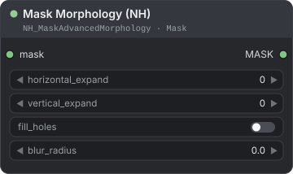
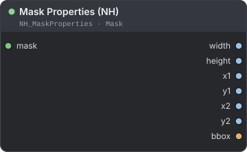
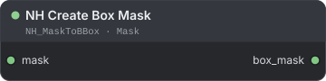
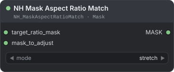
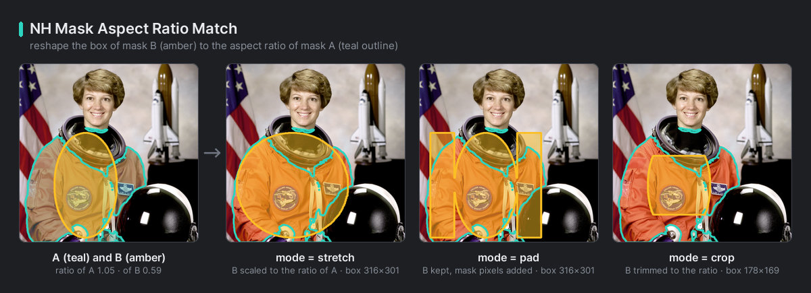

[← Back to guide](./README.md)

# Mask

Four small nodes for working with masks: grow or soften one, measure it, turn it into a box, and give one mask's box the proportions of another. Find them under **NH-Nodes → Mask**.

A `MASK` is a batch of one-channel images. `1.0` is inside the mask, `0.0` is outside, and values in between are soft edges. The nodes that measure or box a mask count a pixel as inside when it is above `0.5`.

**On this page**

- [Mask Morphology (NH)](#mask-morphology-nh) — grow, shrink, fill holes and soften a mask
- [Mask Properties (NH)](#mask-properties-nh) — size and corners of a mask's bounding box
- [NH Create Box Mask](#nh-create-box-mask) — replace a mask with its bounding rectangle
- [NH Mask Aspect Ratio Match](#nh-mask-aspect-ratio-match) — give one mask's box the proportions of another's

---

## Mask Morphology (NH)

<p align="center"></p>

Grows or shrinks a mask along each axis, fills holes in it and softens its edge.

**Use it when** a segmentation mask is too tight for inpainting and needs a margin, when it has holes you want closed, or when its hard edge needs a soft fade.

| Input | Type | Default | Description |
|---|---|---|---|
| `mask` | MASK | — | The mask or mask batch. A single 2-D mask is accepted as a batch of one. |
| `horizontal_expand` | INT | `0` | Range -512 to 512. Positive grows the mask to the left and right, negative shrinks it. The value is the kernel length in pixels: each edge moves by half of it, rounded down. |
| `vertical_expand` | INT | `0` | Range -512 to 512. The same for the top and bottom edges. |
| `fill_holes` | BOOLEAN | `false` | Closes holes that the mask completely encloses. Pixels above `0.5` count as inside. |
| `blur_radius` | FLOAT | `0.0` | Range 0 to 100, step 0.1. Strength of a Gaussian blur in pixels. `0` leaves the edge as it is. |

| Output | Type | Description |
|---|---|---|
| `MASK` | MASK | The processed mask batch, same size as the input. |

**How it works**

- **Order:** horizontal, then vertical, then fill holes, then blur.
- **Kernel length:** an even length is rounded up to the next odd one, so the result stays centred. The table below shows what that means for each edge.
- **Soft masks stay soft.** Growing takes the brightest nearby value and shrinking the darkest, so a gradient is kept and nothing is forced to 0 or 1.
- **The image border never eats the mask.** A shape that touches the border keeps touching it when you shrink.
- Growing and shrinking run as PyTorch operations on the device that holds the mask (CPU or GPU), so large masks and long mask batches are handled efficiently. Filling holes and blurring run on the CPU, one mask at a time.

| `horizontal_expand` or `vertical_expand` | Each edge moves by |
|---|---|
| `0`, `1`, `-1` | 0 px, no change |
| `2`, `3` (or negative) | 1 px |
| `4`, `5` (or negative) | 2 px |
| `10`, `11` (or negative) | 5 px |

<p align="center"><br><em>Grow, shrink, and two nodes chained: shrink then grow (open), grow then shrink (close).</em></p>

**Example**

```text
Garment Segment (NH) → Mask Morphology (NH) → inpaint
```

With `horizontal_expand` `17`, `vertical_expand` `17`, `fill_holes` on and `blur_radius` `4`, every edge moves out by 8 px, holes close, and the edge fades softly.

> **Note:** `fill_holes` makes the mask hard first: every pixel becomes `0` or `1` before the blur. Leave it off if you need to keep an existing soft gradient.

> **Tip:** Growing uses a rectangular kernel, so corners stay square. Add a small `blur_radius` to soften them.

---

## Mask Properties (NH)

<p align="center"></p>

Measures the bounding box of a mask: its size and its corner coordinates.

**Use it when** you need numbers for the area a mask covers, for example to crop an image around the subject or to pass the box size to another node.

| Input | Type | Default | Description |
|---|---|---|---|
| `mask` | MASK | — | The mask to measure. Only the first mask of a batch is measured. Pixels above `0.5` count as inside. |

| Output | Type | Description |
|---|---|---|
| `width` | INT | Box width in pixels, `x2 - x1 + 1`. |
| `height` | INT | Box height in pixels, `y2 - y1 + 1`. |
| `x1` | INT | Left edge: the first column inside the mask. |
| `y1` | INT | Top edge: the first row inside the mask. |
| `x2` | INT | Right edge: the last column inside the mask. |
| `y2` | INT | Bottom edge: the last row inside the mask. |
| `bbox` | BBOX | The same box as one value, `(x1, y1, x2, y2)`. |

**How it works**

- Both ends are inclusive. A mask that covers columns 10 to 29 and rows 5 to 24 gives `x1` 10, `x2` 29, `y1` 5, `y2` 24, `width` 20 and `height` 20.
- An empty mask (nothing above `0.5`) gives `0` for every number and `(0, 0, 0, 0)` for `bbox`.

**Example**

```text
Garment Segment (NH) → Mask Properties (NH) → x1, y1, width, height → a crop node
```

---

## NH Create Box Mask

<p align="center"></p>

Replaces each mask with the filled rectangle that tightly surrounds it.

**Use it when** you want a rectangular inpainting area around a subject instead of its exact outline.

| Input | Type | Default | Description |
|---|---|---|---|
| `mask` | MASK | — | The mask or mask batch. Pixels above `0.5` count as inside. |

| Output | Type | Description |
|---|---|---|
| `box_mask` | MASK | One rectangle of `1.0` per input mask, covering its bounding box. An empty mask gives an empty (all `0.0`) mask. |

**How it works**

- Every mask of a batch is boxed separately.
- The box is tight. To add a margin, send `box_mask` through [Mask Morphology (NH)](#mask-morphology-nh) and grow it.

**Example**

```text
Garment Segment (NH) → NH Create Box Mask → Mask Morphology (NH, grow) → inpaint
```

---

## NH Mask Aspect Ratio Match

<p align="center"></p>

Reshapes the bounding box of one mask so it has the same aspect ratio as the bounding box of another mask.

**Use it when** a box mask must follow the proportions of a reference shape, for example a square box that should match the proportions of a garment before you inpaint or crop.

| Input | Type | Default | Description |
|---|---|---|---|
| `target_ratio_mask` | MASK | — | The mask whose bounding box sets the aspect ratio to aim for. Only its box matters. |
| `mask_to_adjust` | MASK | — | The mask to reshape. |
| `mode` | COMBO | `stretch` | How to reach the ratio: `stretch`, `pad` or `crop`. |

| Output | Type | Description |
|---|---|---|
| `MASK` | MASK | The reshaped mask batch. Everything outside the new box is `0.0`. |

**Modes**

| Mode | What it does |
|---|---|
| `stretch` | Scales the content to fill the new box, without smoothing (nearest sampling). |
| `pad` | Keeps the content where it is and adds mask pixels (`1.0`) around it until the box has the ratio. |
| `crop` | Keeps only the middle part of the content so the box has the ratio. What stays does not move. |

**How it works**

- The node changes one side only, around the centre of the `mask_to_adjust` box: `stretch` and `pad` make the box longer on one axis, `crop` makes it shorter.
- A box that would leave the image slides back inside it.
- Every mask of the batch is processed. If `target_ratio_mask` has fewer masks, they repeat in turn.
- An empty `target_ratio_mask` counts as 1:1. An empty `mask_to_adjust` is returned unchanged.

For a target box of 100 × 50 (2:1) and a box to adjust of 40 × 40:

| `mode` | New box | Result |
|---|---|---|
| `stretch` | 80 × 40 | The 40 × 40 content is scaled to 80 × 40. |
| `pad` | 80 × 40 | The 40 × 40 content stays, with 20 px of mask added on the left and on the right. |
| `crop` | 40 × 20 | The middle 40 × 20 of the content is kept. |

<p align="center"><br><em>The same mask matched to a target ratio with <code>pad</code>, <code>crop</code> and <code>stretch</code>.</em></p>

**Example**

```text
Garment Segment (NH) mask → target_ratio_mask ┐
                                              ├→ NH Mask Aspect Ratio Match (pad) → inpaint mask
box mask → mask_to_adjust ────────────────────┘
```

> **Tip:** Use `pad` when the area must stay fully covered, and `crop` when you want a smaller, exact-ratio core.

---

[← Back to guide](./README.md)
