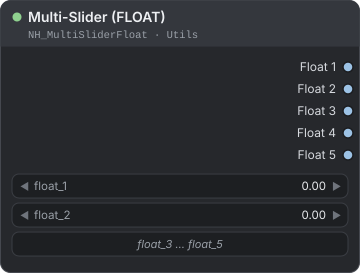
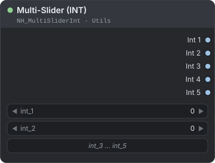
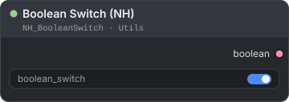
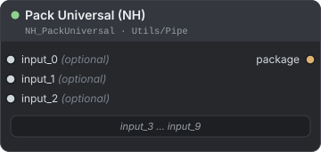
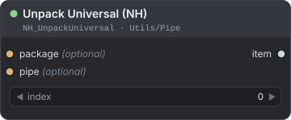
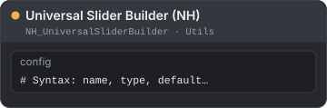

[← Back to guide](./README.md)

# Utils

Small helpers that keep a workflow tidy: a node with five sliders, an on/off switch that can drive many places at once, and a pair of nodes that carries up to ten wires as one. Find them under **NH-Nodes → Utils** in the node menu; `Pack Universal (NH)` and `Unpack Universal (NH)` are under **NH-Nodes → Utils → Pipe**.

**On this page**

| Node | Use it to |
|---|---|
| [Multi-Slider (FLOAT)](#multi-slider-float) | Set up to five decimal numbers from one node |
| [Multi-Slider (INT)](#multi-slider-int) | Set up to five whole numbers from one node |
| [Boolean Switch (NH)](#boolean-switch-nh) | Flip one on/off switch that can drive many places |
| [Pack Universal (NH)](#pack-universal-nh) | Bundle up to ten values into one wire |
| [Unpack Universal (NH)](#unpack-universal-nh) | Take one value out of that wire |
| [Universal Slider Builder (NH)](#universal-slider-builder-nh) | Deprecated: use the Multi-Sliders instead |

In the tables, `*` means any data type.

---

## Multi-Slider (FLOAT)

<p align="center"></p>

Five float sliders in one node, each with its own output.

**Use it when** you tune several numbers, such as LoRA strengths or a denoise value, and want them on one compact panel instead of five separate nodes.

| Input | Type | Default | Description |
|---|---|---|---|
| `float_1` … `float_5` | FLOAT | `0.0` | Five sliders, each from -1.0 to 1.0 in steps of 0.01. |

| Output | Type | Description |
|---|---|---|
| `Float 1` … `Float 5` | FLOAT | The value of the slider with the same number. |

**Example — one panel for a LoRA and the sampler**

```text
Multi-Slider (FLOAT) → Load LoRA Model Index (NH) / KSampler
```

Wire `Float 1` into `strength_model` of the LoRA loader and `Float 2` into `denoise` of `KSampler`. You now change both from one node.

> **Tip:** The range is -1.0 to 1.0. For larger whole numbers use `Multi-Slider (INT)`, or type the value into the target node.

---

## Multi-Slider (INT)

<p align="center"></p>

Five integer sliders in one node, each with its own output.

**Use it when** you set several whole numbers, such as slot numbers or counts, from one panel.

| Input | Type | Default | Description |
|---|---|---|---|
| `int_1` … `int_5` | INT | `0` | Five sliders, each from -100 to 100 in steps of 1. |

| Output | Type | Description |
|---|---|---|
| `Int 1` … `Int 5` | INT | The value of the slider with the same number. |

**Example — choose a LoRA and a VAE with two sliders**

```text
Multi-Slider (INT) → Load LoRA Model Index (NH) [index]
Multi-Slider (INT) → Load VAE Index (NH) [index]
```

Wire `Int 1` into the `index` of the LoRA loader and `Int 2` into the `index` of the VAE loader. Slots count from 1, and the sliders start at `0`, so move them to 1 or higher before you run. A value below 1 selects nothing and blocks the loader (see [Loaders](./loaders.md)).

---

## Boolean Switch (NH)

<p align="center"></p>

One on/off switch that outputs a BOOLEAN.

**Use it when** one setting should control several places at once, for example the `condition` of `If/Else (NH)`, the `enabled` input of `Gate Switch (NH)`, or the `reset` of `Counter (NH)`.

| Input | Type | Default | Description |
|---|---|---|---|
| `boolean_switch` | BOOLEAN | `true` | The switch. It reads On (True) or Off (False). |

| Output | Type | Description |
|---|---|---|
| `boolean` | BOOLEAN | The state of the switch. |

**Example — fast or quality, from one switch**

```text
Boolean Switch (NH) → If/Else (NH)
```

Wire `boolean` into `condition`. Put the fast branch on `if_true` and the quality branch on `if_false`. Only the chosen branch runs. See [Logic](./logic.md).

---

## Pack Universal (NH)

<p align="center"></p>

Bundles up to ten values of any type into one wire, an `NH_UNIVERSAL_PIPE`.

**Use it when** many wires (model, CLIP, VAE, prompts, numbers) travel to the same distant part of a workflow and one wire would keep the canvas tidy.

| Input | Type | Default | Description |
|---|---|---|---|
| `input_0` … `input_9` | `*` | not connected | Optional. A value to store. Each one is stored at the position with the same number. |

| Output | Type | Description |
|---|---|---|
| `package` | NH_UNIVERSAL_PIPE | The pipe holding all the values. |

**How it works**

- The pipe always has 10 positions, numbered 0 to 9. `input_N` goes to position N.
- A position you did not connect stays empty. It never shifts the others: if you connect only `input_1` and `input_3`, they stay at positions 1 and 3.
- There are no type checks. Pack accepts any type, and `Unpack Universal (NH)` outputs any type.

---

## Unpack Universal (NH)

<p align="center"></p>

Takes one value out of a pipe by its position number.

**Use it when** you have a pipe from `Pack Universal (NH)` and need one of its values.

| Input | Type | Default | Description |
|---|---|---|---|
| `index` | INT | `0` | The position to read, 0 to 9. Use the number of the `input_N` you filled on Pack. |
| `package` | NH_UNIVERSAL_PIPE | — | Optional. The pipe to read. |
| `pipe` | NH_UNIVERSAL_PIPE | — | Optional. A second pipe input. It is used only when `package` is not connected. |

| Output | Type | Description |
|---|---|---|
| `item` | `*` | The value at that position. |

**How it works**

- `item` is empty (`None`) when the position holds nothing, when `index` is outside 0 to 9, or when no pipe is connected. A node that needs a real value will usually stop with an error, so check the number first.
- One `Unpack Universal (NH)` returns one value. Add one per value you need.

**Example — send a model set through one wire**

```text
Load Checkpoint → Pack Universal (NH) → Unpack Universal (NH) → KSampler
```

Plan the positions once, and use the same numbers on both sides:

| On Pack | Carries | On Unpack (`index`) |
|---|---|---|
| `input_0` | MODEL | `0` |
| `input_1` | CLIP | `1` |
| `input_2` | VAE | `2` |
| `input_3` | positive prompt (STRING) | `3` |

> **Tip:** Give each Pack and Unpack pair a clear title, and keep the plan above in a note next to them.

---

## Universal Slider Builder (NH)

<p align="center"></p>

**Deprecated.** This node is hidden from the node search and is kept only so that old workflows that contain it still load. It never produced outputs, so it cannot do anything useful. Replace it with `Multi-Slider (FLOAT)` or `Multi-Slider (INT)`.

| Input | Type | Default | Description |
|---|---|---|---|
| `config` | STRING | two example lines | A multiline text box. Each line was meant to define one slider (`name, type, default, min, max, step`), but the node never produced outputs, so the text has no effect on the workflow. |

---

**See also:** [Loaders](./loaders.md) for the nodes these sliders and switches usually drive, [Batch & Lists](./batch-lists.md) for `Counter (NH)`, and [Logic](./logic.md) for `If/Else (NH)` and `Gate Switch (NH)`.

[← Back to guide](./README.md)
