[← Back to guide](./README.md)

# Vision

Nine nodes that cut parts out of a photo. Three of them parse people with models that know them: clothing with Garment Segment, face, hair and neck with Portrait Segment, and the skin, hair, lips, teeth, arms, legs and clothes of every person with Body Segment, where you type the names of the parts you want. Each returns a mask at the size of the input image, a cutout with transparency, a mask preview and the parts it found as instances. The other six work with SAM 3, Meta's segmentation model: you type what you want into SAM3 Segment (people, a wine glass, windows, the sky, or a formula such as `person - bag` or `background`) and it returns the mask and shows it on the node. It also keeps every instance it found, and five Segs nodes pick, combine, preview and convert them, also together with the parts that the three people nodes found. Find them under **NH-Nodes → Vision**.

**On this page**

- [Which node do I need?](#which-node-do-i-need) — the people nodes or SAM 3
- **People nodes: garments, portraits and body parts**
  - [Before you start](#before-you-start) — models, the face detector, first run, licences, memory
  - [How the SegFormer nodes look at a photo](#how-the-segformer-nodes-look-at-a-photo) — why small faces and people get close-ups, Body Segment included
  - [Refining the mask](#refining-the-mask) — the options all three nodes share
  - [Garment Segment (NH)](#garment-segment-nh) — mask upper garments, lower garments, footwear, headwear, or a dress, bag, scarf…; two models to choose from
  - [Portrait Segment (NH)](#portrait-segment-nh) — mask face, hair, neck and facial features
  - [Body Segment (NH)](#body-segment-nh) — type the parts you want: skin, hair, lips, teeth, arms, legs, clothes
- **SAM 3 nodes: anything you can name**
  - [Before you start with SAM 3](#before-you-start-with-sam-3) — GPU, package, checkpoint, memory, licence
  - [How the two passes work](#how-the-two-passes-work) — what `balanced` does on 4K to 8K photos, and where it stops
  - [Instances: the NH_SEGS type](#instances-the-nh_segs-type) — what flows between the nodes, and which nodes make it
  - [Writing a formula](#writing-a-formula) — what `concepts`, `expression` and `regions` accept: lists, `-`, `&`, `~`, `background`, Vietnamese words
  - [SAM3 Segment (NH)](#sam3-segment-nh) — type what you want, get its mask and see it on the node
  - [Segs Select (NH)](#segs-select-nh) — keep instances by label, score, size and position
  - [Segs Compose (NH)](#segs-compose-nh) — build a mask from labels with `|`, `-`, `&` and `~`, also from several nodes at once
  - [Segs To Masks (NH)](#segs-to-masks-nh) — one mask per instance, the union and the labels
  - [Segs To Impact SEGS (NH)](#segs-to-impact-segs-nh) — hand the instances to Impact Pack's detailers
  - [Segs Preview (NH)](#segs-preview-nh) — draw instances on their picture
  - [SAM 3 workflows](#sam-3-workflows) — the background behind people, the biggest object, a facade without windows
  - [If something goes wrong with SAM 3](#if-something-goes-wrong-with-sam-3)

## Which node do I need?

| You want | Use | What it needs |
|---|---|---|
| The clothing of one person or of a group: shirt, dress, trousers, shoes, hat, bag, scarf | [Garment Segment](#garment-segment-nh) | A SegFormer model (256 MB) and a small face detector that download themselves on the first run. Runs on the CPU or the GPU. |
| The face, hair, neck and facial features of a portrait, a half-body shot or every face of a group photo | [Portrait Segment](#portrait-segment-nh) | The same, with a 340 MB model. |
| The skin, hair, lips, teeth, arms, hands, legs or clothes of the people in a photo, by the names of the parts (`skin`, `hair, face`, `clothes - shoes`) | [Body Segment](#body-segment-nh) | A Sapiens2 model (1.6 GB) and the same face detector, which download themselves on the first run, and PyTorch 2.4 or newer. Meant for a GPU: the CPU is slow. |
| Anything you can name (people, objects, sky, walls, windows) as a mask from a short formula (`person - bag`, `background`), or every instance on its own, also on 4K to 8K photos | [SAM3 Segment](#sam3-segment-nh) and the Segs nodes | An NVIDIA GPU, Meta's `sam3` package and a checkpoint that you install and download yourself. See [Before you start with SAM 3](#before-you-start-with-sam-3). |

You can ask SAM3 Segment for `dress` or `hair` too. The people nodes stay the easier choice for their fixed sets of parts: they set themselves up, parse every person of the picture at once, and Garment Segment and Portrait Segment also run without a GPU.

**Choosing between the people nodes.** Garment Segment tells garments apart (a top from a dress, a skirt from trousers) and also finds bags, hats, scarves, glasses and jewelry. Body Segment names the body: skin, hair, lips, teeth, arms, legs, and clothes as a whole. Portrait Segment is the one that knows the eyes, eyebrows, nose and ears. [Segs Compose](#segs-compose-nh) mixes what they found, for example `face - eyes - eyebrows` (the face of Body Segment and of Portrait Segment, without the eyes and eyebrows of Portrait Segment).

## Before you start

This section is about the three people nodes: Garment Segment, Portrait Segment and Body Segment. SAM3 Segment and the Segs nodes have their own: [Before you start with SAM 3](#before-you-start-with-sam-3).

| Node and model | Hugging Face repository | Download | Licence |
|---|---|---|---|
| Garment Segment (NH), `model` `fashn` (the default): FASHN Human Parser, a SegFormer-B4 fine-tuned from `nvidia/mit-b4`, with 18 classes for fashion | `fashn-ai/fashn-human-parser` | about 256 MB | NVIDIA Source Code License for SegFormer: research or evaluation only |
| Garment Segment (NH), `model` `fashionpedia`: SegFormer trained for Fashionpedia clothing classes, the model of 1.8.0 and before | `1038lab/segformer_fashion` | about 190 MB | The uploader declares none, but it is fine-tuned from `nvidia/mit-b3`: treat it like `fashn` |
| Portrait Segment (NH): SegFormer fine-tuned on CelebAMask-HQ face parts | `jonathandinu/face-parsing` | about 340 MB | Non-commercial research and education only |
| Body Segment (NH): Sapiens2 (Meta, 2026), with 28 body-part and clothing classes plus background | `facebook/sapiens2-seg-0.4b`, `-0.8b` or `-1b` | 1.6 GB (`0.4b`), 3.3 GB (`0.8b`) or 5.9 GB (`1b`) | Sapiens2 License (Meta): royalty-free, no non-commercial clause, but with use restrictions |

**First run.** The first time a node runs, it downloads its model from Hugging Face, together with the face detector described below: the model chosen in `model` for Garment Segment, the size chosen in `model_size` for Body Segment. Each download is pinned to a fixed revision of the repository, so a later change upstream cannot alter what you get. The files go to `ComfyUI/models/NH-Nodes/`, one sub-folder per model (`fashn_human_parser`, `segformer_fashion`, `face_parsing`, `sapiens2-seg-<size>`). A complete copy that already exists is used instead: in `models/RMBG/segformer_fashion` for the Fashionpedia model, in `models/face_parsing` or `models/RMBG/segformer_face` for the face model, or in any folder you add under the `nh_nodes` key in `extra_model_paths.yaml` (see [Installation](../../README.md#installation) for an example). If a download is interrupted, run the node again: finished files are kept. A machine that is offline fails on the first run of a model until that model is downloaded.

**Face detector.** All three nodes also use YuNet, a small face detector (about 230 KB, MIT licence, from OpenCV Zoo), to find where the people are before they parse a picture. It is downloaded once, pinned to a fixed revision of `opencv/face_detection_yunet`, into `ComfyUI/models/NH-Nodes/yunet/`. It runs on the CPU with the OpenCV that NH-Nodes already needs, so it takes no VRAM. A copy that already sits in a `yunet` sub-folder of any `nh_nodes` folder (`models/NH-Nodes/`, or one you add in `extra_model_paths.yaml`) is used instead; to run offline, put `face_detection_yunet_2023mar.onnx` there yourself. If the detector cannot be loaded (offline on the first run, or an OpenCV that cannot run it), the node prints one warning in the console and goes on without it. Portrait Segment then parses the whole picture, without the close-ups described in [How the SegFormer nodes look at a photo](#how-the-segformer-nodes-look-at-a-photo). Garment Segment and Body Segment still take close-ups of the people that their first look at the whole picture finds, but they can miss a person whom that first look overlooks. Restart ComfyUI to try again.

**Memory.** A model is read from disk once and kept in system memory. It moves to the GPU only while a node runs, and goes back to system memory afterwards, so it does not hold VRAM between runs. Before it moves to the GPU, the node asks ComfyUI to unload some of its own models if VRAM is tight. Body Segment keeps one Sapiens2 size in memory at a time: when you ask for another size, the first one is dropped.

> **Note:** If a node reports unexpected labels, a different checkpoint sits in one of the folders it searches. Remove that copy and the right model is downloaded. Body Segment says so in the same way when a file is not the Sapiens2 checkpoint of the size you chose.

> **Licence:** These models come with terms that limit how you may use them. The model behind Portrait Segment may only be used for non-commercial research and education. Both models behind Garment Segment are built on NVIDIA's SegFormer. FASHN Human Parser is under the NVIDIA Source Code License for SegFormer, whose section 3.3 says the work "only may be used or intended for use non-commercially" and defines that as "for research or evaluation purposes only": narrower than "any use that earns no money", it is research or evaluation and nothing else. The Fashionpedia model declares no licence, but it is fine-tuned from `nvidia/mit-b3`, so the same licence plausibly applies. Sapiens2, behind Body Segment, is under Meta's Sapiens2 License: royalty-free, with no non-commercial clause, but it prohibits surveillance, biometric processing, identifying people, deepfakes and other uses, and it requires you to follow privacy, biometric and trade-control laws. NH-Nodes' own code is MIT. The YuNet face detector is MIT-licensed and changes none of this. Read [THIRD_PARTY_NOTICES.md](../../THIRD_PARTY_NOTICES.md) before you use any of these nodes for paid work.

## How the SegFormer nodes look at a photo

The models behind these nodes look at a small picture of a fixed size (width × height): 512 × 512 for the face model and the Fashionpedia model, 384 × 576 for FASHN, 768 × 1024 for Sapiens2. On a 6000 px photo, a face that is 600 px wide is only about 50 px wide to a 512 px model, so the nodes do not hand it the photo in one piece.

1. **The whole picture first.** A big picture is shrunk with area averaging, which is faster than the model's own resize and keeps fine detail clean, and then parsed. This first answer is kept wherever nothing better is found, so whatever the later steps miss keeps at least this result.
2. **People are found.** The face detector looks for faces on two sizes of the picture. Garment Segment and Body Segment also take the people that the first parse found.
3. **Close-ups refine the answer.** Each face (Portrait Segment) or group of people (Garment Segment, Body Segment) is parsed again on a crop that the model sees at its full resolution. The crop's labels go into the first answer, but not along the crop's cut edges, where the model sees things cut off, so no straight edge shows in hair or clothes. How far a crop is trusted differs by node, as the sections of the nodes describe. A crop shorter than 128 px is not parsed again: it would be blown up 4 to 8 times to reach the model's input, so most of what the model returns is made up, and it came back as scattered specks (a small thing held in the hand, for example). The labels of the first look stay there.

On a photo longer than 4096 px, all of this is worked out on a copy 4096 px long and the label map is enlarged to the photo at the end: the models see 384 to 1024 px at a time, so their labels hold no finer detail, and merging crops at full 8K size would take seconds.

Body Segment runs Sapiens2, not a SegFormer, and follows the same three steps with crops of its own 3:4 shape. It sees each crop at 768 × 1024, so a person gets about 1024 px whatever the size of the photo. It adds a check at the start: when no face is found, it takes the picture to have nobody in it if Sapiens2 is unsure of most of what it labels as people, or if a look at the mirrored picture does not find the same people (see [Body Segment](#body-segment-nh)).

What each node does with this is in its own section: [Garment Segment](#garment-segment-nh), [Portrait Segment](#portrait-segment-nh) and [Body Segment](#body-segment-nh).

## Refining the mask

Garment Segment, Portrait Segment and Body Segment turn the model's label map into a mask, then refine it in this order: `fill_holes`, `mask_expand`, `mask_blur`. The mask always has the size of the input image.

| Option | Range | Garment Segment | Portrait Segment | Body Segment | What it does |
|---|---|---|---|---|---|
| `fill_holes` | on / off | off | on | off | Closes holes that the mask completely encloses. It is off for garments by default because an arm across the torso would otherwise be filled in. It is on for portraits because a face stays solid where glasses, earrings or hair cut into it. |
| `mask_expand` | -64 to 64 | `0` | `0` | `0` | Grows (positive) or shrinks (negative) the mask by that many pixels. |
| `mask_blur` | 0 to 64 | `0` | `0` | `0` | Feathers the edge by about that many pixels. |
| `device` | `cuda`, `cpu` | `cuda` | `cuda` | `cuda` | Where the model runs. Without CUDA the node falls back to the CPU and prints a note once in the console. |

These three outputs are shared by the three nodes. Each node also returns `segs` (the parts it found as instances, described in its own section), and Body Segment a `report`.

| Output | Type | Description |
|---|---|---|
| `mask` | MASK | The mask, from 0 to 1. Edges are soft when `mask_blur` is above 0. |
| `cutout_rgba` | IMAGE | The input image with the mask as its alpha channel. The colours are left untouched outside the mask. |
| `mask_image` | IMAGE | The mask as a grey RGB image, for previews or for nodes that need an `IMAGE`. |

Batches work: every image is segmented in turn and the outputs keep the batch order.

---

## Garment Segment (NH)

<p align="center">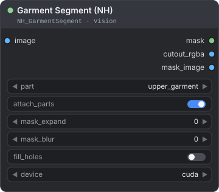</p>

Masks one group of clothing, one garment (a dress, a bag, a scarf…), or all groups together, on the people in the image. Two models do the work: `fashn` (the default) and `fashionpedia`.

**Use it when** you want a clean mask of a shirt, a dress, trousers, shoes, a hat or a bag for inpainting, recolouring or a try-on workflow.

| Input | Type | Default | Description |
|---|---|---|---|
| `image` | IMAGE | — | A photo of a person or of a group of people. |
| `part` | COMBO | `upper_garment` | A group: `upper_garment`, `lower_garment`, `footwear`, `headwear` or `all_garments`; or one garment: `dress`, `bag`, `belt`, `scarf`, `glasses` or `jewelry`. See the table below. |
| `attach_parts` | BOOLEAN | `true` | With `fashionpedia` only: merges pockets, zippers, bows, ruffles and similar decorations that touch the selected garment. It does nothing with `fashn`, which counts them as part of the garment. |
| `mask_expand` | INT | `0` | Range -64 to 64. Grows (+) or shrinks (-) the mask by N pixels. |
| `mask_blur` | INT | `0` | Range 0 to 64. Feathers the mask edge by N pixels. |
| `fill_holes` | BOOLEAN | `false` | Fills enclosed holes. Off by default: an arm across the torso would be filled in. |
| `device` | COMBO | `cuda` | `cuda` or `cpu`. |
| `model` | COMBO | `fashn` | Optional, so that workflows saved before it existed still load: they run `fashn`. `fashn` or `fashionpedia`. See the table below. |

| Output | Type | Description |
|---|---|---|
| `mask` | MASK | The mask of the selected part. |
| `cutout_rgba` | IMAGE | The input with the mask as alpha. |
| `mask_image` | IMAGE | The mask as a grey RGB preview. |
| `segs` | NH_SEGS | One instance per part the model found, whatever `part` is, for [Segs Compose](#segs-compose-nh) and the other Segs nodes. With `fashn`: face, hair, top, dress, skirt, pants, belt, bag, hat, scarf, glasses, arms, hands, legs, feet, torso, jewelry. With `fashionpedia`: its class names (shirt, top, sweater, …, sleeve, pocket, …). An instance covers its part on every person in the picture. |

**Which `model`**

| `model` | What it is | Good at | Weaker at |
|---|---|---|---|
| `fashn` (default) | FASHN Human Parser, a SegFormer-B4 for fashion with 18 classes, 256 MB | Clean tops, dresses, skirts, pants, bags, hats, scarves, glasses and jewelry. | No shoe, sock or headband classes. A pale garment close to the colour of the skin. |
| `fashionpedia` | `1038lab/segformer_fashion`, the model of 1.8.0 and before, 190 MB | Shoes, socks, headbands and small parts (sleeves, collars, pockets). | Whole garments: it misses some dresses and tops. No jewelry class. |

**What each `part` covers**

| `part` | With `fashn` | With `fashionpedia` |
|---|---|---|
| `upper_garment` | Tops, dresses and scarves. | Shirts and blouses, tops and T-shirts, sweaters, cardigans, jackets, vests, coats, dresses, jumpsuits, capes, ties, scarves, hoods, collars, lapels, epaulettes, sleeves and necklines. |
| `lower_garment` | Skirts, pants and belts. | Pants, shorts, skirts, belts, buckles, leg warmers, tights and stockings. Shoes are not included. |
| `footwear` | FASHN's "feet" class: the feet with whatever they wear, so bare feet too. | Shoes and socks. |
| `headwear` | Hats. There is no headband class. | Hats, headbands, head coverings and hair accessories. |
| `all_garments` | The four groups above together in one mask, bare feet included. | The four groups above together in one mask. |
| `dress` | Dresses. | Dresses and jumpsuits. |
| `bag` | Bags. | Bags and wallets. |
| `belt` | Belts. | Belts and buckles. |
| `scarf` | Scarves. | Scarves. |
| `glasses` | Glasses. | Glasses. |
| `jewelry` | Jewelry. | An empty mask: the model has no jewelry class, and the console says so. Choose `fashn`. |

**How it works**

- **Dresses and jumpsuits** belong to `upper_garment`, with the tops. `dress` gives the dresses alone. For a shirt and trousers together, or a dress and shoes, choose `all_garments`.
- **Footwear with `fashn`** is FASHN's "feet" class, not shoes: the feet with whatever they wear. A bare foot is in `footwear` and in `all_garments` too.
- **Attached parts** (`fashionpedia` only) are pockets, zippers, appliqués, beads, bows, flowers, fringe, ribbons, rivets, ruffles, sequins and tassels. With `attach_parts` on, a piece is added only when it touches the selected garment (within a few pixels). A pocket on a jacket joins an `upper_garment` mask, but a bow on a bag does not. `fashn` has no such classes: it counts pockets, zips and patches as part of the garment.
- **Not reachable through `part`:** with `fashn`, the face, hair, arms, hands, legs and torso; with `fashionpedia`, gloves, watches and umbrellas. They are in `segs`.
- **Close-ups of people.** The node parses the whole picture first and keeps that answer. It then finds the people (in that parse and with the face detector) and cuts crops of the model's own input shape (square for `fashionpedia`, 2:3 for `fashn`) around each group of them: a row of overlapping crops for a wide group, one crop for a person or a tight group. Each crop is parsed at the model's full resolution, and a crop grows when people run past one of its edges. This helps people who are small in a large photo. See [How the SegFormer nodes look at a photo](#how-the-segformer-nodes-look-at-a-photo).
- **A crop only refines.** Its labels replace the first answer only where the model is surer, away from the crop's cut edges, and only for parts on people already found. Nothing is invented on an empty backdrop, and no straight crop edge cuts through a garment.

<p align="center">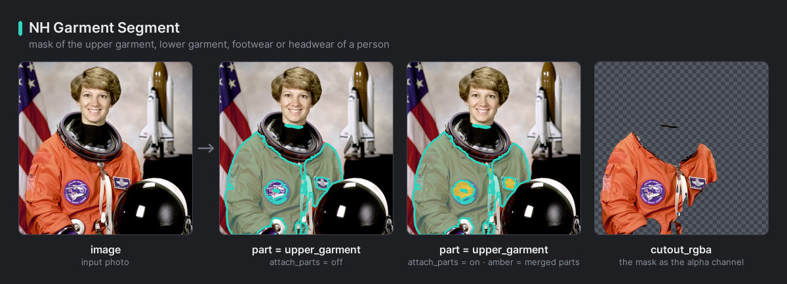<br><em>Garment Segment on a sample photo: the coloured areas are the masks of the selected part, from the fashn model (the default) and from the fashionpedia model (amber: the parts that attach_parts merged), and the cutout made from the fashn mask.</em></p>

**Example**

```text
Load Image → Garment Segment (NH, upper_garment) → mask → Mask Morphology (NH) → inpaint
```

Grow the mask a few pixels with [Mask Morphology (NH)](./mask.md#mask-morphology-nh) so the inpainted garment can overlap the old outline.

> **Note:** `fashn` can miss a pale garment close to the colour of the skin: a pale pink sleeveless top was only partly found. The model itself misses it, not the crops, and Body Segment's `top` or `clothes` covers it better. It can also label things held near the body as a top, for example champagne glasses. `fashionpedia` misses some tops too, for example a blouse under a big hat.

> **Licence:** both garment models are for research or evaluation only. FASHN Human Parser is under the NVIDIA Source Code License for SegFormer, and the Fashionpedia model, which declares no licence, is fine-tuned from NVIDIA's `mit-b3`. See [Before you start](#before-you-start).

---

## Portrait Segment (NH)

<p align="center">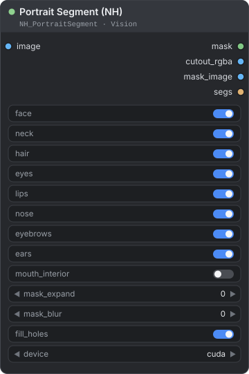</p>

Masks the face, hair, neck and facial features of a portrait, or of every face in a group photo. You tick the regions you want.

**Use it when** you want to retouch or recolour hair, work on skin and facial features, or protect the face while you edit the rest of the picture.

| Input | Type | Default | Description |
|---|---|---|---|
| `image` | IMAGE | — | A portrait, a half-body shot or a group photo. |
| `face` | BOOLEAN | `true` | The solid face region: skin, nose, eyes, eyebrows, eyeglasses, lips and the inside of the mouth. |
| `neck` | BOOLEAN | `true` | The neck. |
| `hair` | BOOLEAN | `true` | The hair. |
| `eyes` | BOOLEAN | `true` | Both eyes. |
| `lips` | BOOLEAN | `true` | Upper and lower lip. |
| `nose` | BOOLEAN | `true` | The nose. |
| `eyebrows` | BOOLEAN | `true` | Both eyebrows. |
| `ears` | BOOLEAN | `true` | Both ears. |
| `mouth_interior` | BOOLEAN | `false` | The inside of the mouth, between the lips. |
| `mask_expand` | INT | `0` | Range -64 to 64. Grows (+) or shrinks (-) the mask by N pixels. |
| `mask_blur` | INT | `0` | Range 0 to 64. Feathers the mask edge by N pixels. |
| `fill_holes` | BOOLEAN | `true` | Fills enclosed holes. |
| `device` | COMBO | `cuda` | `cuda` or `cpu`. |

| Output | Type | Description |
|---|---|---|
| `mask` | MASK | The combined mask of every ticked region, of every face found. |
| `cutout_rgba` | IMAGE | The input with the mask as alpha. |
| `mask_image` | IMAGE | The mask as a grey RGB preview. |
| `segs` | NH_SEGS | One instance per part the model found, whatever you ticked: skin, nose, glasses, eyes, eyebrows, ears, mouth (the inside of the mouth), lips, hair, hat, earrings, necklace, neck, clothes. An instance covers its part on every person in the picture. For [Segs Compose](#segs-compose-nh) and the other Segs nodes. |

**How it works**

- The ticked regions are combined into one mask. With nothing ticked, the mask is empty.
- `face` already contains eyes, eyebrows, nose, lips and the inside of the mouth. Those options change the result only when `face` is off.
- Hats, earrings, necklaces and clothing exist in the model, but the node has no switch for them. They are in `segs`, where [Segs Compose](#segs-compose-nh) can use them.
- **The whole picture first.** It is parsed as a padded square (it keeps its proportions, grey fills the rest) instead of being squeezed into the model's square. This answer stays wherever the crops below do not reach, so a picture in which no face is found, or in which the detector is not available, keeps it as the result. Once faces are found, the face parts (skin, eyes, eyebrows, nose, lips, ears) that this answer shows far from all of them are dropped as mistakes, such as a reflection or a pattern; its hair, neck and clothes stay.
- **Faces.** The face detector finds the faces (at most 32, the largest ones). When it finds none, the picture gets a grey margin and is searched once more, which finds a face that the frame cuts. The parser then checks each face on a tight crop: a hand or a pattern that the detector took for a face is turned down and changes nothing.
- **Two crops per face.** A wide crop shows hair and neck whole. A tight crop, framed like the photos the model learnt on, gives eyes, eyebrows, nose and lips. The wide crop refines what is inside it away from its cut edges, and the tight crop decides only inside an ellipse around the face, so no straight crop edge shows in long hair. Where the crops of two faces overlap, each pixel goes to the nearer face. In a group photo the mask therefore holds the ticked regions of every person.
- **Large faces.** A face that already fills a large part of the frame is left to the whole-picture parse, which shows it large enough. See [How the SegFormer nodes look at a photo](#how-the-segformer-nodes-look-at-a-photo).

<p align="center">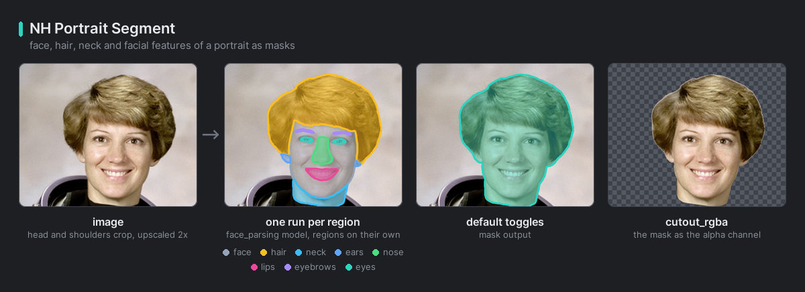<br><em>Portrait Segment on a sample photo: the coloured areas are the masks of the ticked regions.</em></p>

**Example: hair only**

```text
Load Image → Portrait Segment (NH) → mask → recolour or inpaint
```

Switch off every region except `hair`. With the defaults you get face, ears, neck and hair together in one mask.

> **Tip:** The model was fine-tuned on CelebAMask-HQ, a set of close-up face photos, so the node parses each face it finds on a close-up crop. A small face in a large photo, a half-body shot or a group photo needs no cropping first. A face the detector misses (very small, hidden or turned away) keeps the whole-picture parse, which is coarser: crop around it yourself when you need its finest detail.

> **Licence:** the face-parsing model is for non-commercial research and education only. See [Before you start](#before-you-start).

---

## Body Segment (NH)

<p align="center">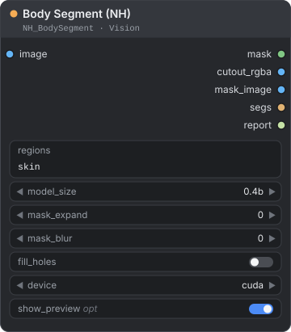</p>

Type the parts of the body you want, by name (`skin`, `hair, face`, `clothes - shoes`), and get their mask. The model is Sapiens2 (Meta, 2026). It labels every pixel of each person as one of 28 parts, or as background: the face and neck, hair, torso, upper and lower arms, hands, upper and lower legs, feet, lips, teeth, tongue, glasses, upper and lower clothing, shoes, socks and "apparel" (accessories). The node turns the words you type into one mask and shows it on itself.

**Use it when** you want the skin, hair, lips, teeth, hands or clothes of the people in a photo as a mask from one node, without painting: to retouch skin, recolour hair or lips, protect the hands, or change clothes. Garment Segment is finer for a single garment (a dress, a bag, a scarf), Portrait Segment for the eyes, eyebrows, nose and ears, and SAM3 Segment for anything that is not a person.

| Input | Type | Default | Description |
|---|---|---|---|
| `image` | IMAGE | — | A photo with people. Every image of a batch is processed in turn. |
| `regions` | STRING | `skin` | The parts you want, by name, written as a formula (see [Writing a formula](#writing-a-formula)): `skin`, `hair, face`, `clothes - shoes`, `~person`, `background`. Commas or new lines list several. The words are in the tables below, in English and in Vietnamese. Write at least one. |
| `model_size` | COMBO | `0.4b` | `0.4b`, `0.8b` or `1b`. The larger sizes are slower and need more VRAM. See "Sizes, memory and speed" below. |
| `mask_expand` | INT | `0` | Range -64 to 64. Grows (+) or shrinks (-) the mask by N pixels. |
| `mask_blur` | INT | `0` | Range 0 to 64. Feathers the mask edge by N pixels. |
| `fill_holes` | BOOLEAN | `false` | Fills enclosed holes. |
| `device` | COMBO | `cuda` | `cuda` or `cpu`. The CPU works, but it is slow. |
| `show_preview` | BOOLEAN | `true` | Optional. Shows the result on the node: the mask bright and the rest darkened, the parts that the mask keeps outlined and labelled, and the report lines below. At most 1536 px on the longer side, and the first 16 pictures of a batch. Off: nothing is drawn, and the node still runs (see "How it works" below). |

| Output | Type | Description |
|---|---|---|
| `mask` | MASK | The mask of your formula, one per image, at the size of the image. |
| `cutout_rgba` | IMAGE | The input with the mask as alpha. |
| `mask_image` | IMAGE | The mask as a grey RGB preview. |
| `segs` | NH_SEGS | One instance per part found, whatever `regions` says: hair, face, torso, arms, hands, legs, feet, lips, teeth, tongue, glasses, top, bottom, shoes, socks, accessories. An instance covers its part on every person in the picture. For [Segs Compose](#segs-compose-nh) and the other Segs nodes. |
| `report` | STRING | One line per word of `regions` with its share of the picture ("under 0.1%" for a tiny share, "not in the picture" when there is none, "of the pictures" for a batch). Notes follow when a word means something else in Sapiens2 than in everyday use. |

**The words you can type**

The words are English, or the common Vietnamese words of the shared list. Case does not matter, singular and plural are the same word (`lower leg` or `lower legs`, `accessory` or `accessories`), and several words in a row are one label (`upper arm` needs no quotes). The tables follow `REGIONS` and `WHOLE_LIMBS` in `nodes/vision/body_segment_nodes.py`, which have the complete lists.

| Write | You get |
|---|---|
| `skin`, `body skin` | The skin of the face and neck, torso, arms, hands, legs and feet. Not the lips, teeth, tongue or hair. |
| `face`, `neck`, `face skin` | The face and the neck together: one class, with the eyes, eyebrows and beard. |
| `head` | The face and the hair. |
| `hair` | The hair. |
| `arm`, `arms`, `upper arm`, `upper arms`, `lower arm`, `lower arms`, `forearm`, `forearms` | The arms without the hands. `upper arm` is the part above the elbow, `lower arm` and `forearm` the part below it. |
| `hand`, `hands` | The hands. |
| `leg`, `legs`, `thigh`, `thighs`, `upper legs`, `calf`, `calves`, `lower legs` | The legs without the feet. `thigh` and `upper legs` are the part above the knee, `calf`, `calves` and `lower legs` the part below it. |
| `foot`, `feet` | The feet. |
| `torso`, `chest`, `belly` | The torso: one class, so the three words are the same. |
| `lips`, `lip`, `upper lip`, `lower lip` | The lips (both, or one). |
| `teeth`, `tooth`, `upper teeth`, `lower teeth` | The teeth (all, or one row). |
| `tongue` | The tongue. |
| `mouth` | Lips, teeth and tongue together. |
| `glasses`, `eyeglasses`, `sunglasses` | Glasses. |
| `top`, `upper clothes`, `shirt`, `t-shirt`, `blouse`, `jacket`, `suit jacket`, `sweater`, `hoodie`, `coat`, `vest`, `bra`, `dress`, `wedding dress`, `ao dai` | Upper clothing. All these words are the same class. |
| `bottom`, `lower clothes`, `pants`, `trousers`, `jeans`, `shorts`, `skirt` | Lower clothing. All these words are the same class. |
| `shoe`, `shoes`, `high heels`, `sandal`, `sandals`, `sneakers`, `boots` | Shoes. |
| `sock`, `socks` | Socks. |
| `accessories`, `apparel` | The model's one class for accessories: hats, bags and the like. |
| `clothes`, `clothing`, `outfit` | Upper and lower clothing, shoes, socks and accessories. |
| `person`, `body` | Everything the model labels as a person. |
| `left hand`, `right hand`, `left arm`, `right arm`, `left leg`, `right leg`, `left foot`, `right foot`, `left shoe`, `right shoe` | One side only. See below for which side. |

| Vietnamese | You get |
|---|---|
| `da` | Skin (`skin`). |
| `tóc` | Hair. |
| `mặt`, `da mặt`, `cổ` | The face and the neck, one class. |
| `đầu` | The head: the face and the hair. |
| `môi`, `răng`, `lưỡi`, `miệng` | The lips, the teeth, the tongue, and the mouth (all three). |
| `tay`, `đôi tay`, `hai tay` | The whole arm with the hand, as Vietnamese means it. |
| `tay trái`, `tay phải` | The whole left or right arm with its hand. |
| `cánh tay` | The arm without the hand. |
| `bắp tay`, `cẳng tay` | The upper arm, the forearm. |
| `bàn tay` | The hands. |
| `chân`, `đôi chân`, `hai chân` | The whole leg with the foot. |
| `chân trái`, `chân phải` | The whole left or right leg with its foot. |
| `đùi`, `bắp đùi` | The thigh. |
| `bắp chân`, `cẳng chân` | The lower leg, below the knee. |
| `bàn chân` | The feet. |
| `ngực`, `bụng` | The torso. |
| `áo`, `áo sơ mi`, `áo thun`, `áo khoác`, `áo len` | Upper clothing. |
| `váy`, `đầm`, `váy cưới`, `áo dài` | A dress, which the model labels as upper clothing. |
| `quần`, `quần jean`, `quần short` | Lower clothing. |
| `chân váy` | A skirt: lower clothing. |
| `giày`, `giày cao gót`, `dép` | Shoes. |
| `tất`, `vớ` | Socks. |
| `kính`, `kính mát` | Glasses. |
| `quần áo`, `trang phục` | Clothes. |
| `người`, `cơ thể` | The person. |
| `nền` | The keyword `background`: everything outside the people. |

For one side only, write `left hand`, `right foot`… in English, or `tay trái`, `tay phải`, `chân trái` and `chân phải` in Vietnamese. A colour or a size after a Vietnamese word (`áo đỏ`) is not understood here: Body Segment names parts, it does not search by colour.

**What the words mean**

Sapiens2 has fewer classes than the words people use, so some words share one. The report adds a note when you use one of these. The notes about the face class, a dress and a skirt appear only when the picture has some of that region.

- **Left and right** are the person's own sides: `left hand` is on the right of the picture when the person faces the camera.
- **`face` is one class**, with the neck, the eyes, the eyebrows and the beard, and `skin` includes it. So `skin - face` also removes the neck, `face - neck` is empty, and a skin mask has no holes for the eyes. For a face mask without eyes and eyebrows, use Portrait Segment, or take its `eyes` and `eyebrows` out with Segs Compose (see below).
- **A dress is a top.** Sapiens2 has one class for what is worn on the upper body: `dress - top` is empty, and the skirt of a dress counts as `top`, not as `bottom`. `skirt` finds a separate skirt only.
- **`skin` has no lips, teeth or tongue.** They are classes of their own, so `skin - lips` changes nothing, and `skin + lips` is the skin with the lips.
- **`clothes` includes the accessories** (bags, hats), the shoes and the socks.
- **`tay` and `chân` are the whole limb**, hand and foot included. `arm` and `leg` are the limb without them, so `tay - cánh tay` leaves the hands.

**Words it refuses**

A word that Body Segment has no region for stops the node with an error before the model loads, and the error says what to write instead:

| You write | What to write instead |
|---|---|
| `eyes`, `eyebrows`, `nose`, `ears` (also `mắt`, `mũi`, `tai`) | They are part of `face` here. Portrait Segment masks them one by one. |
| `beard`, `mustache` (also `râu`, `ria mép`) | A beard is part of `face` here, and no NH-Nodes parser has a beard class. SAM3 Segment can try `beard`. |
| `hat`, `bag`, `scarf`, `belt`, `jewelry`, `necklace`, `watch`, `gloves`, `tie` (also `mũ`, `túi`, `khăn`) | Sapiens2 has one class for accessories: `accessories`. For one of them, use Garment Segment or SAM3 Segment. |
| `shoulders` | They are part of `torso` and `upper arms`. |
| `fingers` | They are part of `hands`. |
| `skin and hair`, `skin or hair`, `not skin` | `and`, `or` and `not` are not operators here: write `skin + hair` (or `skin, hair`), `skin - hair` and `~skin`. |
| A wildcard (`*`, `?`) | Not allowed: write region names. |
| A Vietnamese word that is not in the list | Write it in English, or use `da`, `tóc`, `mặt`, `môi`, `răng`, `tay`, `chân`, `áo`, `quần`, `giày`. |
| An empty field | Write at least one region, for example `skin`. |

**How it works**

- **People, close up.** The node parses the whole picture first, finds the people (in that parse and with the face detector), and parses crops of the model's 3:4 shape around each person or group at 1024 × 768, so a person gets about 1024 px of the model whatever the size of the photo. As in Garment Segment, a crop only refines the first answer, and on a photo longer than 4096 px the work is done on a 4096 px copy that is enlarged at the end. See [How the SegFormer nodes look at a photo](#how-the-segformer-nodes-look-at-a-photo).
- **The formula.** Each word picks classes of the model, and the formula combines them as in [Writing a formula](#writing-a-formula). `background` is everything outside the people, the same as `~person` here; `all` is every part found, which is the people; `image` is the whole picture and `none` is nothing. `fill_holes`, `mask_expand` and `mask_blur` then refine the result, in this order.
- **A picture with nobody.** When no face is found, the node checks that people are really there, with two tests. First, Sapiens2's first look must be sure of at least half of what it labels as people (it counts a pixel as sure from a confidence of 0.9). Second, a look at the mirrored picture must find the same people: the people of the two looks must overlap by at least 0.6 (IoU). People come back in the mirror; what a model invents on a wall does not. If a test fails, the node takes the picture to have nobody in it: `skin` is empty, `background` is the whole picture, and the report and the preview say "no person found (none Sapiens2 was sure of, and no face)", with the numbers of the images in a batch. The second test costs one more look, only when no face is found. Without these tests, a building facade or an interior with shelves got faint "people" in its walls and shelves, and everyday edits of a facade (a little more exposure, contrast, saturation or sharpening) could lift the first share above one half, which is why the second test exists. A person whose face is found is never dropped. A garment alone (a flat lay or a product shot without a body) counts as nobody, so use Garment Segment for it, and a very stylised or blurred figure without a face can be dropped too.
- **How the nobody tests were measured.** On 49 pictures without a face, 32 photos of people (backs, bodies without a head, a mannequin) were kept and 17 pictures of no one (a facade, a café, an elephant, flat lays of products, masks) were emptied. The people overlapped 0.83 to 0.99 with their mirror (edited copies and small people on a plain background went down to 0.64, still above the 0.6 limit), what the model invents on a facade 0.02 to 0.03. On 21 everyday edits each of a facade, a café and an elephant, the map was always empty. On 21 edits each of four faceless photos of people (a mannequin, a headless product shot, a dancer, a product on a body) it was always kept.
- **The report.** One line per word, then the notes described above. For a batch, the shares are for all the pictures together, and the preview under each picture shows its own.
- **Seeing the result.** With `show_preview` on, the node draws the preview itself: no other node is needed. It outlines the parts the mask keeps: with `skin - hands` it outlines the skin parts and not the hands. To see the parts at the full size of the picture, connect `segs` and the same picture to [Segs Preview](#segs-preview-nh).
- **It runs on its own.** Body Segment is an output node (the dot on its card is orange): ComfyUI runs it even when nothing is connected to its outputs. A copy that you no longer need therefore keeps running Sapiens2 whenever its inputs change, and turning `show_preview` off does not stop it. Mute or delete it.
- **Mixing with other nodes.** `segs` holds the same parts whatever you typed in `regions`. Connect it to [Segs Compose](#segs-compose-nh), together with the `segs` of SAM3 Segment, Garment Segment or Portrait Segment run on the same picture: for example Body Segment in `segs`, Portrait Segment in `segs_2` and `face - eyes - eyebrows` as the expression.

**Sizes, memory and speed**

| `model_size` | Download | Notes |
|---|---|---|
| `0.4b` (default) | 1.6 GB | Fast. About 1.5 to 2 GB of VRAM at the peak. |
| `0.8b` | 3.3 GB | A larger model: slower, and it needs more VRAM. |
| `1b` | 5.9 GB | The largest: slower still, and it needs more VRAM. |

The weights are downloaded once from Hugging Face (`facebook/sapiens2-seg-<size>`, pinned to a fixed revision), the first time you pick a size, into `ComfyUI/models/NH-Nodes/sapiens2-seg-<size>/`, the `nh_nodes` model folder. They stay in system memory, one size at a time, and move to the GPU only while the node runs. The node needs PyTorch 2.4 or newer and stops with a message when yours is older.

**Measured on one machine** (an NVIDIA RTX 5090) with `0.4b`: about 1 s on a photo of 1 to 2K px and 4 to 7 s on an 8K photo. Only `0.4b` was timed. On the CPU the node works, but slowly: about 8 s for each crop with 8 threads. Other machines will differ.

<p align="center">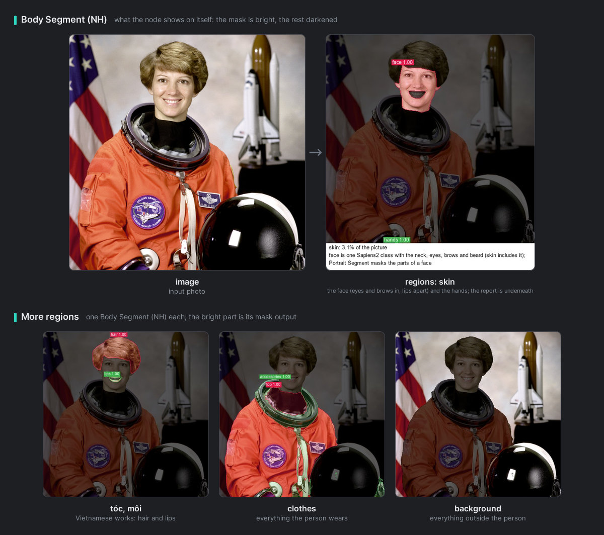<br><em>Body Segment on a sample photo, as the node shows it. Top: "skin", with the report under the picture. Bottom: "tóc, môi" (Vietnamese words), "clothes" and "background"; the bright part is each one's mask output.</em></p>

**Formulas to start with**

| `regions` | You get |
|---|---|
| `skin` | The skin of the face and neck, torso, arms, hands, legs and feet. |
| `hair, face` | The hair, and the face with the neck. |
| `tóc, môi` | The hair and the lips (Vietnamese words). |
| `clothes - shoes` | What the people wear, without the shoes. |
| `skin - hands` | The skin without the hands. |
| `skin + lips` | The skin with the lips. |
| `background` | Everything outside the people. |

**Example**

```text
Load Image → Body Segment (NH, regions: skin) → mask → Mask Morphology (NH, shrink) → retouch
```

Shrink the mask a few pixels with [Mask Morphology (NH)](./mask.md#mask-morphology-nh) so that the edit stays inside the skin, away from the edge of the hair and the clothes.

> **Note:** Old, faded or sepia scans are a known limit. Sapiens2 can take the whole backdrop for clothes: a scanned group photo came out 96% "person". Use Garment Segment (`fashn`) or SAM3 Segment with `person` there.

> **Licence:** Sapiens2 is under Meta's Sapiens2 License. It is royalty-free and has no non-commercial clause, but it prohibits surveillance, biometric processing, identifying or re-identifying people, deepfakes, impersonation and misleading content, inferring sensitive data about people without the rights and consents that the law requires, and some other uses. It requires you to follow privacy, biometric and trade-control laws, and it lets Meta audit your use, end the licence and change its terms. NH-Nodes' own code is MIT, and it includes Meta's model code with the licence text but not the weights, which are downloaded from Meta's Hugging Face repositories. Read [THIRD_PARTY_NOTICES.md](../../THIRD_PARTY_NOTICES.md) before you use the node.

---

## Before you start with SAM 3

SAM 3 is Meta's model for finding things by name: you write what you want (`person`, `window`, `wine glass`) and it returns every instance of it, each with a score and its own mask. NH-Nodes does not include the model and never downloads it, so SAM3 Segment needs three things from you, once. If another SAM 3 pack already works in your ComfyUI, steps 2 and 3 are usually done: that pack has installed the package and put `sam3.pt` where this node looks.

**1. An NVIDIA GPU with CUDA.** SAM 3 runs only on CUDA: the official sam3 code builds part of the model on the GPU, so there is no CPU mode and no `device` input. Plan for about 5 GB of VRAM at the peak.

**2. Meta's `sam3` package.** NH-Nodes does not install it for you. In the Python that runs ComfyUI, run these two lines, then restart ComfyUI:

```text
python -m pip install --no-deps git+https://github.com/facebookresearch/sam3@b26a5f330e05d321afb39d01d3d4881f258f65ff
python -m pip install timm ftfy regex iopath
```

The first line installs the sam3 commit that NH-Nodes was tested with; newer commits with the same image API also work. It needs Git on your computer. `--no-deps` keeps your numpy: sam3 asks for numpy below 2, which ComfyUI does not need. Meta's page for the package lists Python 3.12 or newer, PyTorch 2.7 or newer and CUDA 12.6 or newer. If another SAM 3 pack already provides `sam3`, skip the first line: installing it again could replace the copy that pack uses.

**3. The checkpoint `sam3.pt`.** Meta hands out the weights only after you accept its SAM License, so NH-Nodes cannot download them for you. Request access at [huggingface.co/facebook/sam3](https://huggingface.co/facebook/sam3), download `sam3.pt` from that page and put it in `ComfyUI/models/sam3/`. Press R in ComfyUI to refresh the lists, then pick the file in `checkpoint`. To keep it somewhere else, add the folder under the `sam3` key in `extra_model_paths.yaml` (see [Installation](../../README.md#installation) for the file):

```yaml
my_models:
    base_path: D:/ai-models/
    sam3: sam3/                    # SAM 3 checkpoints, shared with other SAM 3 packs
```

Only the PyTorch checkpoint `sam3.pt` works. The safetensors export on Hugging Face is made for the transformers library and uses other weight names.

**Memory.** The weights are read from disk once and kept in system memory (about 3.6 GB). They move to the GPU while SAM3 Segment runs and go back afterwards, so ComfyUI gets its VRAM back. Before they move, the node asks ComfyUI to unload some of its own models if VRAM is tight. Turn on `keep_model_loaded` to leave them on the GPU when you run the node again and again. While it is on, ComfyUI's **Unload Models** button does not release them: turn `keep_model_loaded` off and run the node once, or restart ComfyUI.

> **Licence:** SAM 3 is released under Meta's SAM License. It is royalty-free and has no non-commercial clause, but it forbids uses that fall under ITAR or that trade controls prohibit, including military or warfare, nuclear, espionage, and guns or illegal weapons. NH-Nodes' own code is MIT, and it contains neither the model nor the `sam3` package. Read [THIRD_PARTY_NOTICES.md](../../THIRD_PARTY_NOTICES.md) before you use the node commercially.

---

## How the two passes work

SAM 3 looks at a picture of about 1000 px. On a 6000 px photo that is a sixth of the width, so small objects and thin edges would come out soft. SAM3 Segment therefore looks twice.

1. **First pass: the whole image.** The picture is shrunk to the model's square input (1008 px) and encoded once. Every concept you listed is asked against that one encoding, which is cheap. This gives each instance a score, a box and a first mask, which is resampled to full resolution inside its own box only.
2. **Second pass: a close-up of each instance** (`balanced` only). The instance is cut out of the full-resolution image with a margin (20% of its longer side, at least 16 px) and segmented again with SAM 3's box-prompt decoder, with the first mask as a hint. Its edges now come from the original pixels.
3. **A safety net.** A close-up is kept when it matches the first-pass instance to within the blur of the first pass, so thin things such as poles and cables survive. When it does not match, the first-pass mask stays, and the console says for how many instances. Specks of the new mask that do not touch the first-pass mask are dropped.

| `detail_level` | Passes | Use it for |
|---|---|---|
| `balanced` (default) | Both | Crisp edges on small and medium objects, also on 4K to 8K photos. About 0.1 s per instance on a fast GPU. |
| `fast` | The first only | Small pictures, and quick tries while you look for the right words for the concepts. |

**What `balanced` can and cannot do.** Small and medium objects (a window, a glass, one person in a group photo) get crisp edges even on a 4K to 8K photo, because each one is judged on a close-up of the original pixels. The limit is the model: SAM 3 describes whatever it looks at on a grid of about 288 cells. A subject that fills most of an 8K frame is its own close-up, so its edges are accurate to about 1/300 of its size, around 25 px for a subject 7000 px across. That is fine for the outline of a person or a building, and soft on hair, lace and fur. Hair-level edges need a matting step that NH-Nodes does not have yet; a Matte Refine node is planned.

**Measured on one machine** (an NVIDIA RTX 5090): the first run loads the model in about 9 s. A 7360×4912 photo with the concepts `person, wine glass, dress` gave 13 instances in about 3.6 s with `balanced`. A 6720×4480 interior with 8 concepts gave 29 instances in about 6 s. The VRAM peak was about 5 GB. Other GPUs will differ.

---

## Instances: the NH_SEGS type

`NH_SEGS` is the data that SAM3 Segment, Garment Segment, Portrait Segment and Body Segment hand to the Segs nodes. For every image of a batch it holds a list of instances. Each instance keeps its **label** (in SAM3 Segment the English words SAM 3 was asked for: `áo đỏ` is stored as `red top`; in the other three the name of the part), its **score** (always 1.0 in the other three), a tight **box** and the mask **only inside that box**. A full-size mask is built only when a node outputs a `MASK`, so dozens of instances on an 8K photo stay light.

- **Objects and parts.** SAM3 Segment returns one instance per thing it finds: three people are three instances. Garment Segment, Portrait Segment and Body Segment return one instance per part for the whole picture: with three people, `hair` is the hair of the three together, in one instance. To pick one person among several, use SAM3 Segment.
- **The labels of the three people nodes** are listed in the output table of each node: [Garment Segment](#garment-segment-nh), [Portrait Segment](#portrait-segment-nh) and [Body Segment](#body-segment-nh). They do not all use the same words: `mouth` is the inside of the mouth in Portrait Segment, while Body Segment has `lips`, `teeth` and `tongue`. The Segs nodes also read the words of the node that made the segs (`skin` on Body Segment's segs): see [Segs Compose](#segs-compose-nh). When a label finds nothing, look at the labels in the preview or in [Segs To Masks](#segs-to-masks-nh).
- Instances of SAM3 Segment come in the order the labels appear in your concepts, and by score within a label. Those of the other three come in the order of their list of parts.
- The Segs nodes treat every image of a batch separately.
- The instances of an image also keep a small grey print of the picture they were found in. [Segs Compose](#segs-compose-nh) uses it to refuse instances of another photo.
- ComfyUI's own nodes do not read `NH_SEGS`. To get masks out, use the `mask` outputs, [Segs Compose](#segs-compose-nh) or [Segs To Masks](#segs-to-masks-nh). To use Impact Pack's detailers, convert with [Segs To Impact SEGS](#segs-to-impact-segs-nh).

---

## Writing a formula

SAM3 Segment's `concepts`, Segs Compose's `expression` and Body Segment's `regions` read the same small language. You name the things you want, combine them with operators, and the result is one mask per image. In SAM3 Segment the words you write are also what SAM 3 looks for. In Segs Compose they pick instances that were found already. In Body Segment they pick parts of the body that its model labels.

| Write | Meaning |
|---|---|
| `person` | A label: the instances with that name. Case does not matter, and singular and plural are the same when instances are matched (`arm` finds `arms`; `glasses` and `glass` stay apart). |
| `red car`, `women's dress` | Several words in a row are one label, with no quotes. A hyphen between two letters or digits belongs to the label (`t-shirt`, `x-ray`), and so does an apostrophe inside a word. |
| `person, hair` | A list: the union of its items. A new line works like a comma. A list is read after every other operator, so `person - hair, dress` is `person - hair` plus `dress`. Empty items are skipped. |
| `a + b`, `a \| b` | Union: everything in a or in b. |
| `a - b` | a without b. Put spaces around the minus: `person-hair` is read as one label. |
| `a & b` | Overlap: only where a and b both are. |
| `~a`, `!a` | Everything except a: the whole picture minus a. |
| `( … )` | Grouping. |
| `background` | Everything outside every instance that was found. The same as `~all`. |
| `all` | Every instance that was found. |
| `image` | The whole picture. |
| `none` | An empty mask. |
| `# …` | A comment, to the end of the line. It starts where a word could start; inside a word, as in `car#2`, the `#` belongs to the word. |
| `"salt & pepper"` | Quotes keep together a label that contains operator characters. A quoted `all`, `image`, `none` or `background` is an ordinary label. |

`~` binds first, then `&`, then `+`, `|` and `-` together, left to right, and last the list: `a - b + c` is `(a - b) + c`. When in doubt, add parentheses.

**Line breaks.** A line break lists, like a comma. It joins instead when it is next to an operator (the line before ends with one, other than `)`, or the next line starts with `+`, `|`, `-`, `&` or `)`), so a long formula can be laid out over several lines:

```text
(wall + ceiling)
  - window
```

**Vietnamese words.** SAM 3 reads English only, so the nodes translate the common Vietnamese words you type: `tóc` is `hair`, `váy` is `dress`, `cửa sổ` is `window`. The list covers people, body, clothes, accessories, nature, rooms and buildings, vehicles, food and animals. The full list is in `core/vi_words.py`.

- A thing followed by colours or sizes is put into English order: `áo đỏ` is `red top`, `tóc dài` is `long hair`, `ghế sofa lớn` is `large sofa`. `màu` (colour) may stand between them: `áo màu đỏ`. `tóc vàng` is `blonde hair`.
- `xanh` after a thing means blue or green, so it is not guessed. Write `xanh dương` (blue) or `xanh lá` (green), as in `áo xanh dương`, or write the English word.
- `các`, `những`, `mấy`, `cái`, `chiếc` and `con` in front of a thing are skipped when the phrase is not in the list as written: `những chiếc xe` is `vehicle`.
- `nền`, `phông`, `phông nền` and `hậu cảnh` are the keyword `background`, also with a colour (`nền trắng`). `tất cả` is `all`, and `toàn ảnh` and `cả ảnh` are `image`.
- Write Vietnamese with its accents. Text without Vietnamese accents is taken as English (a few short words, such as `xe`, are in the list as written).
- A Vietnamese phrase that is not in the list is searched for as written, and SAM 3 usually finds nothing. The report then says that it was not understood. The labels of the instances are always the English words.
- Quotes do not stop the translation. A quoted `nền` is the label `background`, not the keyword.

**Where the two nodes differ**

| | SAM3 Segment, `concepts` | Segs Compose, `expression` |
|---|---|---|
| `or`, `and`, `not` | Plain words, so a phrase such as `black and white dog` reaches SAM 3 as written. | Operators: `a or b`, `a and b`, `not a`. |
| Wildcards `*` and `?` | Refused: SAM 3 needs plain words. | Match labels (`*shirt`). |
| What a label does | It is what SAM 3 is asked to find. | It picks the instances that have that label. A label that no instance has gives an empty part. |
| An empty field | Stops with a message to write at least one concept. A field with only comments, or only `all`, `image` or `none`, counts as empty. | Stops with a message to use `all` for every instance. |

**Body Segment's `regions`** follows SAM3 Segment's rules, with three differences. `or`, `and` and `not` are not operators there (they are refused with advice: write `+`, `-` or `~`). Every word must name a region of the body that its model has, such as `skin`, `hair` or `clothes`: other words, and wildcards, are refused before the model loads. And the Vietnamese words go through the same list, so `tay` and `chân` mean the whole limb there. See [Body Segment](#body-segment-nh).

---

## SAM3 Segment (NH)

<p align="center">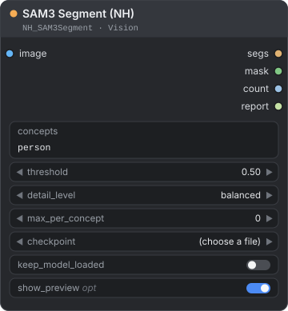</p>

Type what you want to cut out and get its mask: one word (`person`), a list (`hair, face`) or a formula (`person - bag`, `background`). SAM 3 finds every instance of the things you name. The node returns the mask of your formula, the instances as `NH_SEGS`, a count and a report of what was and was not found, and it shows what it found on itself.

**Use it when** you want masks of "all the people", "every window", "the sky", "the background" or "the person without the bag" in a photo, also a 4K to 8K one, without painting anything. For finer picks (the second person from the left, the biggest object), or to make several masks from one run, connect `segs` to the [Segs nodes](#segs-select-nh).

Combo inputs without a stated default start on their first option.

| Input | Type | Default | Description |
|---|---|---|---|
| `image` | IMAGE | — | The picture. Colour (RGB) is used and any alpha is dropped. Every image of a batch is processed in turn. |
| `concepts` | STRING | `person` | What to find and which mask to return, written as a formula (see [Writing a formula](#writing-a-formula)): short English words (`person`, `red car`, `window`), commas or new lines to list several, and `+`, `-`, `&`, `~`, parentheses and `background` to combine them (`person - bag`). Common Vietnamese words work too (`tóc`, `áo đỏ`, `nền`). Write at least one word. |
| `threshold` | FLOAT | `0.5` | Range 0.05 to 0.95. The minimum confidence. Lower finds more instances and more mistakes; higher keeps only the sure ones. A score exactly at the threshold is not kept. When a concept finds nothing, the report says how close the best candidate came. |
| `detail_level` | COMBO | `balanced` | `balanced` or `fast`. `balanced` segments every instance a second time on a close-up of the full-resolution image, for crisp edges on small and medium objects. `fast` keeps the first, whole-image pass. See [How the two passes work](#how-the-two-passes-work). |
| `max_per_concept` | INT | `0` | Range 0 to 200. Keep at most this many instances of each concept, best score first. `0` keeps all. |
| `checkpoint` | COMBO | — | A SAM 3 `.pt` or `.pth` file from `models/sam3` or another folder registered as `sam3`. Other SAM 3 packs use the same folder. When it holds no file, the list shows `sam3.pt` and the node tells you where to get it when you run it. |
| `keep_model_loaded` | BOOLEAN | `false` | Off: after the run the weights go back to system memory and ComfyUI gets the VRAM back. On: they stay on the GPU (about 3.6 GB), which is faster when the node runs again, but ComfyUI cannot use that VRAM meanwhile, and its **Unload Models** button does not release it (turn this off and run the node once, or restart ComfyUI). |
| `show_preview` | BOOLEAN | `true` | Optional. Shows the result on the node: the mask bright and the rest darkened, the instances outlined and labelled, and the report lines below. At most 1536 px on the longer side, and the first 16 pictures of a batch. Off: nothing is drawn, and the node still runs (see below). |

| Output | Type | Description |
|---|---|---|
| `segs` | NH_SEGS | The instances of every image, each with its label, score, box and mask. The labels are the English words SAM 3 was asked for. When the formula uses `background`, they include the `person` instances that were searched for it. Connect it to the Segs nodes. |
| `mask` | MASK | The mask of your formula, one per image, at the size of the image. A plain list of words gives the union of every instance. |
| `count` | INT | The number of instances found, over the whole batch, including the `person` instances that `background` searched for. |
| `report` | STRING | What the request found, one line per word: counts and best scores, translations, near misses, words that were not understood, and what `background` meant. See below. |

<p align="center">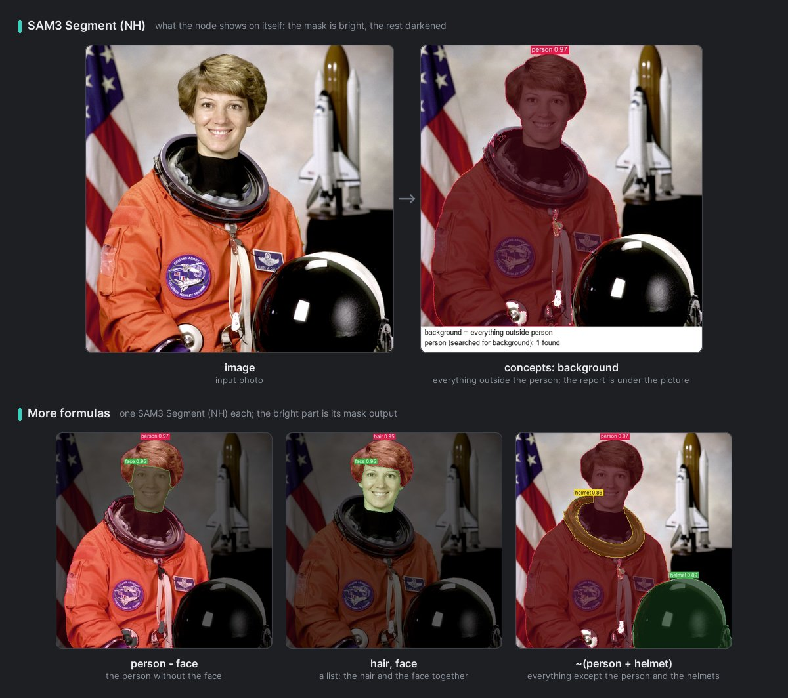<br><em>SAM3 Segment on a sample photo, as the node shows it. Top: "background" lights up everything outside the person, and the report is under the picture. Bottom: three more formulas; the bright part is each one's mask output.</em></p>

**The report.** The first line of `report` gives the totals. Each line after it (they are also written under the preview) starts with what you wrote:

| Line | Meaning |
|---|---|
| `person: 2 found (best 0.91)` | The number of instances found and the best score. |
| `áo đỏ -> red top: 1 found (best 0.64)` | What a Vietnamese phrase was translated to. |
| `hair: none at threshold 0.50; the best candidate scored 0.31, lower the threshold to keep it` | Nothing passed `threshold`, but a candidate came close. Lower `threshold` below its score to keep it. |
| `bag: none found; try another English word` | No candidate scored even 0.1. |
| `áo xanh: not understood; write it in English (SAM 3 reads English only)` | A Vietnamese phrase that is not in the list and found nothing. |
| `background = everything outside person, red top` | What `background` meant: everything outside the instances of these labels. |
| `person (searched for background): 2 found` | The `person` search that the node added because the formula uses `background` and does not name `person`. |

**How it works**

- **Labels.** The English words SAM 3 was asked for are the labels of the instances: `áo đỏ` is looked for as `red top`, and its instances are labelled `red top`. The Segs nodes ignore case when they match labels, so spelling is not a problem.
- **The mask.** `mask` is the result of the formula. For `person - bag`, SAM 3 looks for `person` and for `bag`, `mask` is the people without the bags, and `segs` still holds both kinds of instance.
- **`background`.** It is everything outside every instance that was found, so the node needs to know where the subject is. When the formula uses it and does not name `person`, SAM 3 also looks for `person`; those instances are part of `segs` and `count` and are outlined in the preview. To keep other things out of the background too, name them: `~(person + wine glass + chair)`. A list is a union, so `person, background` is the whole picture.
- **Order and duplicates.** Instances come in the order the labels appear in your formula (the `person` that `background` added comes last), best score first within a label. Two instances of the same label whose masks overlap almost completely (90% or more) count as one, and the better score stays. `max_per_concept` then keeps the best of what is left. Instances with exactly equal scores keep the order SAM 3 gave them. A concept written in singular and plural (`arm, arms`) is one search, and the report lists it once; `glass` and `glasses` stay two concepts.
- **Seeing the result.** With `show_preview` on, the node draws the preview itself: no other node is needed. To see the picture at full size (the preview is at most 1536 px), or to see what Segs Select works with, connect `segs` and the same picture to [Segs Preview](#segs-preview-nh).
- **It runs on its own.** SAM3 Segment is an output node (the dot on its card is orange): ComfyUI runs it even when nothing is connected to its outputs. A copy that you no longer need therefore keeps running SAM 3 whenever its inputs change, and turning `show_preview` off does not stop it. Mute or delete it. While its inputs stay the same, ComfyUI reuses the last result.
- **Nothing found** is not an error: you get no instances and a `count` of 0. The mask is empty for a plain list, and the whole picture for a formula such as `background` or `~person`, because nothing was found to leave out.
- **Batches.** Every image is processed in turn and has its own list of instances. A progress bar counts the concepts, and you can cancel the run between concepts and between close-ups.
- **Things cut by the frame.** SAM 3 fades its masks over a band along the border of the square view it works in, about 0.3% of the picture's side wide. The mask of a thing that runs off the picture still reaches the image edge: the band is lifted where the object reaches it from inside. The price is that a thing which ends within that band just above the edge is drawn down to the edge.
- **Very wide or tall pictures.** SAM 3 first sees the whole picture squeezed into a square. On a picture wider or taller than 4:1 (a panorama), it can miss small things, and the console says so. Split such a picture into tiles with [Image Tile (NH)](./image-compose.md#image-tile-nh) and run the tiles.
- **Setup problems** stop the node with a message that says what to do: a missing package, a missing checkpoint, no CUDA GPU. See [If something goes wrong with SAM 3](#if-something-goes-wrong-with-sam-3).

> **Tip:** Write simple English nouns: `window`, `wine glass`, `red car`. If a concept finds nothing, try another word (an unusual building may answer to `structure` or `monument` rather than `building`) or lower `threshold`. The report says which case it is: nothing found, a candidate that came close, or a word that was not understood.

> **Tip:** Ask for a whole and its parts in one formula: `person - hair`. The node looks for both and `mask` is the difference. `segs` still holds both, so [Segs Compose](#segs-compose-nh) can make other masks from the same run.

> **Licence:** SAM 3 is under Meta's SAM License. See [Before you start with SAM 3](#before-you-start-with-sam-3).

---

## Segs Select (NH)

<p align="center">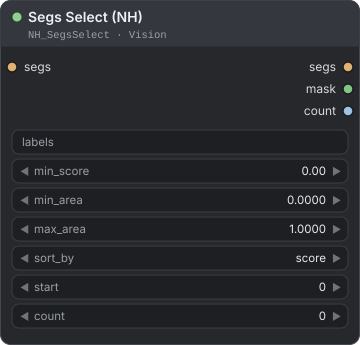</p>

Keeps the instances you want, by label, score, size and position, in the order you choose.

**Use it when** you need only some of what SAM3 Segment found: the biggest object, the second person from the left, only the sure detections, or only the large windows.

| Input | Type | Default | Description |
|---|---|---|---|
| `segs` | NH_SEGS | — | The instances, from SAM3 Segment, Garment Segment, Portrait Segment, Body Segment or another Segs node. |
| `labels` | STRING | empty | The labels to keep, separated by commas. `*` stands for any run of characters and `?` for one character (`*shirt`). Case does not matter, singular and plural are the same (`arm` finds `arms`), and `_` counts as a space (`red_car` finds `red car`). Labels with spaces need no quotes here: `wine glass, red car`. Common Vietnamese words are translated (`tóc` finds `hair`); the formula words `nền` and `tất cả` are not labels here. The words of the node that made the segs work too: `skin` on Body Segment's segs keeps its face, torso, arms, hands, legs and feet parts (see [Segs Compose](#segs-compose-nh)). Empty keeps every label. |
| `min_score` | FLOAT | `0.0` | Range 0 to 1. Drops instances with a lower score. |
| `min_area` | FLOAT | `0.0` | Range 0 to 1. Drops instances smaller than this fraction of the image (`0.01` is 1%). |
| `max_area` | FLOAT | `1.0` | Range 0 to 1. Drops instances larger than this fraction of the image. |
| `sort_by` | COMBO | `score` | The order of the kept instances. See the table below. |
| `start` | INT | `0` | Range 0 to 4096. Skips this many instances of the sorted list. `0` starts at the first. |
| `count` | INT | `0` | Range 0 to 4096. Keeps this many instances from `start` on. `0` keeps all of them. |

| Output | Type | Description |
|---|---|---|
| `segs` | NH_SEGS | The kept instances, in the sorted order. |
| `mask` | MASK | The union of the kept instances, one mask per image. |
| `count` | INT | The number of instances kept, over the whole batch. |

| `sort_by` | Order |
|---|---|
| `score` | Highest score first. |
| `area` | Largest first. |
| `left_to_right`, `right_to_left` | By the horizontal centre of the box. |
| `top_to_bottom`, `bottom_to_top` | By the vertical centre of the box. |
| `center_first` | The instance whose box centre is nearest the centre of the image first. |
| `as_found` | The order SAM3 Segment found them in: your concepts in turn, best score first within each. |

**How it works**

- **Three steps, in this order:** the filters (`labels`, `min_score`, `min_area`, `max_area`), then the sorting, then the slice (`start` and `count`).
- **Per image.** Every image of a batch is handled on its own, so `start` `1` skips the first instance of each image.
- **Area** is the share of the image's pixels that the mask covers, not the size of its box. Positions use the centre of the box. Ties keep the order the instances were found in.
- The kept instances stay sorted, so [Segs To Masks](#segs-to-masks-nh) after this node returns its masks in that order.

| To get | Set |
|---|---|
| The second person from the left | `labels` `person`, `sort_by` `left_to_right`, `start` `1`, `count` `1` |
| The biggest object | `sort_by` `area`, `count` `1` |
| The three surest instances | `sort_by` `score`, `count` `3` |
| Nothing under 1% of the picture | `min_area` `0.01` |
| The instance nearest the middle | `sort_by` `center_first`, `count` `1` |

---

## Segs Compose (NH)

<p align="center">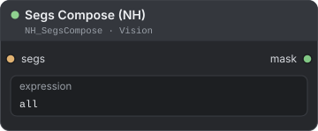</p>

Builds one mask from the labels of the instances, with the same small formula as SAM3 Segment's `concepts`: union, minus, overlap and "everything except". The instances can come from up to three nodes at once.

**Use it when** you already have instances and want "the background", "the person without the hair", "the wall without the windows", or another combination of what SAM3 Segment found: after [Segs Select](#segs-select-nh), or to make several masks from one SAM 3 run. Use it also to mix what several nodes found in the same photo: the bag from SAM 3, the dress from Garment Segment, the lips from Body Segment. For a single mask from SAM 3 alone you can also write the same formula straight into SAM3 Segment's `concepts`.

| Input | Type | Default | Description |
|---|---|---|---|
| `segs` | NH_SEGS | — | The instances, from SAM3 Segment, Garment Segment, Portrait Segment, Body Segment or Segs Select. |
| `expression` | STRING | `all` | The formula. See [Writing a formula](#writing-a-formula). The field has several lines: a line break lists, like a comma, and joins when it is next to an operator. |
| `segs_2` | NH_SEGS | — | Optional. More instances of the same picture, from another of these nodes. They are mixed into the formula with `segs`. |
| `segs_3` | NH_SEGS | — | Optional. And more. |
| `check_same_photo` | BOOLEAN | `true` | Optional. Refuses segs that look like different photos of the same size. Turn it off to mix segs of edits of one photo that differ a lot, such as a new background or a relight. See "The same photo only" below. |

| Output | Type | Description |
|---|---|---|
| `mask` | MASK | The result of the formula, one mask per image, at the size of the image. |

**What is different here.** The language is the one in [Writing a formula](#writing-a-formula), with these differences from SAM3 Segment:

- `or`, `and` and `not` are operators: `a or b` is `a | b`, `a and b` is `a & b`, `not a` is `~a`.
- A label picks the instances that have it. Case does not matter, singular and plural are the same (`arm` finds `arms`, `foot` finds `feet`, `shoe` finds `shoes`, `scarf` finds `scarves`; `glasses` and `glass` are kept apart), `_` counts as a space (`red_car` finds `red car`), and `*` and `?` are wildcards, matched as written (`*shirt`).
- Put a label that contains an operator character in quotes, `"` or `'` (`"salt & pepper"`), and use double quotes when it also has an apostrophe. Several words in a row need no quotes.
- Vietnamese labels are translated (`tóc` finds `hair`), also inside quotes. `nền` is the keyword `background`.

| Expression | You get |
|---|---|
| `person - hair` | The people without their hair (ask SAM3 Segment for `person, hair`). |
| `~person` | Everything except the people. |
| `background` | Everything outside every instance in the segs. Unlike `~person`, it also leaves out windows, chairs or anything else that was found. |
| `(wall \| ceiling) - window` | The walls and the ceiling with the window openings cut out. |
| `wine glass, person` | The glasses and the people together (a list, the same as `wine glass \| person`). |
| `all - person` | Everything that was found except the people. Unlike `~person`, it leaves out the background that nothing found. |
| `dress - bag - lips` | With three nodes on the same photo: SAM3 Segment (`bag`) in `segs`, Garment Segment in `segs_2` and Body Segment in `segs_3`. The dress without any bag and without the lips. |
| `face - eyes - eyebrows` | Body Segment in `segs` and Portrait Segment in `segs_2`. `face` takes the face of both nodes (see the next table), and the eyes and eyebrows of Portrait Segment come out. |
| `skin - bag` | SAM3 Segment (`bag`) in `segs` and Body Segment in `segs_2`. The skin without the bag: `skin` is one of Body Segment's own words (see the next table). |
| `skin - hands` | Body Segment's segs alone, with the same words. The skin without the hands. |

**A node's own words.** A label picks the instances that carry it. Each node is read on its own: where a node has no instance with the word as its label, Segs Compose reads the word as one of that node's own words and takes the parts it stands for. An instance of one node that carries the word does not hide another node's word: with Portrait Segment's and Body Segment's segs together, `skin` is Portrait Segment's skin instance and Body Segment's skin parts. [Segs Select](#segs-select-nh) reads the same words in `labels`. Only group words stand for several parts:

| On the segs of | Group words | What they take |
|---|---|---|
| Body Segment | `skin` (`body skin`), `head`, `mouth`, `clothes` (`clothing`, `outfit`), `person` (`body`), `upper clothes` (top), `lower clothes` (bottom), `apparel` (accessories), the Vietnamese words for them (`da`, `đầu`, `miệng`, `quần áo`, `người`), and the whole limbs `tay`, `đôi tay`, `hai tay`, `chân`, `đôi chân`, `hai chân` | `skin`: the face, torso, arms, hands, legs and feet parts. `head`: face and hair. `mouth`: lips, teeth and tongue. `clothes`: top, bottom, shoes, socks and accessories. `person`: every part. `tay`, `đôi tay`, `hai tay`: arms and hands. `chân`, `đôi chân`, `hai chân`: legs and feet. |
| Garment Segment | The groups of its `part`: `upper_garment`, `lower_garment`, `footwear`, `headwear`, `all_garments` | With `fashn`: `upper_garment` is top, dress and scarf, `lower_garment` skirt, pants and belt, `footwear` the feet, `headwear` the hat, `all_garments` all of these. With `fashionpedia`: its own groups (`footwear` is shoe and sock, `headwear` hat and headband…). |
| Portrait Segment | `face`, `face skin`, `mouth interior` | `face`: skin, nose, glasses, eyes, eyebrows, mouth and lips. `face skin`: the skin part. `mouth interior`: the mouth part, the inside of the mouth. |

- A word that is the name of one of a node's own parts never stands for other parts: Fashionpedia's `belt` is only its belt.
- The near synonyms of Body Segment's `regions` (`dress`, `pants`, `skirt`, `jeans`, `shirt`, `neck`…) are not read here: with Body Segment's segs alone, `dress` or `váy` and `pants` or `quần` find nothing. Write the part names (`top`, `bottom`) instead, or mix in Garment Segment's segs, which label dress, skirt and pants for real.
- A word that covers only a piece of a part (`left hand`, `upper arm`, `thigh`) finds nothing here, and neither do the side forms `tay trái`, `tay phải`, `chân trái` and `chân phải`: Body Segment's segs hold no instance of one side. Body Segment's `regions` has those. `cánh tay` is still the arms alone.
- Segs Select reads the Vietnamese `tay` and `chân` as `arm` and `leg`, the arms and the legs without the hands and the feet.

**How it works**

- **A label that no instance has** gives an empty part, and the console says so and lists the labels the segs hold (`no instance is labelled 'x'; those parts are empty. The segs hold: hair, face, …`). A typo in `~persn` therefore gives the whole picture: check the console when a mask looks wrong.
- **Words in a row are one label.** When no instance has that label but each word is the label of an instance (`person hair`), the node stops with an error that suggests `person + hair`. The same goes for a hyphen: when both `person` and `hair` were found, `person-hair` stops with an error that shows `person - hair`.
- **Every image** of a batch gets its own mask, built from its own instances.
- **Mixing nodes.** `segs`, `segs_2` and `segs_3` are put together before the formula is read: every image gets the instances of all of them, and a label picks the instances of every node that has it. When two nodes use the same label (`hair` in Portrait Segment and in Body Segment, `glasses` in three nodes), that label is the union of their masks. Each node cuts the picture with its own model, so masks from different nodes do not line up edge to edge.
- **The same photo only.** The node stops when the segs come from different pictures: another number of images, or another size. With `check_same_photo` on, it also stops when they look like different photos of the same size. Every frame of segs keeps a small grey print of its picture, and the prints must agree. Edits of the same photo (brightness, contrast, colour, blur) are accepted. This is a guard against wiring mistakes, not a proof: it catches most other photos of the same size, a copy shifted or zoomed a little usually passes, and a new background behind the same person can fail. For edits like that, turn `check_same_photo` off. Segs made by older versions have no print and are mixed on size alone.
- **A formula that cannot be read** stops the node with a message that gives the position of the problem, for example `unexpected '(' at position 8` for `person (adult)`.

<p align="center">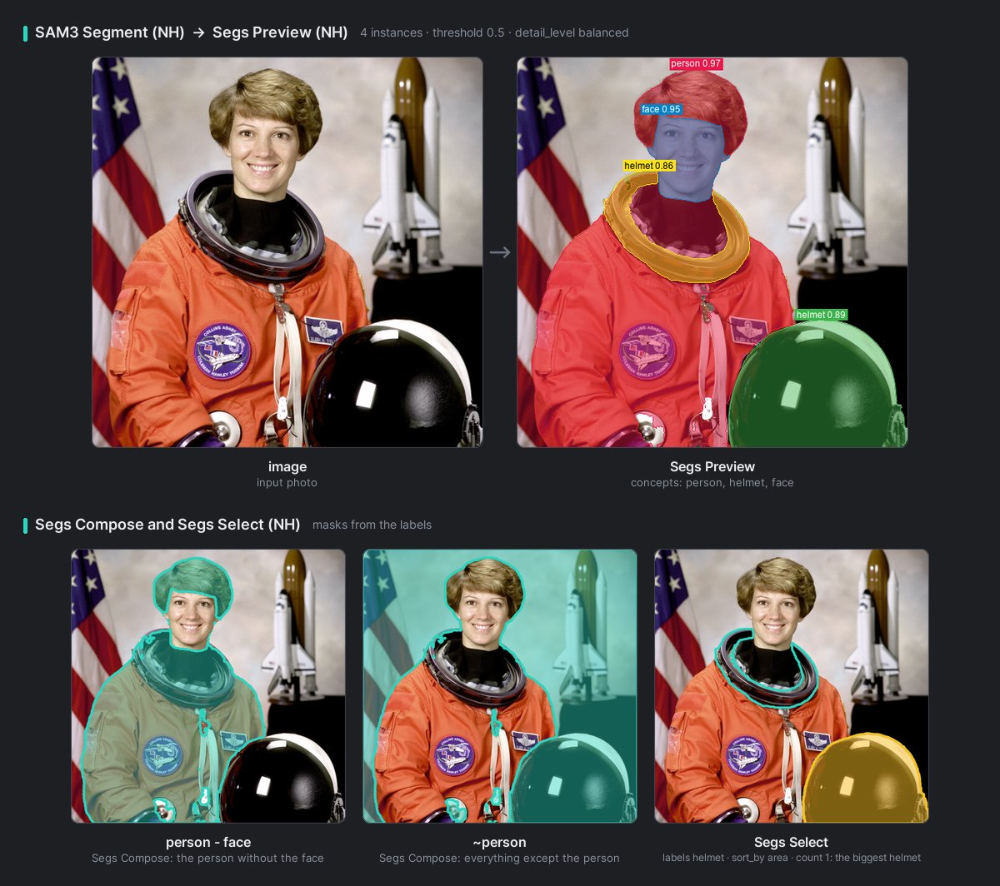<br><em>The instances of "person, helmet, face" on a sample photo, drawn by Segs Preview, then three masks made from them with Segs Compose and Segs Select.</em></p>

---

## Segs To Masks (NH)

<p align="center">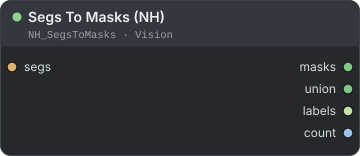</p>

Turns the instances into ordinary masks: one mask per instance, the union per image, and the list of labels.

**Use it when** you need each instance as a mask of its own: to process them one by one, to save them, or to read their labels.

| Input | Type | Default | Description |
|---|---|---|---|
| `segs` | NH_SEGS | — | The instances, from SAM3 Segment, Garment Segment, Portrait Segment, Body Segment or Segs Select. |

| Output | Type | Description |
|---|---|---|
| `masks` | MASK | One mask per instance, image after image, in the order of `labels`. When there is no instance at all, a single empty mask, so that nodes after it do not fail. |
| `union` | MASK | One mask per image: the union of its instances. |
| `labels` | STRING | The label of every instance, one per line, in the order of `masks`. |
| `count` | INT | The number of instances. It is 0 when there are none, although `masks` then holds one empty mask. |

> **Note:** Every mask has the size of the picture and 4 bytes per pixel: about 145 MB on a 7360×4912 photo. When the masks would need more than about half of your free RAM (for example hundreds of instances on an 8K photo), the node stops with a message instead of filling the memory. Use [Segs Select](#segs-select-nh) first to keep only the instances you need, or [Segs Compose](#segs-compose-nh) to get one mask.

---

## Segs To Impact SEGS (NH)

<p align="center">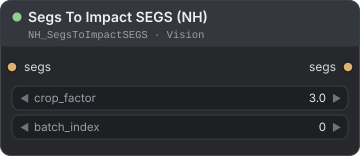</p>

Converts the instances of one image to Impact Pack's `SEGS`, so that its detailers and SEGS tools can work on them.

**Use it when** you already use Impact Pack and want its detailers to refine what SAM3 Segment found. NH-Nodes needs Impact Pack for nothing else, so skip this node if you do not use it.

| Input | Type | Default | Description |
|---|---|---|---|
| `segs` | NH_SEGS | — | The instances, from SAM3 Segment, Garment Segment, Portrait Segment, Body Segment or Segs Select. |
| `crop_factor` | FLOAT | `3.0` | Range 1 to 10. The size of the region a detailer works on around each instance, as a multiple of its box (Impact Pack's `crop_factor`). The region is moved to stay inside the image and always contains the box. |
| `batch_index` | INT | `0` | Range 0 to 4095. Impact Pack's SEGS hold one image, so this picks which image of the batch to convert. A number past the last image stops the node with a message. |

| Output | Type | Description |
|---|---|---|
| `segs` | SEGS | Impact Pack's `SEGS` for that image. Each instance has its box, crop region, mask, label and score (as `confidence`). |

**How it works**

- The output is Impact Pack's own type, not `NH_SEGS`. NH-Nodes builds it with the same fields and does not import Impact Pack, so the conversion needs no Impact Pack. Using the result does.
- To convert several images of a batch, use one node per `batch_index`.

---

## Segs Preview (NH)

<p align="center"></p>

Draws the instances on their picture: each one tinted in its own colour, outlined and labelled with its label and score.

**Use it when** you want to see the instances at the full size of your picture, or to see what Segs Select picked. SAM3 Segment already shows a small preview on itself (at most 1536 px, with its report). Put this node after SAM3 Segment to see everything, or after Segs Select to see only the selection.

| Input | Type | Default | Description |
|---|---|---|---|
| `image` | IMAGE | — | The picture the segs were found in: the same number of images and the same size. Otherwise the node stops and says so. |
| `segs` | NH_SEGS | — | The instances to draw. |

| Output | Type | Description |
|---|---|---|
| `preview` | IMAGE | The picture with the instances drawn on it, at the same size. |

The colours follow the order of the instances, each label sits above the highest point of its instance, and the size of the labels follows the size of the picture. An 8K picture gives an 8K preview.

---

## SAM 3 workflows

In each of these, check what SAM3 Segment found before you edit anything. Its preview on the node shows every instance with an outline and a label, and its report says what was not found. If an instance you want is missing, lower `threshold` (for example to 0.3) or try another word for the concept.

### The background behind people

```text
Load Image → SAM3 Segment (concepts: background)
           → Mask Morphology (NH)
           → edit the background
```

`background` is everything outside the people that SAM 3 found: the node looks for `person` on its own. When people hold or sit on things, name those too, so that they stay out of the background, for example the concepts `~(person + wine glass + chair)`. Move the edge of the mask a few pixels with [Mask Morphology (NH)](./mask.md#mask-morphology-nh): grow it so that the edit covers the old outline, or shrink it if the edit eats into the people. Then use the mask to blur, relight, recolour or inpaint the background.

### The biggest object, inpainted

```text
Load Image → SAM3 Segment (concepts: person, dog, car)
           → Segs Select (sort_by: area, count: 1)
           → Mask Morphology (NH, grow)
           → inpaint
```

With `labels` empty, Segs Select picks the biggest of everything you asked for. Set `labels` (for example `car`) to pick the biggest of one kind, `start` `1` for the second biggest, and raise `min_score` so that a doubtful detection cannot be picked. Grow the mask a few pixels so that the inpainted area covers the old outline.

### Architecture: a facade without windows

```text
Load Image → SAM3 Segment (concepts: building - (window + door))
           → recolour, restyle or inpaint the wall
```

`building` covers the whole facade with its windows and doors; the formula cuts them out and leaves the wall. For a room, use `(wall + ceiling) - window`. If `building` finds nothing on an unusual building, try `structure` or `monument` and change the formula to match. On a 4K to 8K photo, keep `balanced`: every window is segmented again on a close-up of the original pixels. The outline of a facade that fills the whole frame is accurate to about 1/300 of its width (see [How the two passes work](#how-the-two-passes-work)), so check the roofline in the preview.

---

## If something goes wrong with SAM 3

| What you see | What to do |
|---|---|
| An error that SAM 3 needs Meta's sam3 package | Install it as in [Before you start with SAM 3](#before-you-start-with-sam-3), then restart ComfyUI. |
| An error that the sam3 package is installed but failed to load, or lacks something | The installed version is not one NH-Nodes supports, or one of its extras is missing. Reinstall with the two lines in [Before you start with SAM 3](#before-you-start-with-sam-3). The message shows the cause. |
| An error that the checkpoint was not found | Download `sam3.pt` as in [Before you start with SAM 3](#before-you-start-with-sam-3), press R in ComfyUI and pick the file. The message lists the folders that were searched. |
| An error that a file is not a SAM 3 `.pt` checkpoint | Use `sam3.pt`. The safetensors files on Hugging Face do not work with this node. |
| An error that a file cannot be read as a SAM 3 checkpoint, or is not one | The file in the `sam3` folder is an incomplete download or another model's `.pt`. Download `sam3.pt` again as in [Before you start with SAM 3](#before-you-start-with-sam-3). |
| An error that SAM 3 needs an NVIDIA GPU with CUDA | ComfyUI is running on the CPU or on another kind of GPU. SAM3 Segment has no CPU mode. |
| An error that you must write at least one concept | `concepts` is empty, holds only comments, or holds only the keywords `all`, `image` or `none`. Write a word such as `person`. |
| An error that a concept has a wildcard | Remove the `*` or `?`: SAM 3 needs plain words. Wildcards work in Segs Select and Segs Compose. |
| An error from SAM3 Segment that gives a position, such as `unexpected '(' at position 8` | Check the formula at that position. A bracket in a label is read as grouping. See [Writing a formula](#writing-a-formula). |
| `count` is 0, or an instance is missing | Read the report: it says whether the word found nothing, a candidate came close (lower `threshold` to its score), or the word was not understood (write it in English). The preview on the node shows what was found. |
| The report says a word was not understood | It is a Vietnamese phrase that is not in the list. Write it in English. After a thing, `xanh` is ambiguous: write `xanh dương` (blue) or `xanh lá` (green). |
| The mask is the whole picture, or not what you expected | A list is a union: `person, background` is the person plus everything outside it. Write `background` alone, or a formula such as `person - bag`, and look at the preview: the bright part is the mask. |
| SAM3 Segment runs although nothing is connected to it | It is an output node. Mute or delete it when you do not need it; turning `show_preview` off does not stop it. |
| The console says it kept the first-pass mask for some instances | Their close-up did not match the first pass, so those instances keep the first pass's edges. Nothing is wrong. |
| An error from Segs Preview about sizes or the number of images | Connect the picture that the segs were found in. |
| An error from Segs Compose that gives a position | Check the formula at that position. See [Writing a formula](#writing-a-formula). |
| An error from Segs Compose that no instance is labelled `person hair`, but `person` and `hair` are | Words in a row are one label. Join them: `person + hair`. |
| A Segs Compose mask is empty, and the console says no instance has a label | Check the spelling of the label, and read the labels the console lists under "The segs hold". Put spaces around a minus: `person - hair`, not `person-hair`. Labels differ between nodes: see the output table of the node that made the segs, and its own words under "A node's own words" in [Segs Compose](#segs-compose-nh). |
| An error from Segs Compose that the segs to mix come from different pictures | `segs`, `segs_2` and `segs_3` must come from the same image batch: the same number of images, of the same sizes. Run every node on the same Load Image. |
| An error from Segs Compose that the segs to mix look like different photos of the same size | One of the nodes ran on another photo of the same size. Run every node on the same photo. If they are edits of one photo that differ a lot (a new background, a relight), turn `check_same_photo` off. A copy with only brightness, contrast, colour or blur changed is accepted. |
| An error from Segs To Masks that the full-size instance masks would need more memory than is free | There are too many instances for the size of the picture. Use Segs Select to keep only the ones you need, or Segs Compose to get one mask. |
| The console says that SAM 3 sees the picture squeezed into a square and can miss small things | The picture is wider or taller than 4:1. Split it into tiles with Image Tile (NH) and run the tiles. |
| ComfyUI runs out of VRAM after the node | Leave `keep_model_loaded` off, so the weights leave the GPU after each run. |
| ComfyUI's Unload Models button does not free the VRAM of SAM 3 | `keep_model_loaded` is on. Turn it off and run the node once, or restart ComfyUI. |

---

[← Back to guide](./README.md)
