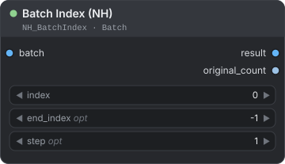
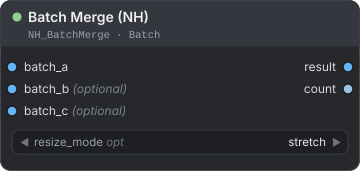
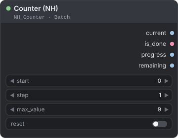
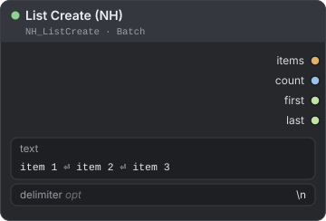
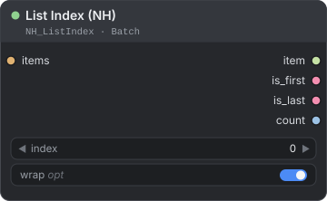
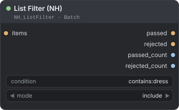
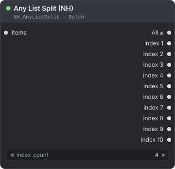

[← Về trang hướng dẫn](./README.md)

# Batch & Lists (lô ảnh và danh sách)

Các node làm việc với nhóm phần tử. Bạn có thể chọn hoặc ghép ảnh trong một batch (lô ảnh), đếm số lần đã queue workflow, và tạo, lọc, lấy phần tử từ danh sách văn bản. Một node nữa tách bất kỳ danh sách ComfyUI nào thành các đầu ra riêng. Bạn tìm chúng trong menu node tại **NH-Nodes → Batch**.

Lỗi hay gặp nhất với các node này là lẫn lộn giữa đếm từ 0 và đếm từ 1, nên hãy đọc [Quy tắc đếm](#quy-tắc-đếm) trước.

**Nội dung trang**

| Node | Dùng để |
|---|---|
| [Batch Index (NH)](#batch-index-nh) | Lấy một ảnh, hoặc một đoạn ảnh, từ batch |
| [Batch Merge (NH)](#batch-merge-nh) | Ghép tối đa ba batch thành một |
| [Counter (NH)](#counter-nh) | Tạo một con số tăng dần sau mỗi lần queue |
| [List Create (NH)](#list-create-nh) | Biến văn bản thành danh sách |
| [List Index (NH)](#list-index-nh) | Lấy một phần tử từ danh sách |
| [List Filter (NH)](#list-filter-nh) | Chia danh sách thành phần khớp và phần không khớp |
| [Any List Split (NH)](#any-list-split-nh) | Tách danh sách ComfyUI bất kỳ thành các đầu ra riêng |

Trong các bảng, `*` nghĩa là kiểu dữ liệu bất kỳ.

---

## Quy tắc đếm

Có node đếm từ 0, có node đếm từ 1. Hãy xem bảng này khi bạn nối một con số từ node này sang node khác.

| Vị trí | Phần tử đầu tiên là |
|---|---|
| `Batch Index (NH)` — `index`, `end_index` | `0` |
| `List Index (NH)` — `index` | `0` |
| `Any List Split (NH)` — các đầu ra | `index 1` |
| `Counter (NH)` — `current` | giá trị `start` của bạn (mặc định `0`) |
| Các loader theo index — `index` (xem [Loaders](./loaders.md)) | `1` |

Để điều khiển một loader bằng Counter, hãy đặt `start` của Counter là `1`.

---

## Batch Index (NH)

<p align="center"></p>

Chọn một ảnh, hoặc một đoạn ảnh, từ batch ảnh và cho bạn biết batch gốc có bao nhiêu ảnh.

**Dùng khi** bạn cần một ảnh duy nhất từ batch vừa tạo (ví dụ ảnh thứ ba trong bốn ảnh), khung hình cuối của một chuỗi, hoặc chỉ một phần của batch.

| Đầu vào | Kiểu | Mặc định | Mô tả |
|---|---|---|---|
| `batch` | `IMAGE` | — | Batch ảnh cần chọn. |
| `index` | `INT` | `0` | Vị trí của ảnh đầu tiên cần lấy, tính từ 0. Số âm đếm từ cuối (`-1` là ảnh cuối). Giá trị vượt quá cuối batch sẽ lấy ảnh cuối. Phạm vi từ -100 đến 1000. |
| `end_index` | `INT` | `-1` | Tùy chọn. `-1` chỉ lấy đúng ảnh tại `index`. Giá trị khác sẽ lấy một đoạn ảnh (xem bên dưới). Phạm vi từ -100 đến 1000. |
| `step` | `INT` | `1` | Tùy chọn. Lấy cách đều mỗi n ảnh trong đoạn. Chỉ có tác dụng khi lấy đoạn. Phạm vi từ 1 đến 10. |

| Đầu ra | Kiểu | Mô tả |
|---|---|---|
| `result` | `IMAGE` | Ảnh (hoặc các ảnh) đã chọn. |
| `original_count` | `INT` | Số ảnh của batch đầu vào. |

**Cách hoạt động**

- **Một ảnh (mặc định):** khi `end_index` là `-1`, bạn nhận ảnh tại `index`.
- **Một đoạn:** `end_index` dương không bao gồm ảnh tại vị trí đó, giống cách slice một danh sách. `index` 2 và `end_index` 5 trả về ảnh 2, 3 và 4. `end_index` âm đếm từ cuối và bao gồm ảnh đó: `-2` dừng ở ảnh áp chót, nên chỉ ảnh cuối bị bỏ lại. `-1` được dành riêng cho chế độ một ảnh.
- **Đoạn rỗng:** nếu `end_index` không nằm sau `index`, node in cảnh báo trong console và trả về ảnh đầu tiên của batch.
- `end_index` lớn hơn kích thước batch chỉ đơn giản nghĩa là "đến hết batch".

Kết quả với batch 10 ảnh, đánh số từ 0 đến 9:

| `index` | `end_index` | `step` | Kết quả |
|---|---|---|---|
| `3` | `-1` | — | ảnh 3 |
| `-1` | `-1` | — | ảnh 9 (ảnh cuối) |
| `2` | `5` | `1` | ảnh 2, 3, 4 |
| `2` | `5` | `2` | ảnh 2, 4 |
| `0` | `-2` | `1` | ảnh 0 đến 8 (tất cả trừ ảnh cuối) |
| `-3` | `1000` | `1` | ảnh 7, 8, 9 (ba ảnh cuối) |
| `0` | `1000` | `3` | ảnh 0, 3, 6, 9 |

**Ví dụ — giữ lại ảnh thứ ba của batch**

```text
KSampler (batch 4 ảnh) → VAE Decode → Batch Index (NH) → Save Image
```

Đặt `index` là `2`. Node trả về ảnh thứ ba, còn `original_count` hiển thị `4`. Dùng `index` là `-1` để luôn lấy ảnh cuối, bất kể batch dài bao nhiêu.

> **Mẹo:** Nối một `Counter (NH)` vào `index` để duyệt qua batch, mỗi lần queue một ảnh. Đặt `max_value` của Counter bằng số ảnh của batch trừ đi một.

---

## Batch Merge (NH)

<p align="center"></p>

Ghép tối đa ba batch ảnh thành một batch dài hơn, tự đổi kích thước các batch phụ cho khớp với batch đầu tiên.

**Dùng khi** bạn muốn ảnh từ các nhánh khác nhau nằm chung một batch (để xem trước, lưu hoặc chuyển tiếp cùng nhau), hoặc khi các batch cần ghép có kích thước khác nhau.

| Đầu vào | Kiểu | Mặc định | Mô tả |
|---|---|---|---|
| `batch_a` | `IMAGE` | — | Batch đầu tiên. Chiều rộng, chiều cao và số kênh (RGB hoặc RGBA) của nó quyết định định dạng của kết quả. Batch này không bao giờ bị đổi kích thước. |
| `batch_b` | `IMAGE` | — | Tùy chọn. Batch thứ hai, được nối sau `batch_a`. |
| `batch_c` | `IMAGE` | — | Tùy chọn. Batch thứ ba, được nối sau cùng. |
| `resize_mode` | `COMBO` | `stretch` | Tùy chọn. Cách đưa ảnh của `batch_b` và `batch_c` về kích thước của `batch_a`: `stretch`, `crop` hoặc `pad`. Ảnh đã đúng kích thước thì giữ nguyên. |

| Đầu ra | Kiểu | Mô tả |
|---|---|---|
| `result` | `IMAGE` | Toàn bộ ảnh theo thứ tự: `batch_a`, rồi `batch_b`, rồi `batch_c`. |
| `count` | `INT` | Số ảnh trong `result`. |

**Các chế độ đổi kích thước**

| Chế độ | Việc nó làm | Tỉ lệ khung hình | Đánh đổi |
|---|---|---|---|
| `stretch` | Co giãn ảnh về đúng kích thước đích. | Không giữ — ảnh có thể bị méo. | Không mất gì. |
| `crop` | Phóng ảnh đến khi phủ kín kích thước đích, rồi cắt (crop) phần thừa đều từ giữa. | Giữ nguyên. | Phần rìa bị cắt mất. |
| `pad` | Thu phóng ảnh sao cho lọt vừa toàn bộ, đặt vào giữa và lấp phần còn lại bằng viền đệm (padding). | Giữ nguyên. | Thêm viền: đen với kết quả RGB, trong suốt với kết quả RGBA. |

**RGB và RGBA**

Kết quả có số kênh của `batch_a`. Mọi batch còn lại được chuyển cho khớp trước khi ghép.

| `batch_a` | Batch còn lại | Kết quả |
|---|---|---|
| RGB | RGB | RGB |
| RGBA | RGBA | RGBA |
| RGB | RGBA | RGB — batch còn lại bị bỏ kênh alpha. |
| RGBA | RGB | RGBA — batch còn lại được thêm kênh alpha hoàn toàn đục. Với `pad`, phần viền trong suốt. |

Batch có số kênh khác (ví dụ một kênh) không thể ghép với batch khác số kênh. Node dừng lại và báo lỗi nêu rõ hai số kênh đó.

**Ví dụ — ghép hai ảnh khác kích thước**

```text
Load Image A + Load Image B → Batch Merge (NH) → Preview Image
```

Đặt `resize_mode` là `pad`. Ảnh B giữ nguyên tỉ lệ và nằm giữa khung có kích thước của ảnh A. `count` hiển thị `2`.

> **Mẹo:** Nối ảnh có kích thước bạn muốn giữ vào `batch_a`. Để ghép hơn ba batch, hãy nối hai node liên tiếp: đưa `result` của node thứ nhất vào `batch_a` của node thứ hai.

---

## Counter (NH)

<p align="center"></p>

Bộ đếm tăng thêm `step` mỗi lần bạn queue workflow, và báo khi đã vượt qua `max_value`.

**Dùng khi** bạn muốn duyệt qua một tập phần tử, mỗi lần queue một phần tử: thử nhiều LoRA, xoay vòng prompt, hoặc xử lý từng ảnh trong batch.

| Đầu vào | Kiểu | Mặc định | Mô tả |
|---|---|---|---|
| `start` | `INT` | `0` | Giá trị đầu tiên của bộ đếm. |
| `step` | `INT` | `1` | Mỗi lần queue bộ đếm tăng bao nhiêu. Tối thiểu 1. |
| `max_value` | `INT` | `9` | Giá trị cuối cùng cần đếm tới. Tối thiểu 0. |
| `reset` | `BOOLEAN` | `false` | Khi bật, mỗi lần queue đều đếm lại từ `start`. |

| Đầu ra | Kiểu | Mô tả |
|---|---|---|
| `current` | `INT` | Giá trị của lần queue này. Không bao giờ vượt `max_value`. |
| `is_done` | `BOOLEAN` | `true` khi bộ đếm đã vượt qua `max_value`. |
| `progress` | `FLOAT` | `current` chia cho `max_value`, từ 0.0 đến 1.0. |
| `remaining` | `INT` | Số giá trị còn lại đến `max_value`, tính cả `current` (`max_value - current + 1`). Không bao giờ nhỏ hơn 0. |

**Cách hoạt động**

- **Chạy ở mọi lần queue.** Node không bao giờ dùng kết quả cache của ComfyUI, nên mỗi lần queue bộ đếm đều tiến thêm một bước: mỗi lần nhấn Run, mỗi lượt lặp của batch count, mỗi lượt auto-queue.
- **Cách đếm:** lần queue đầu trả về `start`, lần kế tiếp `start + step`, và cứ thế. Khi giá trị kế tiếp sẽ vượt `max_value`, bạn nhận `max_value` cùng `is_done` bật và bộ đếm dừng. Các lần queue thừa lặp lại kết quả đó. Với `step` 2 và `max_value` 9, dãy giá trị là 0, 2, 4, 6, 8, rồi 9 với `is_done` bật.
- **`reset`:** bật lên và queue một lần để đếm lại từ đầu. Lần queue đó trả về `start`. Tắt `reset` đi thì lần queue kế tiếp trả về `start + step`. Chừng nào `reset` còn bật, mọi lần queue đều trả về `start`.
- **Đổi thiết lập giữa chừng:** `step` và `max_value` có hiệu lực ngay. `start` chỉ được đọc khi bắt đầu đếm và sau khi reset.
- **Bộ đếm được lưu ở đâu:** trong bộ nhớ, theo ID của node. Khởi động lại ComfyUI sẽ đếm lại từ đầu, và hai node Counter đếm độc lập nhau. Các workflow có Counter trùng ID node dùng chung một bộ đếm, nên hãy dùng `reset` sau khi chuyển qua lại giữa chúng.

Với thiết lập mặc định (`start` 0, `step` 1, `max_value` 9):

| Lần queue | 1 | 2 | … | 10 | 11 | 12 |
|---|---|---|---|---|---|---|
| `current` | 0 | 1 | … | 9 | 9 | 9 |
| `is_done` | false | false | … | false | true | true |
| `remaining` | 10 | 9 | … | 1 | 0 | 0 |
| `progress` | 0.0 | 0.11 | … | 1.0 | 1.0 | 1.0 |

**Ví dụ — thử năm LoRA, mỗi lần queue một LoRA**

```text
Counter (NH) → Load LoRA Model Index (NH) → KSampler
```

| Node | Thiết lập |
|---|---|
| `Counter (NH)` | `start` 1, `step` 1, `max_value` 5. |
| `Load LoRA Model Index (NH)` | Nối `current` vào `index`. Đặt `lora_count` là 5 và chọn một LoRA trong `lora_1` đến `lora_5`. |

Đặt batch count là 5 rồi nhấn Run. Mỗi lần queue dùng LoRA kế tiếp, và đầu ra `filename` cho bạn biết đó là LoRA nào. Counter bắt đầu từ 1 vì các loader đếm từ 1. Xem [Loaders](./loaders.md) để biết đầy đủ về node này.

> **Mẹo:** `is_done` là một `BOOLEAN` bình thường. Nối nó vào `If/Else (NH)` hoặc `Logic Gate (NH)` (xem [Logic](./logic.md)) để phản ứng khi dãy đã chạy xong. Bật `reset` trong một lần queue để chạy lại dãy.

---

## List Create (NH)

<p align="center"></p>

Biến văn bản thành danh sách phần tử, mỗi dòng một phần tử hoặc tách theo dấu phân tách bạn chọn.

**Dùng khi** bạn giữ một bộ prompt, tên style hay từ khóa trong cùng một ô văn bản và muốn chọn, lọc hoặc duyệt qua chúng bằng các node List.

| Đầu vào | Kiểu | Mặc định | Mô tả |
|---|---|---|---|
| `text` | `STRING` | ba dòng: `item 1`, `item 2`, `item 3` | Văn bản cần tách. Ô văn bản nhiều dòng. |
| `delimiter` | `STRING` | `\n` | Tùy chọn. Dấu phân tách giữa các phần tử. `\n` là xuống dòng và `\t` là tab. Ký tự khác được dùng đúng như bạn gõ, ví dụ `,` hoặc `;`. |

| Đầu ra | Kiểu | Mô tả |
|---|---|---|
| `items` | `NH_LIST` | Danh sách. Chỉ `List Index (NH)` và `List Filter (NH)` nhận loại này. |
| `count` | `INT` | Số phần tử của danh sách. |
| `first` | `STRING` | Phần tử đầu tiên. Rỗng nếu danh sách rỗng. |
| `last` | `STRING` | Phần tử cuối cùng. Rỗng nếu danh sách rỗng. |

**Cách hoạt động**

- Mỗi phần tử được cắt bỏ khoảng trắng hai đầu, và phần tử rỗng bị loại, nên dòng trống không tạo ra phần tử.
- Dấu phân tách là văn bản thuần, không phải mẫu (pattern). Nó có thể dài hơn một ký tự, ví dụ `||`.
- Nếu sau khi cắt không còn gì, `items` là danh sách rỗng, `count` bằng 0, còn `first` và `last` rỗng.
- Đừng để trống `delimiter`. Ô trống làm node dừng với lỗi "empty separator".

**Ví dụ — tách một dòng thành ba phần tử**

Đặt `text` là `red, green, blue` và `delimiter` là `,`. Danh sách chứa `red`, `green` và `blue`; `count` là `3`, `first` là `red` và `last` là `blue`.

> **Lưu ý:** `NH_LIST` là kiểu danh sách riêng của pack. Nó đi như một giá trị duy nhất, nên không khiến ComfyUI chạy node kế tiếp một lần cho mỗi phần tử. Để mỗi phần tử có một lần chạy, hãy dùng `Text Split Lines (NH)` trong [Text](./text.md) cùng với [Any List Split (NH)](#any-list-split-nh).

---

## List Index (NH)

<p align="center"></p>

Lấy một phần tử từ danh sách theo vị trí và cho bạn biết đó có phải phần tử đầu hay phần tử cuối không.

**Dùng khi** bạn muốn chọn một prompt hoặc style theo số thứ tự, hoặc duyệt qua danh sách, mỗi lần queue một phần tử, bằng `Counter (NH)`.

| Đầu vào | Kiểu | Mặc định | Mô tả |
|---|---|---|---|
| `items` | `NH_LIST` | — | Danh sách, lấy từ `List Create (NH)` hoặc `List Filter (NH)`. |
| `index` | `INT` | `0` | Vị trí của phần tử, tính từ 0. Phạm vi từ -100 đến 1000. |
| `wrap` | `BOOLEAN` | `true` | Tùy chọn. Điều gì xảy ra khi `index` nằm ngoài danh sách (xem bên dưới). |

| Đầu ra | Kiểu | Mô tả |
|---|---|---|
| `item` | `STRING` | Phần tử được chọn. |
| `is_first` | `BOOLEAN` | `true` nếu phần tử là phần tử đầu của danh sách. |
| `is_last` | `BOOLEAN` | `true` nếu phần tử là phần tử cuối của danh sách. |
| `count` | `INT` | Số phần tử của danh sách. |

**Cách hoạt động**

- **`wrap` bật:** vị trí quay vòng quanh danh sách, nên Counter cứ chạy tiếp và danh sách chỉ đơn giản lặp lại. Giá trị âm đếm lùi từ cuối.
- **`wrap` tắt:** vị trí vượt quá cuối danh sách cho ra phần tử cuối. Vị trí âm đếm từ cuối và dừng ở phần tử đầu tiên.
- **Danh sách rỗng:** `item` rỗng, `is_first` và `is_last` đều là `true`, `count` là `0`, và console hiện cảnh báo.

Với danh sách 4 phần tử (từ 0 đến 3):

| `index` | `wrap` bật | `wrap` tắt |
|---|---|---|
| `0` | phần tử 0 | phần tử 0 |
| `3` | phần tử 3 | phần tử 3 |
| `4` | phần tử 0 | phần tử 3 |
| `5` | phần tử 1 | phần tử 3 |
| `-1` | phần tử 3 | phần tử 3 |
| `-5` | phần tử 3 | phần tử 0 |

**Ví dụ — xoay vòng các prompt**

```text
List Create (NH) → List Index (NH) → CLIP Text Encode
```

Viết mỗi prompt một dòng trong `List Create (NH)`. Nối `current` của một `Counter (NH)` vào `index`. Với `start` 0 và `max_value` đặt bằng `count` trừ một, mỗi lần queue dùng prompt kế tiếp. Để `wrap` bật nếu bạn muốn danh sách lặp lại thay vì dừng.

---

## List Filter (NH)

<p align="center"></p>

Chia một danh sách làm hai: các phần tử khớp với một điều kiện và các phần tử không khớp.

**Dùng khi** bạn chỉ muốn giữ các prompt có chứa một từ, loại bỏ phần tử không cần, hoặc chỉ giữ các phần tử ngắn hay dài.

| Đầu vào | Kiểu | Mặc định | Mô tả |
|---|---|---|---|
| `items` | `NH_LIST` | — | Danh sách cần lọc. |
| `condition` | `STRING` | `contains:dress` | Phép thử áp dụng cho từng phần tử (xem bên dưới). |
| `mode` | `COMBO` | `include` | `include`: `passed` chứa các phần tử khớp. `exclude`: `passed` chứa các phần tử không khớp. |

| Đầu ra | Kiểu | Mô tả |
|---|---|---|
| `passed` | `NH_LIST` | Các phần tử đạt. |
| `rejected` | `NH_LIST` | Các phần tử không đạt. |
| `passed_count` | `INT` | Số phần tử đạt. |
| `rejected_count` | `INT` | Số phần tử không đạt. |

**Điều kiện**

| Viết | Một phần tử khớp khi… | Chữ hoa/thường |
|---|---|---|
| `contains:text` | nó chứa `text` | bỏ qua |
| `startswith:text` | nó bắt đầu bằng `text` | phân biệt |
| `endswith:text` | nó kết thúc bằng `text` | phân biệt |
| `equals:text` | nó đúng bằng `text` | bỏ qua |
| `regex:pattern` | biểu thức chính quy (regex) tìm thấy kết quả khớp ở bất kỳ đâu trong nó | phân biệt (bắt đầu mẫu bằng `(?i)` để bỏ qua chữ hoa/thường) |
| `len>5`, `len>=5`, `len<5`, `len<=5`, `len==5`, `len!=5` | độ dài của nó (tính bằng ký tự) thỏa phép so sánh | — |
| mọi thứ khác, ví dụ `dress` | nó chứa nguyên văn điều kiện | bỏ qua |

**Cách hoạt động**

- Từ khóa trước dấu hai chấm không phân biệt chữ hoa/thường (`Contains:hat` vẫn dùng được), nhưng từ `len` phải viết thường. Khoảng trắng quanh giá trị và quanh toán tử `len` được bỏ qua.
- Điều kiện có từ khóa lạ, như `foo:bar`, được coi là văn bản thuần và được tìm nguyên văn.
- Regex bị lỗi sẽ không khớp với phần tử nào và in một thông báo trong console.
- Mỗi node chỉ có một điều kiện. Để yêu cầu cả hai điều kiện, hãy nối hai node liên tiếp: đưa `passed` của node thứ nhất vào `items` của node thứ hai. Để chấp nhận một trong hai từ, dùng một regex duy nhất như `regex:red|blue`.

**Ví dụ — chỉ giữ các prompt nhắc đến dress**

```text
List Create (NH) → List Filter (NH) → List Index (NH)
```

Với các phần tử `Red Dress`, `blue jeans`, `dress shirt` và `Hat`, điều kiện `contains:dress` cùng `include` cho `passed` = `Red Dress`, `dress shirt` (`passed_count` là 2) và `rejected` = `blue jeans`, `Hat` (`rejected_count` là 2). Với `exclude`, hai danh sách đổi chỗ cho nhau.

---

## Any List Split (NH)

<p align="center"></p>

Tách một danh sách ComfyUI bất kỳ thành một đầu ra chứa toàn bộ danh sách (`All`) và tối đa mười đầu ra riêng, mỗi đầu ra một phần tử.

**Dùng khi** một node trả về một danh sách (ví dụ `lines` của `Text Split Lines (NH)`, hoặc một batch ảnh) và bạn muốn gửi phần tử thứ nhất, thứ hai, thứ ba đến những nơi khác nhau.

| Đầu vào | Kiểu | Mặc định | Mô tả |
|---|---|---|---|
| `items` | `*` | — | Danh sách hoặc batch cần tách. Nhận mọi kiểu dữ liệu. |
| `index_count` | `INT` | `4` | Số đầu ra `index` mà node hiển thị và sử dụng. Phạm vi từ 0 đến 10. `All` luôn có sẵn. |

| Đầu ra | Kiểu | Mô tả |
|---|---|---|
| `All` | `*` (danh sách) | Mọi phần tử dưới dạng danh sách ComfyUI (dấu `≡` trên thẻ node). Các node nối vào đây chạy một lần cho mỗi phần tử. |
| `index 1` … `index 10` | `*` | Mỗi đầu ra một phần tử. `index 1` là phần tử đầu tiên. Chỉ `index_count` đầu ra đầu tiên được hiển thị. |

**Cách hoạt động**

- **Số đầu ra theo `index_count`.** Khi bạn đổi giá trị này, hoặc nhấn nút `update outputs`, node thêm hoặc bớt đầu ra cho khớp. Giảm số này sẽ ngắt kết nối của các đầu ra biến mất. Thẻ node ở trên hiển thị cả mười đầu ra; trên canvas bạn thấy `index_count` đầu ra.
- **Batch ảnh được tách thành từng ảnh.** Một batch 3 ảnh nối với một batch 2 ảnh cho ra 5 phần tử. Giá trị khác được giữ nguyên, còn mục rỗng bị bỏ qua.
- **Đầu ra bị chặn.** Đầu ra `index N` không có phần tử tương ứng sẽ bị chặn: danh sách ngắn hơn N, hoặc N lớn hơn `index_count`. Các node phía sau đầu ra bị chặn bị bỏ qua âm thầm, không có lỗi. Nếu danh sách đầu vào rỗng, `All` cũng bị chặn.

**Ví dụ — gửi hai dòng của một ô văn bản đến hai nơi**

```text
Text Split Lines (NH) → Any List Split (NH)
```

Viết positive prompt ở dòng 1 và negative prompt ở dòng 2 của `Text Split Lines (NH)`. Nối `lines` vào `items`, đặt `index_count` là `2`, rồi nối `index 1` vào positive prompt và `index 2` vào negative prompt.

> **Mẹo:** Dùng `All` khi node kế tiếp cần chạy một lần cho mỗi phần tử, và dùng các đầu ra `index` khi bạn cần một phần tử cụ thể.

---

**Xem thêm:** [Loaders](./loaders.md) cho các node mà Counter có thể điều khiển, [Text](./text.md) cho `Text Split Lines (NH)`, và [Logic](./logic.md) cho các công tắc và nhánh rẽ.

[← Về trang hướng dẫn](./README.md)
