[← Về trang hướng dẫn](./README.md)

# Image — Tile, Compose and Resize (chia ô, ghép ảnh và đổi kích thước)

Chia một ảnh lớn thành các ô (tile) rồi ghép lại, xếp ảnh thành lưới và bố cục trang, dán các lớp (layer) vào vị trí chính xác, so sánh hai ảnh, thêm nhãn chữ, và đổi kích thước theo milimét hoặc centimét. Các node này làm việc trên điểm ảnh của batch (lô ảnh) `IMAGE`. Không có model nào tham gia. Bạn tìm chúng trong menu node tại **NH-Nodes → Image**.

**Nội dung trang**

| Node | Dùng để |
|---|---|
| [Image Tile (NH)](#image-tile-nh) | Chia ảnh thành các ô chồng lấn nhau |
| [Image Untile (NH)](#image-untile-nh) | Ghép các ô đã xử lý trở lại, hòa trộn vùng chồng lấn |
| [Image Grid Composite (NH)](#image-grid-composite-nh) | Tạo bảng ảnh (contact sheet) từ một batch |
| [Layer Layout Composite (NH)](#layer-layout-composite-nh) | Đặt ảnh lên trang theo preset, lưới hoặc các khung do bạn tự định |
| [Layer Stack Composite (NH)](#layer-stack-composite-nh) | Dán các lớp lên ảnh nền ở những vị trí do bạn tính |
| [Image Compare (NH)](#image-compare-nh) | So sánh hai ảnh cạnh nhau, chia đôi, hòa trộn hoặc theo độ chênh lệch |
| [Image Label (NH)](#image-label-nh) | Thêm dải chữ, hoặc chữ đè lên ảnh |
| [Image Resize Unit (NH)](#image-resize-unit-nh) | Đổi kích thước theo điểm ảnh, milimét hoặc centimét |

**Các widget nhập màu** (`background_color`, `frame_color_hex`, `pad_color_hex`, …) nhận `#RRGGBB`, `#RGB`, `#RRGGBBAA` hoặc tên màu như `red`. Luôn bắt đầu giá trị hex bằng `#`. Giá trị mà node không đọc được sẽ quay về màu mặc định của widget đó. Phần alpha chỉ có tác dụng ở nơi kết quả có thể trong suốt.

---

## Image Tile (NH)

<p align="center"></p>

Chia một ảnh thành các ô (tile) chồng lấn nhau có cùng kích thước, và ghi lại vị trí gốc của từng ô để Image Untile dựng lại ảnh.

**Dùng khi** ảnh quá lớn cho một model hoặc bộ upscale, hoặc khi mọi vùng của ảnh cần được xử lý giống nhau, như upscale hay một lượt tăng chi tiết cho từng ô.

| Đầu vào | Kiểu | Mặc định | Mô tả |
|---|---|---|---|
| `image` | `IMAGE` | — | Ảnh hoặc batch cần chia. Mọi ảnh trong batch dùng chung một cách chia ô. |
| `tile_mode` | `COMBO` | `original_ratio` | Cách chọn kích thước ô. `original_ratio`: ô có hình dạng giống ảnh và `tile_size` là cạnh dài của ô. `square`: `tile_size` × `tile_size`. `custom`: `tile_width` × `tile_height`. |
| `tile_size` | `INT` | `1024` | `16` đến `16384`, bước 8. Dùng cho `original_ratio` và `square`. |
| `tile_width` | `INT` | `1024` | `16` đến `16384`, bước 8. Chỉ dùng cho `custom`. |
| `tile_height` | `INT` | `1024` | `16` đến `16384`, bước 8. Chỉ dùng cho `custom`. |

| Đầu ra | Kiểu | Mô tả |
|---|---|---|
| `tiles` | `IMAGE` | Tất cả các ô, gộp thành một batch, cùng kích thước, theo thứ tự đọc: từ trái sang phải, từ trên xuống dưới. Với batch nhiều ảnh, các ô của ảnh thứ nhất đứng trước, rồi đến ảnh thứ hai. |
| `tile_data` | `NH_TILE_DATA` | Bố cục các ô. Nối vào Image Untile. |
| `tile_count` | `INT` | Tổng số ô. |
| `overlap_x` | `INT` | Vùng chồng lấn (overlap) theo chiều ngang giữa các ô kề nhau, tính bằng điểm ảnh. |
| `overlap_y` | `INT` | Vùng chồng lấn theo chiều dọc, tính bằng điểm ảnh. |
| `tile_info` | `STRING` | Bản tóm tắt hai dòng, ví dụ `grid=3x2, overlap=128x128, tiles=6`. |

**Cách hoạt động**

- **Vùng chồng lấn tự động.** Bằng khoảng một phần tám cạnh ô, làm tròn thành bội số của 8 và giữ trong khoảng 16 đến 128 px (ô nhỏ hơn 128 px dùng giá trị nhỏ tương ứng). Ở trục mà ảnh không lớn hơn ô, không có vùng chồng lấn.
- **Cách bố trí.** Các ô tiến lên theo kích thước ô trừ đi vùng chồng lấn. Ô cuối của mỗi hàng và mỗi cột được lùi lại để kết thúc đúng ở mép ảnh, nên nó có thể chồng lên ô kề bên nhiều hơn `overlap_x` hoặc `overlap_y`. Vì có vùng chồng lấn, một cạnh 2048 px cần ba ô 1024 px, không phải hai.
- **Ảnh nhỏ.** Nếu ảnh nhỏ hơn một ô ở một trục, ô phủ toàn bộ cạnh đó và phần còn lại được lấp bằng cách lặp lại các điểm ảnh ở mép. Image Untile cắt phần lấp đó đi.

Số ô bạn có thể gặp:

| Ảnh | Thiết lập | Ô | Lưới | Số ô |
|---|---|---|---|---|
| 2048 × 1536 | `square`, `tile_size` 1024 | 1024 × 1024 | 3 × 2 | 6 |
| 3000 × 2000 | `original_ratio`, `tile_size` 1024 | 1024 × 683 | 4 × 4 | 16 |
| 1920 × 1080 | `custom`, 768 × 512 | 768 × 512 | 3 × 3 | 9 |
| 4096 × 4096 | `square`, `tile_size` 1024 | 1024 × 1024 | 5 × 5 | 25 |
| 4096 × 4096 | `square`, `tile_size` 512 | 512 × 512 | 9 × 9 | 81 |
| 800 × 600 | `square`, `tile_size` 1024 | 1024 × 1024 | 1 × 1 | 1 |

<p align="center">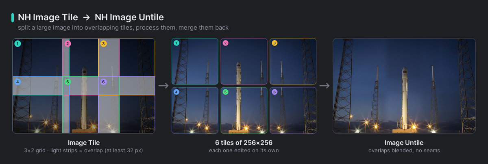<br><em>Một ảnh với lưới ô và vùng chồng lấn, các ô, và ảnh được Image Untile dựng lại.</em></p>

**Ví dụ — upscale theo ô**

```text
Load Image → Image Tile (NH) → Upscale Image (using Model) → Image Untile (NH) → Save Image
Image Tile (NH).tile_data → Image Untile (NH).tile_data
```

Muốn thêm một lượt tăng chi tiết, hãy đặt `VAE Encode → KSampler (denoise thấp) → VAE Decode` giữa hai node ô. Image Untile đọc kích thước của các ô đã xử lý, nên kết quả được phóng theo cùng hệ số với các ô.

**Lỗi thường gặp**

- Không nối `tile_data` thẳng từ Image Tile sang Image Untile, hoặc dùng `tile_data` của một node Image Tile khác.
- Thay đổi số lượng hoặc thứ tự các ô giữa hai node, ví dụ bằng một node lọc batch.
- Cắt (crop) hoặc thêm viền đệm (padding) cho các ô. Phóng to hay thu nhỏ thì được, nhưng mọi ô phải giữ cùng một hình dạng.

> **Mẹo:** Một dải rộng dọc mép phải hoặc mép dưới, nơi hai ô chồng lên nhau nhiều hơn bình thường, được lấy trung bình, và có thể làm mềm chi tiết do model tạo ra. Hãy chọn kích thước sao cho cạnh ảnh bằng kích thước ô cộng với một số nguyên lần (kích thước ô − vùng chồng lấn), ví dụ 1920 px với ô 1024 px.

---

## Image Untile (NH)

<p align="center">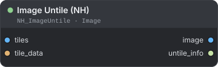</p>

Ghép các ô đã xử lý trở lại thành ảnh đầy đủ, hòa trộn các vùng chồng lấn, dựa trên bố cục từ Image Tile.

**Dùng khi** bạn đã chia ảnh bằng Image Tile và muốn có lại ảnh nguyên vẹn, ở kích thước gốc hoặc đã phóng to.

| Đầu vào | Kiểu | Mặc định | Mô tả |
|---|---|---|---|
| `tiles` | `IMAGE` | — | Các ô đã xử lý, có cùng số lượng và thứ tự mà Image Tile tạo ra. Ô thừa bị bỏ qua. Mọi ô phải cùng kích thước, và có thể cùng được phóng to với một hệ số, như 2× hoặc 3×. |
| `tile_data` | `NH_TILE_DATA` | — | Bố cục từ Image Tile. |

| Đầu ra | Kiểu | Mô tả |
|---|---|---|
| `image` | `IMAGE` | Ảnh đã dựng lại, mỗi ảnh đưa vào Image Tile cho ra một ảnh. |
| `untile_info` | `STRING` | Bản tóm tắt, ví dụ `images=1, tiles=6, scale=2x2, overlap=256x256`. |

**Cách hoạt động**

- **Tỉ lệ phóng.** Node lấy kích thước các ô đã xử lý chia cho kích thước ô gốc, riêng cho chiều rộng và chiều cao. Ô được upscale cho ra ảnh được upscale mà không cần thiết lập thêm. Vùng chồng lấn cũng được nhân tỉ lệ như vậy.
- **Làm mềm biên (feathering).** Trong mỗi dải chồng lấn, các ô kề nhau chuyển dần vào nhau theo một đường dốc tuyến tính rộng bằng vùng chồng lấn. Viền ngoài của ảnh không bị làm mờ dần. Không có thiết lập nào cho việc này.
- **Phần lấp ở mép.** Phần viền đệm mà Image Tile thêm vào ảnh nhỏ được cắt bỏ.
- **Lỗi.** Nếu bạn đưa ít ô hơn cần thiết, node dừng với thông báo `Not enough tiles: got N, expected M`.

**Ví dụ**

```text
Image Tile (NH).tiles → Upscale Image (using Model) → Image Untile (NH).tiles
Image Tile (NH).tile_data → Image Untile (NH).tile_data
```

Một ảnh 2048 × 1536 chia thành 6 ô rồi upscale 2× sẽ trở lại thành 4096 × 3072.

---

## Image Grid Composite (NH)

<p align="center">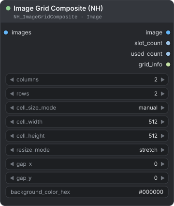</p>

Đặt một batch ảnh vào lưới, tức bảng ảnh (contact sheet), với các ô lưới (cell) cùng kích thước, khoảng cách giữa các ô và màu nền.

**Dùng khi** bạn muốn xem nhiều kết quả cạnh nhau trong một ảnh, hoặc giao một bảng ảnh thu nhỏ.

| Đầu vào | Kiểu | Mặc định | Mô tả |
|---|---|---|---|
| `images` | `IMAGE` | — | Các ảnh cần đặt, từ trái sang phải, từ trên xuống dưới. Nhận một batch, hoặc nhiều batch hay danh sách, và đặt tất cả ảnh vào một chuỗi. |
| `columns` | `INT` | `2` | `1` đến `64`. |
| `rows` | `INT` | `2` | `1` đến `64`. |
| `cell_size_mode` | `COMBO` | `manual` | `manual`: dùng `cell_width` và `cell_height`. `first_image`: mọi ô lưới lấy kích thước của ảnh đầu tiên, hai trường kích thước bị bỏ qua. |
| `cell_width` | `INT` | `512` | `1` đến `16384`. |
| `cell_height` | `INT` | `512` | `1` đến `16384`. |
| `resize_mode` | `COMBO` | `stretch` | Cách ảnh vừa vào ô lưới. `stretch`: lấp đầy ô, làm thay đổi tỉ lệ khung hình. `pad`: giữ tỉ lệ và lấp phần còn lại bằng màu nền. `fill`: giữ tỉ lệ, phủ kín ô và cắt phần thừa đều từ giữa. |
| `gap_x` | `INT` | `0` | `0` đến `4096` px giữa các cột. |
| `gap_y` | `INT` | `0` | `0` đến `4096` px giữa các hàng. |
| `background_color_hex` | `STRING` | `#000000` | Màu của khoảng cách giữa các ô và của vùng `pad`. |

| Đầu ra | Kiểu | Mô tả |
|---|---|---|
| `image` | `IMAGE` | Lưới hoàn chỉnh, một ảnh. |
| `slot_count` | `INT` | `columns` × `rows`. |
| `used_count` | `INT` | Số ảnh đã đặt: giá trị nhỏ hơn giữa số ảnh và `slot_count`. |
| `grid_info` | `STRING` | Bản tóm tắt, rồi mỗi ảnh đã đặt một dòng với vị trí và kích thước. |

**Cách hoạt động**

- Bảng ảnh rộng `columns × cell_width + (columns − 1) × gap_x` và cao `rows × cell_height + (rows − 1) × gap_y`. Không có lề ngoài.
- Ảnh vượt quá `columns × rows` bị bỏ. Ô trống hiện màu nền.
- Kết quả là RGB. Độ trong suốt của đầu vào bị bỏ.
- **Bảo vệ bộ nhớ.** Node cần khoảng 28 byte RAM cho mỗi điểm ảnh của bảng. Nếu bảng không vừa với bộ nhớ trống, node dừng với một thông báo yêu cầu bạn giảm số cột, số hàng, kích thước ô lưới hoặc khoảng cách.

<p align="center">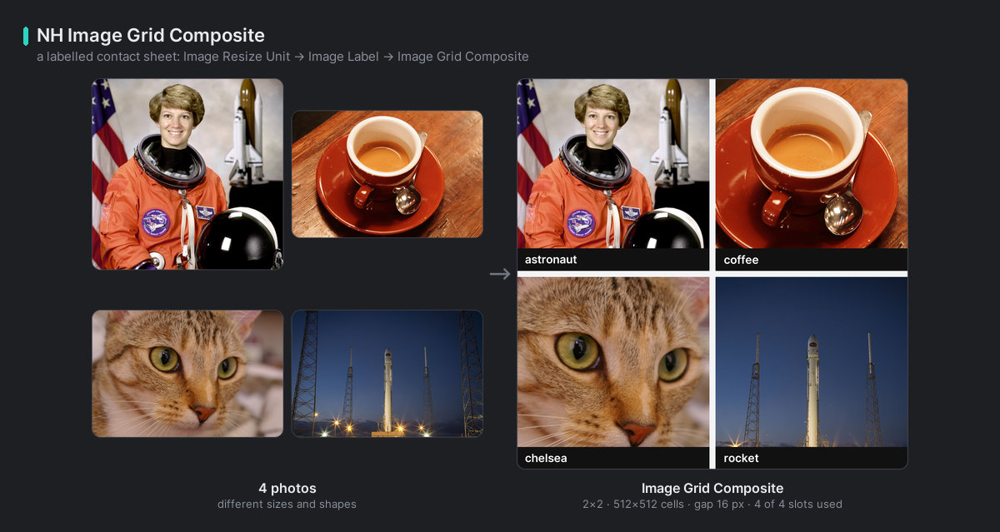<br><em>Bảng ảnh 2 × 2 có nhãn.</em></p>

**Ví dụ — bảng ảnh có nhãn**

```text
4 × Image Label (NH) → Image Batch → Image Grid Composite (NH) → Preview Image
```

Dùng bất kỳ node nào gộp ảnh thành một batch, như `Image Batch` hoặc [Batch Merge (NH)](./batch-lists.md#batch-merge-nh). Đặt `columns` và `rows` là `2`, `resize_mode` là `pad`, và `gap_x`, `gap_y` là `8`.

> **Mẹo:** Với `first_image`, mọi ô lưới lấy kích thước của ảnh đầu tiên. Hãy đặt ảnh có kích thước bạn muốn lên đầu batch.

---

## Layer Layout Composite (NH)

<p align="center">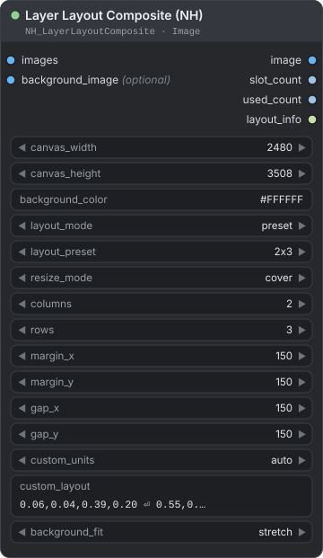</p>

Đặt từng ảnh của một batch vào các khung (slot) của bố cục trang, từ preset, lưới hoặc tọa độ riêng của bạn, trên canvas có kích thước tùy ý.

**Dùng khi** bạn làm poster, tờ ảnh hoặc trang catalogue, như sáu ảnh trên một trang A4.

| Đầu vào | Kiểu | Mặc định | Mô tả |
|---|---|---|---|
| `images` | `IMAGE` | — | Các ảnh cho từng khung. Ảnh 1 vào khung 1, ảnh 2 vào khung 2, và cứ thế. |
| `canvas_width` | `INT` | `2480` | `1` đến `20000` px. Canvas mặc định, 2480 × 3508 px, là một trang A4 ở 300 DPI. |
| `canvas_height` | `INT` | `3508` | `1` đến `20000` px. |
| `background_color` | `STRING` | `#FFFFFF` | Màu canvas. Màu có alpha dưới `FF` (ví dụ `#FFFFFF00`) cho kết quả RGBA trong suốt. |
| `layout_mode` | `COMBO` | `preset` | Nguồn của các khung. `preset`: từ `layout_preset`. `grid`: từ `columns` và `rows`. `custom`: từ `custom_layout`. |
| `layout_preset` | `COMBO` | `2x3` | Preset cho chế độ `preset`. Xem bảng bên dưới. |
| `resize_mode` | `COMBO` | `cover` | Cách ảnh vừa vào khung. `cover`: phủ kín khung và cắt phần thừa từ giữa. `contain`: đặt vừa toàn bộ ảnh, căn giữa, nền ở xung quanh. `stretch`: lấp đầy khung, làm thay đổi tỉ lệ khung hình. |
| `columns` | `INT` | `2` | `1` đến `20`. Dùng ở chế độ `grid`. |
| `rows` | `INT` | `3` | `1` đến `20`. Dùng ở chế độ `grid`. |
| `margin_x` | `INT` | `150` | `0` đến `10000` px khoảng trống ở mép trái và mép phải. |
| `margin_y` | `INT` | `150` | `0` đến `10000` px ở mép trên và mép dưới. |
| `gap_x` | `INT` | `150` | `0` đến `10000` px giữa các khung trong một hàng. |
| `gap_y` | `INT` | `150` | `0` đến `10000` px giữa các khung trong một cột. |
| `custom_units` | `COMBO` | `auto` | Đơn vị của các con số trong `custom_layout`: `auto`, `relative`, `percent` hoặc `pixels`. |
| `custom_layout` | `STRING` | sáu khung theo tỉ lệ | Mỗi dòng một khung. Xem "Bố cục tùy chỉnh" bên dưới. |
| `background_fit` | `COMBO` | `stretch` | Cách `background_image` vừa với canvas: `stretch`, `cover` hoặc `contain`. |
| `background_image` *(tùy chọn)* | `IMAGE` | — | Một ảnh được vẽ lên canvas trước các khung. Chỉ ảnh đầu tiên của batch được dùng. |

| Đầu ra | Kiểu | Mô tả |
|---|---|---|
| `image` | `IMAGE` | Trang hoàn chỉnh, một ảnh. |
| `slot_count` | `INT` | Số khung của bố cục. |
| `used_count` | `INT` | Số khung đã được lấp: giá trị nhỏ hơn giữa số ảnh và `slot_count`. |
| `layout_info` | `STRING` | Mỗi ảnh đã đặt một dòng, ví dụ `0: x=10, y=10, w=323, h=687, mode=contain`. |

**Đầu vào nào có tác dụng ở chế độ nào**

| Đầu vào | `preset` | `grid` | `custom` |
|---|:---:|:---:|:---:|
| `layout_preset` | có | — | — |
| `columns`, `rows` | — | có | — |
| `margin_x`, `margin_y`, `gap_x`, `gap_y` | có | có | — |
| `custom_layout`, `custom_units` | — | — | có |

**Preset**

Lề thu nhỏ vùng dành cho các khung, còn khoảng cách ngăn cách chúng.

| Preset | Số khung | Bố cục |
|---|---|---|
| `2x3` | 6 | 2 cột × 3 hàng, các khung cùng kích thước |
| `2x3_mixed` | 6 | 2 cột × 3 hàng, các hàng cao khoảng 24 %, 24 % và 52 % chiều cao |
| `2_top_1_bottom` | 3 | hai khung cạnh nhau ở trên (khoảng 42 % chiều cao) và một khung rộng ở dưới |
| `1_full` | 1 | một khung phủ kín vùng bên trong lề |
| `2_vertical` | 2 | 1 cột × 2 hàng, xếp chồng lên nhau |
| `2_horizontal` | 2 | 2 cột × 1 hàng, cạnh nhau |
| `3_vertical` | 3 | 1 cột × 3 hàng |
| `4_grid` | 4 | 2 × 2 |

**Bố cục tùy chỉnh**

Viết mỗi khung một dòng theo dạng `x, y, width, height`.

```text
# x, y, width, height, tính theo tỉ lệ so với canvas
0.05, 0.05, 0.90, 0.60     # một ảnh lớn ở trên
0.05, 0.70, 0.43, 0.25     # hai ảnh nhỏ ở dưới
0.52, 0.70, 0.43, 0.25
```

- Ngăn cách các con số bằng dấu phẩy, dấu chấm phẩy hoặc dấu cách. Mọi thứ sau `#` là chú thích. Dòng trống bị bỏ qua.
- Nếu một dòng có nhiều hơn bốn con số, bốn số cuối được dùng, nên bạn có thể bắt đầu dòng bằng số thứ tự của nó.
- Chiều rộng và chiều cao phải lớn hơn 0. Một khung có thể chồng lên khung khác hoặc vượt ra ngoài mép canvas. Phần nằm ngoài bị cắt bỏ.
- Khung *n* nhận ảnh *n*. Ở chế độ này `margin_*` và `gap_*` bị bỏ qua.

| `custom_units` | Các con số có nghĩa là |
|---|---|
| `relative` | Một phần của kích thước canvas, từ `0` đến `1`. |
| `percent` | Phần trăm của kích thước canvas, từ `0` đến `100`. |
| `pixels` | Điểm ảnh. |
| `auto` | `relative` khi mọi con số trong dòng nằm trong khoảng −1 đến 1, ngược lại là `pixels`. `auto` không bao giờ chọn `percent`. |

**Cách hoạt động**

- Nếu bạn đưa nhiều ảnh hơn số khung, ảnh thừa bị bỏ. Nếu ít hơn, các khung trống để lộ canvas.
- Ảnh có kênh alpha được dán cùng độ trong suốt của chính nó, nên canvas lộ ra bên dưới. `background_image` dạng RGBA cũng vậy: vùng trong suốt của nó để lộ `background_color`.
- Kết quả là RGB. Chỉ khi `background_color` có alpha dưới `FF` thì kết quả mới là RGBA.

<p align="center">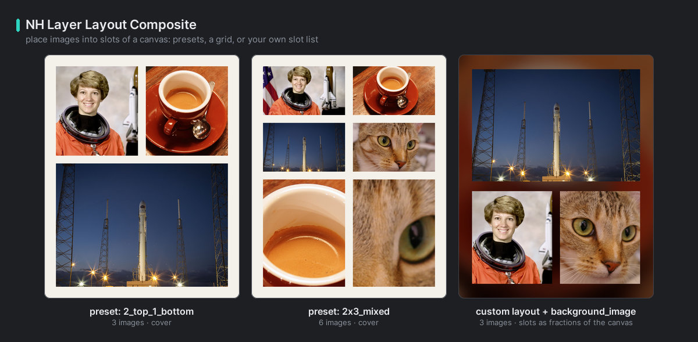<br><em>Một trang được dựng bằng Layer Layout Composite.</em></p>

**Ví dụ — sáu ảnh trên một trang A4**

```text
Image Batch (6 ảnh) → Layer Layout Composite (NH) → Save Image Path (NH)
```

Giữ nguyên giá trị mặc định: `preset`, `2x3`, `cover`, lề và khoảng cách 150 px. Trong Save Image Path, đặt `dpi` là `300` để trang in ra đúng cỡ A4.

> **Mẹo:** Dùng `contain` khi không được cắt bất kỳ phần nào của ảnh, và `cover` khi một khung đầy trông đẹp hơn một ảnh nguyên vẹn.

---

## Layer Stack Composite (NH)

<p align="center">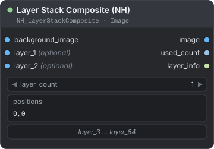</p>

Dán tối đa 64 lớp (layer) lên một ảnh nền. Bạn viết mỗi vị trí bằng con số hoặc công thức.

**Dùng khi** bạn đặt logo, watermark hoặc sticker đúng vị trí. Một vị trí có thể phụ thuộc vào kích thước của ảnh nền hay của một lớp khác, như "căn giữa" hoặc "góc dưới bên phải, cách mép 40 px".

| Đầu vào | Kiểu | Mặc định | Mô tả |
|---|---|---|---|
| `background_image` | `IMAGE` | — | Ảnh nền. Chỉ ảnh đầu tiên của batch được dùng. Kết quả có kích thước của nó. |
| `layer_count` | `INT` | `1` | `0` đến `64`. Số lớp cần đặt. Node hiển thị đúng ngần ấy đầu vào `layer_N`. |
| `positions` | `STRING` | `0,0` | Mỗi lớp một dòng: `x, y` tính bằng điểm ảnh từ góc trên bên trái. Cho phép dùng công thức. Xem bên dưới. |
| `layer_1` … `layer_64` *(tùy chọn)* | `IMAGE` | — | Các lớp. Chỉ ảnh đầu tiên của mỗi đầu vào được dùng. `layer_1` được dán trước, nên số càng cao thì nằm càng trên. |

| Đầu ra | Kiểu | Mô tả |
|---|---|---|
| `image` | `IMAGE` | Ảnh nền với các lớp đã dán lên. |
| `used_count` | `INT` | Số lớp đã dán, tức là nằm ít nhất một phần trong ảnh. |
| `layer_info` | `STRING` | Mỗi lớp một dòng: vị trí và kích thước, hoặc `missing` khi chưa nối ảnh, hoặc `outside canvas`. |

**Viết vị trí**

Mỗi dòng là một lớp: dòng 1 là `layer_1`, dòng 2 là `layer_2`, và cứ thế. Mỗi dòng có một công thức x và một công thức y, ngăn cách bằng dấu phẩy hoặc dấu chấm phẩy. Dòng trống và chú thích `#` không được tính. Lớp không có dòng nào sẽ ở `0, 0`.

```text
(a - w1) / 2, (b - h1) / 2     # lớp 1, căn giữa
x1 + w1 + 20, y1               # lớp 2, nằm bên phải lớp 1 và cách 20 px
a - w3 - 40, b - h3 - 40       # lớp 3, góc dưới bên phải, cách mép 40 px
```

Công thức dùng số, dấu ngoặc, `+ - * / // % **` và dấu trừ đứng đầu. Số thập phân dùng dấu chấm. Không có các hàm như `min` hay `max`, và `^` không phải phép lũy thừa (hãy dùng `**`). Kết quả được làm tròn thành số nguyên điểm ảnh. Chia cho 0 là lỗi.

| Biến | Giá trị |
|---|---|
| `a`, `bg_w`, `width` | Chiều rộng của ảnh nền. |
| `b`, `bg_h`, `height` | Chiều cao của ảnh nền. |
| `w1`, `w2`, … | Chiều rộng của lớp 1, 2, …. Bằng `0` khi lớp đó chưa có ảnh. |
| `h1`, `h2`, … | Chiều cao của lớp 1, 2, …. |
| `x1`, `y1`, `x2`, … | Vị trí đã tính cho một dòng phía trên. Một dòng chỉ dùng được các dòng nằm trên nó. |

Tên biến không phân biệt chữ hoa chữ thường. Công thức mà node không đọc được sẽ làm lần chạy dừng với thông báo `Invalid position expression` kèm nội dung công thức.

**Cách hoạt động**

- Phần của lớp nằm ngoài ảnh bị cắt bỏ. Lớp nằm hoàn toàn bên ngoài không được dán, và `layer_info` ghi `outside canvas`.
- Lớp có kênh alpha được dán cùng độ trong suốt của chính nó. Kết quả có số kênh của ảnh nền: RGB vẫn là RGB, còn ảnh nền RGBA cho kết quả RGBA.
- Node chỉ hiển thị các đầu vào đến `layer_count`. Khi bạn giảm `layer_count`, các đầu vào phía trên nó, cùng các liên kết của chúng, bị gỡ đi. Nút **update layers** trên node làm mới các đầu vào, ví dụ sau khi bạn mở một workflow.
- Kết quả được giữ trong bộ nhớ đệm (cache) như ở mọi node khác: node chỉ chạy lại khi ảnh nền, một layer, `layer_count` hoặc `positions` thay đổi.

**Ví dụ — watermark ở góc dưới bên phải**

```text
Load Image (ảnh).image → Layer Stack Composite (NH).background_image
Load Image (logo).image + .mask → Join Image with Alpha → Layer Stack Composite (NH).layer_1
```

Đặt `layer_count` là `1` và `positions` là `a - w1 - 40, b - h1 - 40`.

> **Lưu ý:** Load Image cho ảnh ở dạng RGB và độ trong suốt ở một `MASK` riêng. Để dán logo có vùng trong suốt, hãy ghép hai thứ lại bằng node gốc `Join Image with Alpha`, như ở trên. Cách này cũng dùng được với các đầu ra `image` và `mask` của [Load Image Info (NH)](./image-io.md#load-image-info-nh).

**Lỗi thường gặp**

- Đổi `layer_count` nhưng không nối các đầu vào mới. Các lớp thừa hiện `missing` trong `layer_info`.
- Mong đợi một batch các lớp. Chỉ ảnh đầu tiên của mỗi đầu vào được dùng.
- Viết công thức với `min()` hoặc `^`. Hãy viết lại bằng các toán tử nêu trên.

---

## Image Compare (NH)

<p align="center">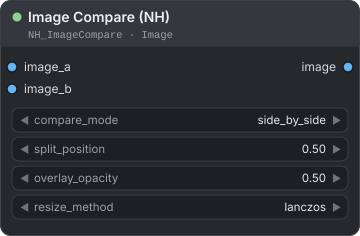</p>

Gộp hai ảnh thành một ảnh để so sánh: cạnh nhau, xếp chồng, chia đôi, hòa trộn, hoặc theo độ chênh lệch.

**Dùng khi** bạn muốn có ảnh trước và sau, hoặc muốn thấy chính xác một bước đã thay đổi điều gì.

| Đầu vào | Kiểu | Mặc định | Mô tả |
|---|---|---|---|
| `image_a` | `IMAGE` | — | Ảnh thứ nhất. Nó quyết định kích thước của kết quả. |
| `image_b` | `IMAGE` | — | Ảnh thứ hai. Nó được đổi kích thước về kích thước của `image_a`. |
| `compare_mode` | `COMBO` | `side_by_side` | Cách gộp hai ảnh. Xem bảng bên dưới. |
| `split_position` | `FLOAT` | `0.5` | `0` đến `1`, bước 0.01. Vị trí đường chia ở hai chế độ `split_*`. |
| `overlay_opacity` | `FLOAT` | `0.5` | `0` đến `1`, bước 0.01. Mức hòa trộn ở chế độ `overlay`: `0` chỉ hiện A, `1` chỉ hiện B. |
| `resize_method` | `COMBO` | `lanczos` | Cách đổi kích thước `image_b` về `image_a`: `lanczos`, `bicubic`, `bilinear` hoặc `nearest`. |

| Đầu ra | Kiểu | Mô tả |
|---|---|---|
| `image` | `IMAGE` | Ảnh đã gộp. |

| `compare_mode` | Kết quả |
|---|---|
| `side_by_side` | A bên trái, B bên phải. Rộng gấp đôi A. |
| `top_bottom` | A ở trên, B ở dưới. Cao gấp đôi A. |
| `split_vertical` | Một ảnh chia bởi đường dọc: A ở bên trái `split_position`, B ở bên phải. |
| `split_horizontal` | Một ảnh chia bởi đường ngang: A ở trên `split_position`, B ở dưới. |
| `difference` | Giá trị tuyệt đối của hiệu A và B ở từng kênh. Màu đen ở nơi hai ảnh giống nhau. |
| `overlay` | A và B hòa trộn theo `overlay_opacity`. |

**Cách hoạt động**

- **Batch.** Nếu hai batch cùng kích thước, ảnh *n* của A được so với ảnh *n* của B. Nếu một batch chỉ có một ảnh, ảnh đó được lặp cho mọi ảnh của batch kia. Nếu không, cả hai bị cắt về độ dài ngắn hơn, và console hiện một thông báo.
- Kết quả là RGB. Độ trong suốt bị bỏ.

<p align="center">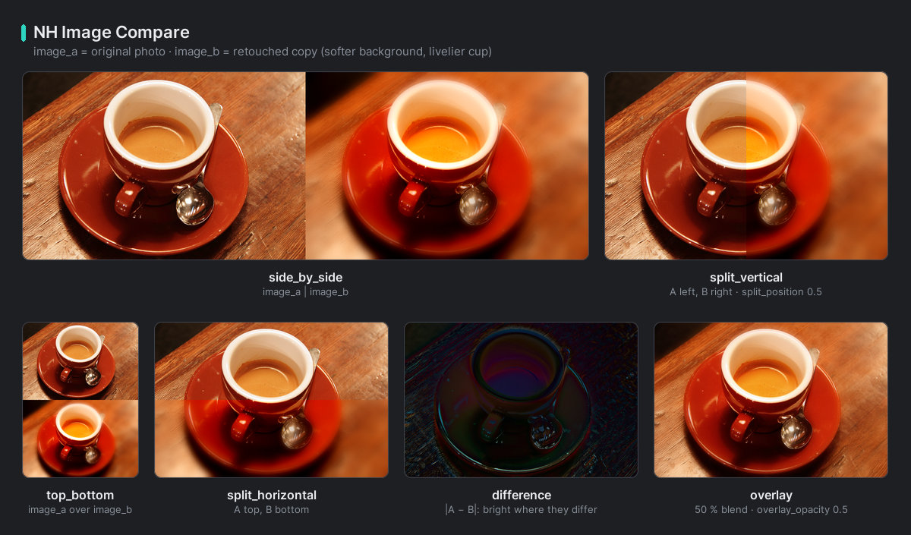<br><em>Đầu ra của Image Compare.</em></p>

**Ví dụ — trước và sau**

```text
Load Image → Image Compare (NH).image_a
KSampler → VAE Decode → Image Compare (NH).image_b
Image Compare (NH) → Preview Image
```

Đặt `compare_mode` là `split_vertical` và `split_position` là `0.5`.

> **Mẹo:** Chế độ chênh lệch không được khuếch đại, nên một thay đổi nhỏ trông gần như đen. Hãy dùng `overlay` hoặc chia đôi để đánh giá những thay đổi tinh tế. Với ảnh hàng chục megapixel, hãy dùng [NH Large Image Compare](./image-preview.md#nh-large-image-compare).

---

## Image Label (NH)

<p align="center">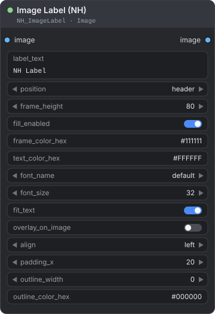</p>

Thêm một dải chữ phía trên hoặc phía dưới ảnh, hoặc viết chữ đè lên ảnh, với lựa chọn phông chữ, màu sắc và viền chữ.

**Dùng khi** bạn muốn chú thích cho bảng ảnh, gắn thẻ "before" và "after" cho ảnh so sánh, hoặc in tên model hay seed lên kết quả.

| Đầu vào | Kiểu | Mặc định | Mô tả |
|---|---|---|---|
| `image` | `IMAGE` | — | Ảnh hoặc batch cần gắn nhãn. Mọi ảnh nhận cùng một nhãn. |
| `label_text` | `STRING` | `NH Label` | Nội dung chữ. Xuống dòng để viết nhiều dòng. |
| `position` | `COMBO` | `header` | `header`: ở trên cùng. `bottom`: ở dưới cùng. |
| `frame_height` | `INT` | `80` | `1` đến `4096`. Chiều cao dải chữ, tính bằng điểm ảnh. Hãy đặt cao hơn chữ. |
| `fill_enabled` | `BOOLEAN` | `true` | `true`: tô dải bằng `frame_color_hex`. `false`: tạo dải từ hàng điểm ảnh trên cùng (header) hoặc dưới cùng (bottom) của ảnh, kéo giãn ra, để dải hòa vào ảnh. |
| `frame_color_hex` | `STRING` | `#111111` | Màu dải chữ. |
| `text_color_hex` | `STRING` | `#FFFFFF` | Màu chữ. |
| `font_name` | `COMBO` | `default` | `default`, hoặc một tệp phông chữ trong thư mục `Fonts` của Windows. Trên hệ điều hành khác chỉ có `default`. `default` dùng Arial nếu có, nếu không thì dùng phông chữ tích hợp của Pillow. |
| `font_size` | `INT` | `32` | `6` đến `512`. |
| `fit_text` | `BOOLEAN` | `true` | Thu nhỏ chữ, xuống tới cỡ 8, cho đến khi vừa với chiều rộng ảnh trừ hai lề `padding_x`. Chữ không bao giờ tự xuống dòng. |
| `overlay_on_image` | `BOOLEAN` | `false` | `false`: thêm dải ra bên ngoài, nên ảnh cao thêm `frame_height`. `true`: vẽ dải đè lên mép ảnh và giữ nguyên kích thước. |
| `align` | `COMBO` | `left` | `left`, `center` hoặc `right`. |
| `padding_x` | `INT` | `20` | `0` đến `2048` px khoảng trống ở bên trái và bên phải chữ. |
| `outline_width` | `INT` | `0` | `0` đến `32` px. Độ dày đường viền quanh chữ. |
| `outline_color_hex` | `STRING` | `#000000` | Màu viền chữ. |

| Đầu ra | Kiểu | Mô tả |
|---|---|---|
| `image` | `IMAGE` | Ảnh đã gắn nhãn, ở dạng RGB. |

**Cách hoạt động**

- Chữ được căn giữa theo chiều dọc trong dải. Nếu dải thấp hơn chữ, chữ sẽ tràn ra khỏi dải.
- Khi `overlay_on_image` bật, dải che một phần ảnh. Chiều cao của dải bị giới hạn bằng chiều cao ảnh.
- Danh sách phông chữ được đọc khi ComfyUI khởi động. Hãy khởi động lại ComfyUI sau khi cài thêm phông chữ.

<p align="center">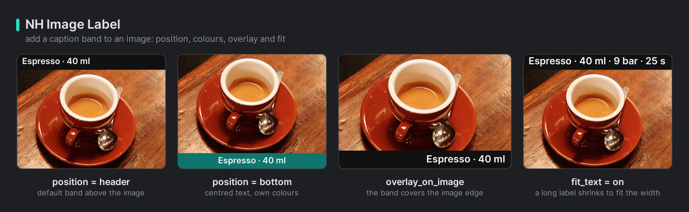<br><em>Đầu ra của Image Label.</em></p>

**Ví dụ — gắn thẻ cho một kết quả**

```text
VAE Decode → Image Label (NH) → Preview Image
```

Đặt `label_text` là `After`, `position` là `bottom`, `align` là `center` và `outline_width` là `2`.

> **Mẹo:** Để in chữ lấy từ nơi khác trong workflow, như một tên tệp, hãy nối một đầu ra `STRING` vào `label_text`.

---

## Image Resize Unit (NH)

<p align="center">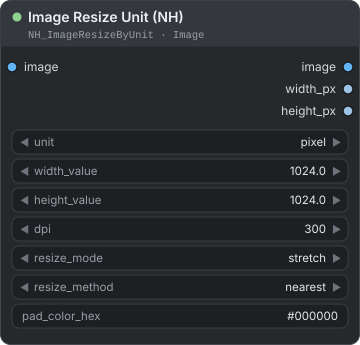</p>

Đổi kích thước ảnh theo chiều rộng và chiều cao tính bằng điểm ảnh, milimét hoặc centimét. Giá trị DPI dùng để quy đổi đơn vị vật lý ra điểm ảnh.

**Dùng khi** kết quả cần có cỡ in, như A4 hoặc 10 × 15 cm, hoặc khi bạn muốn đặt một cạnh và để cạnh còn lại tự theo.

| Đầu vào | Kiểu | Mặc định | Mô tả |
|---|---|---|---|
| `image` | `IMAGE` | — | Ảnh hoặc batch cần đổi kích thước. |
| `unit` | `COMBO` | `pixel` | Đơn vị của `width_value` và `height_value`: `pixel`, `mm` hoặc `cm`. |
| `width_value` | `FLOAT` | `1024.0` | `0` đến `100000`, bước 0.1. Chiều rộng đích theo `unit`. `0` nghĩa là tính từ chiều cao và giữ tỉ lệ khung hình. |
| `height_value` | `FLOAT` | `1024.0` | `0` đến `100000`, bước 0.1. Chiều cao đích. `0` nghĩa là tính từ chiều rộng. |
| `dpi` | `INT` | `300` | `1` đến `2400`. Chỉ dùng cho `mm` và `cm`. Số điểm ảnh = kích thước ÷ 25.4 × `dpi` với milimét, kích thước ÷ 2.54 × `dpi` với centimét. |
| `resize_mode` | `COMBO` | `stretch` | Cách ảnh đạt tới kích thước đích. Xem bảng bên dưới. |
| `resize_method` | `COMBO` | `nearest` | Bộ lọc lấy mẫu lại: `nearest`, `bilinear`, `bicubic`, `area`, `nearest-exact` hoặc `lanczos`. |
| `pad_color_hex` | `STRING` | `#000000` | Màu viền đệm cho `pad`. Phần alpha áp dụng cho ảnh RGBA. |

| Đầu ra | Kiểu | Mô tả |
|---|---|---|
| `image` | `IMAGE` | Ảnh đã đổi kích thước. |
| `width_px` | `INT` | Chiều rộng thực, tính bằng điểm ảnh. |
| `height_px` | `INT` | Chiều cao thực, tính bằng điểm ảnh. |

| `resize_mode` | Kết quả |
|---|---|
| `stretch` | Đúng width × height. Tỉ lệ khung hình thay đổi nếu hình dạng khác nhau. |
| `pad` | Toàn bộ ảnh nằm vừa bên trong, căn giữa, trên canvas đúng width × height được tô bằng `pad_color_hex`. |
| `crop` | Ảnh phủ kín kích thước đích, phần thừa được cắt đều từ giữa. Kích thước đúng width × height. |
| `lock_ratio` | Giữ tỉ lệ khung hình và ảnh nằm vừa bên trong width × height. Một cạnh có thể nhỏ hơn yêu cầu. |

**Cách hoạt động**

- Nếu cả `width_value` và `height_value` là `0`, ảnh giữ nguyên kích thước.
- `nearest` và `nearest-exact` cho cùng một kết quả.
- `dpi` ở đây chỉ dùng để quy đổi đơn vị. Để lưu giá trị DPI vào tệp PNG hoặc JPG, hãy đặt `dpi` trong [Save Image Path (NH)](./image-io.md#save-image-path-nh).

Ví dụ với ảnh 800 × 600:

| Thiết lập | Kết quả |
|---|---|
| `mm`, 210 × 297, `dpi` 300, `stretch`, `pad` hoặc `crop` | 2480 × 3508 px (A4) |
| `cm`, 10 × 15, `dpi` 300, `lock_ratio` | 1181 × 886 px |
| `pixel`, 1024 × 0, `stretch` | 1024 × 768 px |
| `pixel`, 0 × 0 | 800 × 600 px |

**Ví dụ — một trang A4**

```text
Load Image → Image Resize Unit (NH) → Save Image Path (NH)
```

Đặt `unit` là `mm`, `width_value` là `210`, `height_value` là `297`, `dpi` là `300` và `resize_mode` là `pad`. Trong Save Image Path, đặt `dpi` là `300`.

> **Mẹo:** `resize_method` mặc định là `nearest`: nhanh và giữ nguyên cạnh sắc. Với ảnh chụp, hãy chọn `lanczos` hoặc `bicubic`. Để đổi kích thước theo model, xem [Resolution](./resolution.md).

---

**Xem thêm:** [Image — Load and Save](./image-io.md) để lưu kết quả, [Image — Mask-Based Retouch](./image-retouch.md) cho các node theo mask, và [Resolution](./resolution.md) để đổi kích thước theo model.

[← Về trang hướng dẫn](./README.md)
