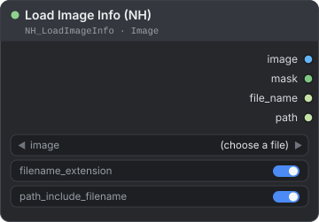
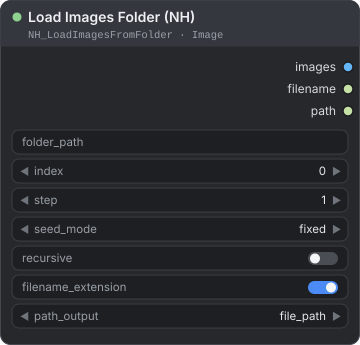
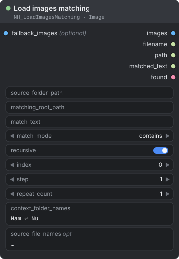
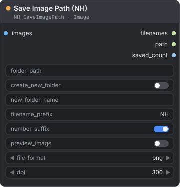
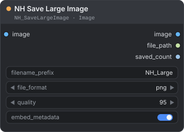

[← Về trang hướng dẫn](./README.md)

# Image — Load and Save (tải và lưu ảnh)

Các node này đưa ảnh vào và ra khỏi workflow. Bạn có thể tải một ảnh cùng tên tệp và đường dẫn của nó, duyệt qua một thư mục mỗi lần chạy một ảnh, lấy ảnh từ thư mục khớp theo tên, và lưu kết quả vào thư mục và tên tệp do bạn chọn. Một node còn lưu được ảnh rất lớn mà không đẩy bản xem trước nặng lên canvas. Bạn tìm chúng trong menu node tại **NH-Nodes → Image**.

**Nội dung trang**

| Node | Dùng để |
|---|---|
| [Load Image Info (NH)](#load-image-info-nh) | Tải một ảnh và lấy tên tệp, đường dẫn của nó dưới dạng văn bản |
| [Load Images Folder (NH)](#load-images-folder-nh) | Tải ảnh từ thư mục theo vị trí, và chuyển sang ảnh kế tiếp sau mỗi lần chạy |
| [Load images matching](#load-images-matching) | Tìm thư mục khớp với tên một đối tượng và tải ảnh của nó |
| [Save Image Path (NH)](#save-image-path-nh) | Lưu vào thư mục bất kỳ với tiền tố, cách đánh số, định dạng và DPI do bạn chọn |
| [NH Save Large Image](#nh-save-large-image) | Lưu ảnh rất lớn mà không có bản xem trước nặng trên canvas |

## Đường dẫn và loại tệp

| Vị trí | Đường dẫn tương đối bắt đầu từ |
|---|---|
| `folder_path` của Load Images Folder, `matching_root_path` và `source_folder_path` của Load images matching | thư mục `input` của ComfyUI |
| `folder_path` của Save Image Path | thư mục `output` của ComfyUI |
| NH Save Large Image | luôn là thư mục `output` của ComfyUI |

Các loader thư mục đọc tệp `.png`, `.jpg`, `.jpeg`, `.webp`, `.avif`, `.bmp`, `.tif` và `.tiff`. Chúng sắp xếp tên theo thứ tự tự nhiên, nên `img2` đứng trước `img10`, và trả về ảnh RGB.

---

## Load Image Info (NH)

<p align="center"></p>

Tải một ảnh từ thư mục `input` của ComfyUI, giống node Load Image có sẵn, và trả thêm tên tệp cùng đường dẫn dưới dạng văn bản.

**Dùng khi** bạn muốn đặt tên hoặc điều hướng kết quả theo tệp nguồn, hoặc ghi lại lần chạy đã dùng tệp nào.

| Đầu vào | Kiểu | Mặc định | Mô tả |
|---|---|---|---|
| `image` | `COMBO` | — | Ảnh cần tải. Liệt kê các tệp ảnh trong thư mục `input`. Dùng nút upload để thêm ảnh. |
| `filename_extension` | `BOOLEAN` | `true` | `true`: `file_name` giữ phần mở rộng. `false`: bỏ phần mở rộng. |
| `path_include_filename` | `BOOLEAN` | `true` | `true`: `path` là đường dẫn đầy đủ của tệp. `false`: `path` chỉ là thư mục chứa tệp. |

| Đầu ra | Kiểu | Mô tả |
|---|---|---|
| `image` | `IMAGE` | Ảnh RGB. Các khung hình của tệp động (GIF, WebP) trở thành một batch (lô ảnh). |
| `mask` | `MASK` | Tạo từ độ trong suốt của tệp: điểm ảnh đục là `0`, điểm ảnh trong suốt là `1`, giống Load Image. Toàn bộ là `0` nếu tệp không có độ trong suốt. |
| `file_name` | `STRING` | Tên tệp. |
| `path` | `STRING` | Đường dẫn đầy đủ, hoặc chỉ thư mục. Xem `path_include_filename`. |

**Cách hoạt động**

- Cách tải giống Load Image của ComfyUI. Node áp dụng việc xoay theo EXIF. Với ảnh động, các khung hình có kích thước khác khung đầu tiên bị bỏ qua. Với tệp MPO, chỉ dùng khung đầu tiên.
- `image` không giữ độ trong suốt. Thông tin này nằm ở `mask`.
- Node chạy lại khi nội dung tệp thay đổi, nên bạn có thể sửa và lưu đè ảnh ngay tại chỗ.

**Ví dụ — đặt tên kết quả theo tệp nguồn**

```text
Load Image Info (NH).image → … workflow của bạn … → Save Image Path (NH).images
Load Image Info (NH).file_name → Save Image Path (NH).filename_prefix
```

Đặt `filename_extension` là `false` để tiền tố không kết thúc bằng `.png`.

> **Mẹo:** Đặt `path_include_filename` là `false` và nối `path` vào `folder_path` của Save Image Path để lưu kết quả vào cùng thư mục với ảnh nguồn.

---

## Load Images Folder (NH)

<p align="center"></p>

Tải một hoặc nhiều ảnh từ một thư mục theo vị trí, và có thể chuyển sang ảnh kế tiếp sau mỗi lần chạy.

**Dùng khi** bạn muốn chạy workflow trên từng ảnh của một thư mục, mỗi lần một ảnh (ví dụ upscale cả thư mục), hoặc tải vài ảnh liên tiếp thành một batch.

| Đầu vào | Kiểu | Mặc định | Mô tả |
|---|---|---|---|
| `folder_path` | `STRING` | trống | Thư mục cần đọc. Có thể là đường dẫn tuyệt đối, hoặc tương đối so với thư mục `input`. Để trống nghĩa là thư mục `input`. Nếu đường dẫn trỏ tới một tệp, node dùng thư mục chứa tệp đó. |
| `index` | `INT` | `0` | Vị trí của ảnh đầu tiên cần tải, từ `0` đến `999999`. Giá trị này quay vòng: với 10 ảnh, `12` tải ảnh số `2`. |
| `step` | `INT` | `1` | Số ảnh tải mỗi lần chạy (`1` đến `9999`), lấy nối tiếp nhau từ `index`. Đây cũng là khoảng `index` di chuyển giữa các lần chạy ở chế độ `increment` và `decrement`. |
| `seed_mode` | `COMBO` | `fixed` | Điều gì xảy ra với `index` mỗi lần bạn queue: `fixed` (giữ nguyên), `increment` (cộng thêm `step`), `decrement` (trừ đi `step`; các ảnh cũng được đọc lùi), `random` (một vị trí ngẫu nhiên mới). |
| `recursive` | `BOOLEAN` | `false` | Đọc cả ảnh trong các thư mục con. |
| `filename_extension` | `BOOLEAN` | `true` | Giữ phần mở rộng trong `filename`. |
| `path_output` | `COMBO` | `file_path` | `path` liệt kê gì: `file_path` (đường dẫn đầy đủ của từng tệp) hoặc `folder_path` (thư mục chứa từng tệp). |

| Đầu ra | Kiểu | Mô tả |
|---|---|---|
| `images` | `IMAGE` | Các ảnh đã tải, gộp thành một batch. Nếu kích thước khác nhau, mọi ảnh được đổi về kích thước của ảnh đầu tiên. |
| `filename` | `STRING` | Tên tệp, mỗi tên một dòng, theo thứ tự tải. |
| `path` | `STRING` | Đường dẫn, mỗi đường dẫn một dòng. |

**Cách hoạt động**

- Nếu thư mục không có ảnh nào ở cấp của nó, các thư mục con vẫn được tìm kể cả khi `recursive` tắt. Việc tìm trong thư mục con bỏ qua thư mục `models` của ComfyUI.
- Trình duyệt di chuyển `index` khi bạn queue workflow từ giao diện ComfyUI. Trình duyệt đếm ảnh theo đúng thiết lập `recursive` của node, nên `increment`, `decrement` và `random` quay vòng và chọn trên đúng những ảnh mà node tải. Nếu bạn gửi workflow qua API, hãy tự đặt `index`.
- Node chạy lại khi một trong các tệp được chọn thay đổi trên ổ đĩa (tên, dung lượng hoặc ngày giờ). Nếu `folder_path` được nối từ một node khác, node không thể kiểm tra các tệp từ trước: khi đó nó chạy lại khi đường dẫn được nối hoặc một thiết lập khác thay đổi, nhưng không chạy lại khi một tệp trong cùng thư mục thay đổi.
- Thư mục không tồn tại, hoặc không có ảnh nào, sẽ làm lần chạy dừng với một thông báo lỗi.

**Ví dụ — upscale cả thư mục**

```text
Load Images Folder (NH) → Upscale Image (using Model) → Save Image Path (NH)
```

Đặt `seed_mode` là `increment` và `step` là `1`. Mỗi lần queue tải tệp kế tiếp. Khi `index` vượt qua ảnh cuối, nó quay lại từ ảnh đầu.

> **Mẹo:** `step` là `4` với `fixed` tải cùng bốn ảnh ở mọi lần chạy. Với `increment`, mỗi lần chạy tiến thêm bốn ảnh.

---

## Load images matching

<p align="center"></p>

Tìm thư mục trong một thư mục gốc có tên khớp với một đối tượng, rồi tải ảnh của thư mục đó. Đối tượng lấy từ thư mục nguồn của bạn, hoặc từ văn bản bạn nhập.

**Dùng khi** ảnh khớp của bạn được xếp thành thư mục theo từng đối tượng, và bạn muốn node tự chọn thư mục tương ứng với nguồn hiện tại. Cách này hợp với thư viện chia theo nhóm, ví dụ `Nam` và `Nu`, mỗi nhóm có một thư mục cho từng người:

```text
matching_root_path
├── Nam
│   ├── subject_01
│   └── subject_02
└── Nu
    ├── subject_01     ← được tải khi đường dẫn nguồn kết thúc bằng …/Nu/subject_01
    └── subject_02
```

| Đầu vào | Kiểu | Mặc định | Mô tả |
|---|---|---|---|
| `source_folder_path` | `STRING` | trống | Thư mục nguồn của đối tượng. Chỉ **tên** các thư mục trong đường dẫn được dùng, nên thư mục không cần tồn tại. Tên cuối cùng là văn bản cần khớp, trừ khi bạn điền `match_text`. Một thư mục ngữ cảnh trong đường dẫn (xem `context_folder_names`) cho node biết nên ưu tiên nhánh nào. |
| `matching_root_path` | `STRING` | trống | Thư mục gốc của cây thư mục cần tìm. Đường dẫn tuyệt đối, hoặc tương đối so với thư mục `input`. Bắt buộc. |
| `match_text` | `STRING` | trống | Tên thư mục cần tìm. Để trống nghĩa là dùng tên của thư mục nguồn. |
| `match_mode` | `COMBO` | `contains` | `contains`: tên thư mục chứa văn bản. `exact`: tên thư mục bằng đúng văn bản. Cả hai đều bỏ qua chữ hoa/thường và dấu, và coi `_` và `-` như dấu cách. |
| `recursive` | `BOOLEAN` | `true` | `true`: tìm trong mọi thư mục dưới thư mục gốc. `false`: chỉ xem thư mục gốc và các thư mục con trực tiếp của nó. |
| `index` | `INT` | `0` | Vị trí của ảnh đầu tiên trong thư mục khớp, từ `0` đến `999999`. Giá trị này quay vòng. |
| `step` | `INT` | `1` | Số ảnh tải từ thư mục khớp (`1` đến `9999`), lấy nối tiếp nhau từ `index`. |
| `repeat_count` | `INT` | `1` | Lặp lại các ảnh đã tải số lần này trong batch đầu ra (`1` đến `9999`). Các đầu ra văn bản không bị lặp. |
| `context_folder_names` | `STRING` | `Nam` và `Nu`, mỗi tên một dòng | Tên các thư mục ngữ cảnh. Ngăn cách các tên bằng xuống dòng, dấu phẩy, dấu chấm phẩy hoặc dấu gạch đứng. Hãy thay giá trị mặc định bằng tên nhóm trong thư viện của bạn. |
| `source_file_names` *(tùy chọn)* | `STRING` | trống | Mỗi dòng là một đường dẫn tệp nguồn. Mỗi dòng là một mục cần khớp: văn bản cần khớp là tên thư mục chứa tệp (trừ khi bạn đặt `match_text`), và đường dẫn của nó cung cấp ngữ cảnh. Dùng khi muốn tải ảnh khớp cho nhiều đối tượng cùng lúc. |
| `fallback_images` *(tùy chọn)* | `IMAGE` | — | Ảnh dùng khi không tìm thấy gì. Chúng chỉ được tính khi không khớp, nên các node cấp ảnh cho đầu vào này không chạy khi có thư mục khớp. Xem "Khi không tìm thấy gì". |

| Đầu ra | Kiểu | Mô tả |
|---|---|---|
| `images` | `IMAGE` | Các ảnh đã tải, gộp thành một batch. Nếu kích thước khác nhau, mọi ảnh được đổi về kích thước của ảnh đầu tiên. Khi không tìm thấy gì, đầu ra này mang `fallback_images` nếu đầu vào đó được nối, còn không thì bị chặn (xem "Khi không tìm thấy gì"). |
| `filename` | `STRING` | Tên tệp, mỗi tên một dòng, mỗi ảnh đã tải một dòng. |
| `path` | `STRING` | Thư mục khớp của từng ảnh đã tải, mỗi thư mục một dòng. |
| `matched_text` | `STRING` | Văn bản đã tìm, mỗi ảnh đã tải một dòng. |
| `found` | `BOOLEAN` | `true` khi mọi mục đều tìm được thư mục có ảnh. Ngược lại là `false`, kể cả khi `fallback_images` cung cấp ảnh. |

**Cách hoạt động**

- **Văn bản cần khớp:** `match_text`; nếu trống thì lấy tên thư mục chứa từng dòng của `source_file_names`; nếu cũng trống thì lấy tên thư mục nguồn. Hãy điền ít nhất một trong ba: `source_folder_path`, `source_file_names`, `match_text`. Nếu bỏ trống cả ba, node tìm theo tên thư mục `input` của ComfyUI, tên này hiếm khi khớp.
- **Ngữ cảnh:** nếu đường dẫn nguồn chứa một trong các `context_folder_names`, kết quả cùng ngữ cảnh được xếp lên đầu. Nguồn ở `…/Nu/subject_01` sẽ chọn `Nu/subject_01` trước `Nam/subject_01`. Nếu thư mục gốc của bạn nằm trong một thư mục ngữ cảnh (`…/Nam`) còn nguồn thuộc ngữ cảnh khác (`Nu`), node cũng tìm đúng vị trí đó dưới thư mục ngữ cảnh còn lại.
- **Khi ngang nhau:** thư mục có đường dẫn giống đường dẫn nguồn nhất thắng, rồi đến thứ tự tên tự nhiên.
- **Giới hạn:** việc tìm kiếm nằm trong thư mục gốc. Node không quét các thư mục cha, ngoại trừ các thư mục ngữ cảnh anh em đã nêu ở trên, và không bao giờ vào thư mục `models` của ComfyUI. Khi `recursive` bật, node từ chối thư mục gốc là một ổ đĩa hoặc một chia sẻ mạng (như `D:\` hay `\\server\share`): không thể tìm đệ quy ở đó. Thư mục `models` cũng bị từ chối làm thư mục gốc, dù `recursive` đặt thế nào.
- **Tệp:** ảnh trong thư mục khớp được sắp xếp theo thứ tự tự nhiên. `index` và `step` chọn ảnh nào được tải.
- **Bộ nhớ đệm:** kết quả được dùng lại cho đến khi thư mục khớp hoặc một trong các tệp được chọn thay đổi (tên, dung lượng hoặc ngày giờ). Lần tìm không thấy gì không bao giờ được ghi nhớ, nên thư mục bạn thêm sau đó sẽ được tìm thấy ở lần chạy kế tiếp. Nếu một thiết lập được nối từ node khác, node không biết trước thư mục nào. Khi đó nó theo dõi cả cây thư mục dưới thư mục gốc, và với cây rất lớn thì chạy lại ở mọi lần queue.

**Khi không tìm thấy gì**

> **Lưu ý:** nếu không thư mục nào khớp, hoặc thư mục khớp không có ảnh, lần chạy không bị lỗi dừng. `found` là `false`, `filename` và `path` để trống, `matched_text` chứa văn bản đã tìm, và lý do được in ra console. Với nhiều mục, chỉ cần một mục không tìm thấy là cả yêu cầu bị coi là "không tìm thấy". Một thiết lập không thể hoạt động vẫn làm lần chạy dừng với lỗi: `matching_root_path` trống hoặc không tồn tại, thư mục gốc là ổ đĩa hoặc chia sẻ mạng (khi `recursive` bật), hoặc thư mục `models`.

Đầu ra `images` khi không tìm thấy gì phụ thuộc vào `fallback_images`:

- **Đã nối:** `images` xuất ra ảnh dự phòng, và các node cấp ảnh cho `fallback_images` chỉ chạy lúc này. `found` vẫn là `false`, nên bạn vẫn biết là không có gì khớp.
- **Chưa nối:** `images` bị chặn. Các node cần nó bị bỏ qua, và ComfyUI hiển thị lý do ("Execution Blocked"). Phần còn lại của workflow vẫn tiếp tục chạy.

> **Mẹo:** Muốn tiếp tục với một ảnh khác khi không có gì khớp, hãy nối ảnh đó vào `fallback_images`. Đừng đưa `images` qua If/Else hay một switch: đầu vào bị chặn cũng chặn luôn node đó, nên nó không có cơ hội chọn.

**Ví dụ — tải ảnh khớp cho một thư mục nguồn**

```text
Load Images Folder (NH).path → Load images matching.source_folder_path
Load images matching.images → … workflow của bạn …
```

Trên Load Images Folder, đặt `path_output` là `folder_path` để `path` là thư mục của ảnh nguồn. Trên Load images matching, đặt `matching_root_path` là thư mục gốc của thư viện bạn. Nối một ảnh mặc định vào `fallback_images`, hoặc dùng `found` để quyết định việc cần làm khi không có thư mục khớp.

> **Mẹo:** Hãy đặt `matching_root_path` càng gần thư mục ảnh càng tốt. Khi `recursive` bật, mọi thư mục dưới thư mục gốc đều bị quét.

---

## Save Image Path (NH)

<p align="center"></p>

Lưu một batch ảnh vào thư mục bạn chọn, với tiền tố tên tệp riêng và đánh số tự động.

**Dùng khi** kết quả cần nằm trong thư mục dự án bên ngoài thư mục `output` mặc định, hoặc bạn cần định dạng hay giá trị DPI mà Save Image có sẵn không có.

| Đầu vào | Kiểu | Mặc định | Mô tả |
|---|---|---|---|
| `images` | `IMAGE` | — | Các ảnh cần lưu. Mỗi ảnh trong batch thành một tệp. |
| `folder_path` | `STRING` | trống | Nơi lưu. Để trống nghĩa là thư mục `output`. Đường dẫn tương đối được đặt bên trong `output`. Đường dẫn tuyệt đối được dùng nguyên như vậy, kể cả bên ngoài ComfyUI. Thư mục chưa có sẽ được tạo. Đường dẫn trỏ tới một tệp có sẵn sẽ dùng thư mục chứa tệp đó. |
| `create_new_folder` | `BOOLEAN` | `false` | Lưu vào một thư mục con của `folder_path`. Ô `new_folder_name` chỉ hiện khi tùy chọn này bật. |
| `new_folder_name` | `STRING` | trống | Thư mục con, ví dụ `day1` hoặc `batch/day1`. Phải nằm bên trong `folder_path`. |
| `filename_prefix` | `STRING` | `NH` | Phần đầu của mọi tên tệp. Giá trị trống sẽ thành `NH`. Dấu `/` đưa tệp vào thư mục con, như `renders/img`. |
| `number_suffix` | `BOOLEAN` | `true` | `true`: thêm số bốn chữ số. `false`: dùng tiền tố trần trước (xem bảng bên dưới). |
| `preview_image` | `BOOLEAN` | `false` | Hiện thêm các ảnh đã lưu trên node. |
| `file_format` | `COMBO` | `png` | `png`, `jpg`, `webp` hoặc `avif`. |
| `dpi` | `INT` | `300` | `1` đến `2400`. Siêu dữ liệu kích thước in mà tệp PNG và JPG lưu giữ. Tệp WEBP và AVIF không lưu giá trị này. Các điểm ảnh không thay đổi. |

| Đầu ra | Kiểu | Mô tả |
|---|---|---|
| `filenames` | `STRING` | Tên các tệp đã lưu, mỗi tên một dòng, gồm cả thư mục con lấy từ `filename_prefix`. |
| `path` | `STRING` | Thư mục đã lưu tệp (`folder_path` cộng thư mục mới). Ghép nó với `filenames` để có đường dẫn đầy đủ. |
| `saved_count` | `INT` | Số tệp đã ghi. |

**Tệp được lưu ở đâu**

| `folder_path` | Thư mục mới | `filename_prefix` | Tệp đầu tiên |
|---|---|---|---|
| trống | tắt | `NH` | `output/NH0001.png` |
| `renders` | tắt | `shot` | `output/renders/shot0001.png` |
| `D:\Projects\ClientA` | bật, `day1` | `portrait` | `D:\Projects\ClientA\day1\portrait0001.png` |
| `D:\Projects\ClientA` | tắt | `final/portrait` | `D:\Projects\ClientA\final\portrait0001.png` |

**Cách đánh số**

Node không bao giờ ghi đè tệp. Nó xem các tệp đã dùng tiền tố đó trong thư mục đích (bất kỳ định dạng nào trong `png`, `jpg`, `webp`, `avif`) và lấy số trống kế tiếp.

| `number_suffix` | Hai ảnh, tiền tố `shot` | Lần chạy kế tiếp |
|---|---|---|
| `true` | `shot0001.png`, `shot0002.png` | `shot0003.png`, `shot0004.png` |
| `false` | `shot.png`, `shot1.png` | `shot2.png`, `shot3.png` |

**Quy tắc đặt tên**

- `filename_prefix` và `new_folder_name` phải nằm bên trong thư mục đích. Thành phần `..` hoặc đường dẫn tuyệt đối làm lần chạy dừng với lỗi trước khi ghi bất cứ thứ gì. `folder_path` tuyệt đối thì được phép.
- Trên Windows, `filename_prefix` không được chứa `:`. Ký tự này sẽ chọn ổ đĩa thay vì đặt tên tệp.

**Cách hoạt động**

- Chất lượng được cố định: `png` không mất dữ liệu, `jpg` và `webp` dùng chất lượng 95, `avif` dùng chất lượng 90. `avif` cần bản Pillow có hỗ trợ AVIF.
- Tệp được lưu ở RGB, nên độ trong suốt bị bỏ. Workflow của ComfyUI không được nhúng vào tệp.
- `dpi` được lưu trong tệp `png` và `jpg`. Tệp `webp` và `avif` nhận giá trị này nhưng không giữ lại.
- Đây là node đầu ra (output node): nó chạy kể cả khi không có gì nối vào các đầu ra của nó.

> **Mẹo:** Muốn kéo ảnh đã lưu trở lại ComfyUI để khôi phục workflow, hãy dùng Save Image có sẵn, hoặc [NH Save Large Image](#nh-save-large-image) với PNG.

---

## NH Save Large Image

<p align="center"></p>

Lưu ảnh ở độ phân giải đầy đủ vào thư mục `output` của ComfyUI và trả về đường dẫn của chúng. Node không gửi bản xem trước nặng của ảnh đã lưu lên canvas.

**Dùng khi** ảnh rất lớn (hàng chục megapixel) khiến trình duyệt khó hiển thị, hoặc bạn muốn xuất TIFF hay đặt chất lượng cho JPG và WEBP.

| Đầu vào | Kiểu | Mặc định | Mô tả |
|---|---|---|---|
| `image` | `IMAGE` | — | Các ảnh cần lưu. Mọi ảnh trong batch đều được lưu. |
| `filename_prefix` | `STRING` | `NH_Large` | Hoạt động như tiền tố của Save Image có sẵn. Có thể kèm thư mục con (`project/shot`) và các token `%width%`, `%height%`, `%year%`, `%month%`, `%day%`, `%hour%`, `%minute%`, `%second%`. Không thể đi ra ngoài thư mục `output`. |
| `file_format` | `COMBO` | `png` | `png`, `jpg`, `webp` hoặc `tiff`. |
| `quality` | `INT` | `95` | `1` đến `100`. Dùng cho `jpg` và `webp`. `png` và `tiff` bỏ qua vì không mất dữ liệu. |
| `embed_metadata` | `BOOLEAN` | `true` | Chỉ với PNG: lưu prompt và workflow trong tệp để bạn kéo thả lại vào ComfyUI. Luôn tắt khi ComfyUI chạy với `--disable-metadata`. |

| Đầu ra | Kiểu | Mô tả |
|---|---|---|
| `image` | `IMAGE` | Các ảnh đầu vào, giữ nguyên. |
| `file_path` | `STRING` | Đường dẫn đầy đủ của từng tệp đã lưu, mỗi đường dẫn một dòng. |
| `saved_count` | `INT` | Số tệp đã lưu. |

**Cách hoạt động**

- Tên tệp có dạng `NH_Large_00001_.png`: tiền tố, bộ đếm năm chữ số, rồi phần mở rộng. Bộ đếm tiếp tục từ số cao nhất đã dùng cho tiền tố đó, bất kể định dạng nào.
- **Giới hạn kích thước:** WEBP cho phép tối đa 16383 px mỗi cạnh và JPEG tối đa 65500 px. Node kiểm tra điều này trước khi ghi bất cứ thứ gì, và thông báo lỗi gợi ý dùng PNG hoặc TIFF. PNG và TIFF thực tế không có giới hạn.
- **Độ trong suốt:** PNG và TIFF giữ được. JPG và WEBP được lưu ở RGB. Ảnh một kênh (xám) vẫn được nhận và lưu ở dạng RGB.
- Tệp TIFF dùng nén LZW.
- Sau khi lưu, node không vẽ gì lên canvas. Hãy đọc `file_path`, hoặc mở thư mục `output`.

**Ví dụ — lưu kết quả đã ghép ô dưới dạng TIFF**

```text
Image Untile (NH) → NH Save Large Image
```

Đặt `file_format` là `tiff` để có tệp không mất dữ liệu, mở được trong phần mềm chỉnh sửa ảnh. Muốn xem ảnh trước, hãy thêm [NH Large Image Preview](./image-preview.md#nh-large-image-preview).

---

**Xem thêm:** [Image — Tile, Compose and Resize](./image-compose.md) cho các node chia ô, và [Image — Large Image Preview](./image-preview.md) cho trình xem.

[← Về trang hướng dẫn](./README.md)
