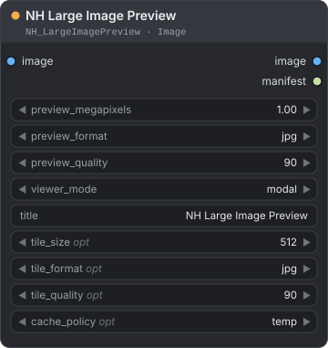
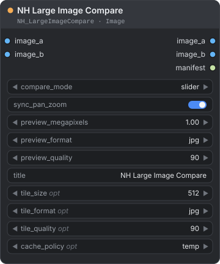
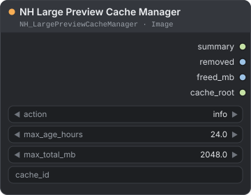

[← Về trang hướng dẫn](./README.md)

# Image — Large Image Preview (xem trước ảnh lớn)

Canvas của trình duyệt xử lý kém các ảnh hàng chục megapixel. Các node này giữ một ảnh thu nhỏ (thumbnail) trên node và chỉ mở trình xem (viewer) có thể phóng to khi bạn yêu cầu. Các điểm ảnh ở kích thước đầy đủ nằm chờ trong bộ nhớ đệm (cache) tạm trên ổ đĩa. Node thứ ba cho bạn biết cache đang chứa gì và dọn nó. Bạn tìm chúng trong menu node tại **NH-Nodes → Image**.

**Nội dung trang**

| Node | Dùng để |
|---|---|
| [NH Large Image Preview](#nh-large-image-preview) | Xem một ảnh lớn bằng ảnh thu nhỏ trên node và trình xem có thể phóng to |
| [NH Large Image Compare](#nh-large-image-compare) | So sánh hai ảnh lớn bằng thanh trượt, cạnh nhau hoặc theo độ chênh lệch |
| [NH Large Preview Cache Manager](#nh-large-preview-cache-manager) | Xem cache xem trước đang chứa gì, và xóa các mục cũ hoặc vượt dung lượng |

## Cách trình xem hoạt động

Mỗi lần một node xem trước hoặc so sánh chạy, nó ghi một mục cache cho từng ảnh:

- một **ảnh thu nhỏ**, không lớn hơn `preview_megapixels`, hiện trên node;
- các **ô (tile)** của ảnh ở kích thước đầy đủ và ở nhiều kích thước nhỏ hơn, để trình xem chỉ tải phần bạn đang nhìn, và tải ô nét hơn khi bạn phóng to;
- một **manifest**, đoạn văn bản JSON nhỏ mô tả mục đó. Node trả nó ở đầu ra `manifest`.

Các mục nằm trong thư mục `temp` của ComfyUI, trong một thư mục con tên `nh_large_preview`. Mỗi mục có một id gồm 32 ký tự. ComfyUI thường xóa thư mục `temp` khi khởi động, nên cache không tồn tại qua lần khởi động lại. Mỗi lần chạy thêm các mục mới, nên cache lớn dần cho đến khi bạn dọn nó bằng [NH Large Preview Cache Manager](#nh-large-preview-cache-manager).

Để mở trình xem, hãy chạy workflow một lần, rồi bấm **Open Viewer** (xem trước) hoặc **Open Compare** (so sánh) trên node. Trước lần chạy đầu tiên, nút sẽ nhắc bạn queue node trước.

| Muốn | Cách làm |
|---|---|
| Kéo ảnh | Kéo bằng chuột. |
| Phóng to hoặc thu nhỏ | Dùng con lăn chuột, hoặc các nút **+** và **−**. Mức thu phóng đi từ một phần tư kích thước vừa khung đến 400 %. |
| Cho ảnh vừa khung cửa sổ | Bấm **Fit**. |
| Xem điểm ảnh thật | Bấm **100%**. |
| Chuyển sang ảnh kế tiếp hoặc ảnh trước của một batch (lô ảnh) | Bấm ◀ hoặc ▶, hoặc nhấn phím mũi tên Trái hoặc Phải. Các điều khiển này xuất hiện khi lần chạy tạo ra nhiều hơn một ảnh, kèm bộ đếm dạng `2 / 5` ở giữa. Mỗi ảnh bắt đầu ở chế độ vừa khung. |
| Mở ảnh thu nhỏ trong một thẻ trình duyệt mới | Bấm **Thumb** (chỉ ở trình xem của node xem trước). |
| Đóng | Bấm **Close**, nhấn Esc, hoặc bấm vào vùng tối bên ngoài cửa sổ. |

---

## NH Large Image Preview

<p align="center"></p>

Hiện ảnh thu nhỏ của một ảnh lớn trên node, mở trình xem có thể phóng to khi cần, và chuyển tiếp ảnh đi nguyên vẹn.

**Dùng khi** bạn cần kiểm tra một kết quả lớn, như ảnh upscale theo ô 50 megapixel, mà không gửi toàn bộ ảnh lên canvas của trình duyệt.

| Đầu vào | Kiểu | Mặc định | Mô tả |
|---|---|---|---|
| `image` | `IMAGE` | — | Ảnh hoặc batch cần xem trước. |
| `preview_megapixels` | `FLOAT` | `1.0` | `0.05` đến `8`, bước 0.05. Kích thước lớn nhất của ảnh thu nhỏ trên node, tính bằng megapixel. Ảnh nhỏ hơn giữ nguyên kích thước. |
| `preview_format` | `COMBO` | `jpg` | Định dạng ảnh thu nhỏ: `jpg`, `webp` hoặc `png`. |
| `preview_quality` | `INT` | `90` | `1` đến `100`. Chất lượng ảnh thu nhỏ. |
| `viewer_mode` | `COMBO` | `modal` | `modal`, `side_panel` hoặc `new_tab`. Giá trị này được lưu trong manifest. Hiện tại trình xem luôn mở thành một cửa sổ nằm trên trang, dù bạn chọn gì. |
| `title` | `STRING` | `NH Large Image Preview` | Tiêu đề trong phần đầu của trình xem. |
| `tile_size` *(tùy chọn)* | `INT` | `512` | `128` đến `2048`, bước 64. Cạnh của một ô, tính bằng điểm ảnh. |
| `tile_format` *(tùy chọn)* | `COMBO` | `jpg` | Định dạng ô: `jpg` hoặc `webp`. |
| `tile_quality` *(tùy chọn)* | `INT` | `90` | `1` đến `100`. Chất lượng ô. |
| `cache_policy` *(tùy chọn)* | `COMBO` | `temp` | Nơi giữ cache. Chỉ có `temp`. |

| Đầu ra | Kiểu | Mô tả |
|---|---|---|
| `image` | `IMAGE` | Ảnh đầu vào, giữ nguyên. |
| `manifest` | `STRING` | Văn bản JSON, mỗi ảnh của batch một mục, gồm cả id cache của nó. |

**Cách hoạt động**

- Node có thể đặt giữa workflow, vì nó chuyển tiếp ảnh đi.
- Ở chất lượng mặc định, các ô bị nén mất dữ liệu, nên trình xem dùng để kiểm tra. Hãy dùng [NH Save Large Image](./image-io.md#nh-save-large-image) để giữ lại các điểm ảnh.
- Mỗi lần chạy tạo các mục cache mới. Xem [Cách trình xem hoạt động](#cách-trình-xem-hoạt-động).

**Ví dụ — kiểm tra ảnh upscale theo ô**

```text
Image Untile (NH) → NH Large Image Preview → NH Save Large Image
```

Chạy workflow, rồi bấm **Open Viewer** trên node xem trước và phóng tới **100%**.

> **Mẹo:** `preview_megapixels` chỉ đổi ảnh thu nhỏ trên node. Trình xem luôn hiện ảnh ở kích thước đầy đủ.

---

## NH Large Image Compare

<p align="center"></p>

So sánh hai ảnh lớn trong trình xem có thể phóng to, với thanh trượt, chế độ cạnh nhau hoặc chế độ chênh lệch. Chỉ một ảnh thu nhỏ nhỏ được gửi lên canvas.

**Dùng khi** bạn muốn kiểm tra ảnh upscale hoặc ảnh chỉnh sửa lớn so với bản gốc ở mức điểm ảnh, nơi [Image Compare (NH)](./image-compose.md#image-compare-nh) sẽ tạo ra một ảnh quá lớn cho canvas.

| Đầu vào | Kiểu | Mặc định | Mô tả |
|---|---|---|---|
| `image_a` | `IMAGE` | — | Ảnh thứ nhất. |
| `image_b` | `IMAGE` | — | Ảnh thứ hai. |
| `compare_mode` | `COMBO` | `slider` | Kiểu xem mà trình xem mở ra và ảnh thu nhỏ hiển thị: `slider`, `side_by_side` hoặc `difference`. |
| `sync_pan_zoom` | `BOOLEAN` | `true` | Được lưu trong manifest. Hiện tại trình xem luôn kéo và phóng cả hai ảnh cùng nhau. |
| `preview_megapixels` | `FLOAT` | `1.0` | `0.05` đến `8`, bước 0.05. Kích thước lớn nhất của các ảnh thu nhỏ, tính bằng megapixel. |
| `preview_format` | `COMBO` | `jpg` | `jpg`, `webp` hoặc `png`. |
| `preview_quality` | `INT` | `90` | `1` đến `100`. |
| `title` | `STRING` | `NH Large Image Compare` | Tiêu đề trong phần đầu của trình xem. |
| `tile_size` *(tùy chọn)* | `INT` | `512` | `128` đến `2048`, bước 64. |
| `tile_format` *(tùy chọn)* | `COMBO` | `jpg` | `jpg` hoặc `webp`. |
| `tile_quality` *(tùy chọn)* | `INT` | `90` | `1` đến `100`. |
| `cache_policy` *(tùy chọn)* | `COMBO` | `temp` | Chỉ có `temp`. |

| Đầu ra | Kiểu | Mô tả |
|---|---|---|
| `image_a` | `IMAGE` | Ảnh thứ nhất. Nếu một batch chỉ có một ảnh, ảnh đó được lặp cho khớp với batch kia. |
| `image_b` | `IMAGE` | Ảnh thứ hai, được khớp theo cách tương tự. |
| `manifest` | `STRING` | Văn bản JSON, mỗi cặp ảnh một mục, gồm cả hai id cache. |

**Cách hoạt động**

- **Batch.** Nếu hai batch cùng kích thước, ảnh *n* của A được ghép cặp với ảnh *n* của B. Nếu một batch chỉ có một ảnh, ảnh đó được lặp cho mọi ảnh của batch kia. Nếu không, cả hai bị cắt về độ dài ngắn hơn, và console hiện một thông báo. Dùng ◀ và ▶ trong trình xem để chuyển qua các cặp.
- **Khác kích thước.** Trong trình xem, mỗi ảnh được thu phóng để vừa một khung chung, nên các ảnh khác kích thước được so sánh trong cùng một vùng.
- **Các kiểu xem.** Trong trình xem, các nút **Slider**, **Side** và **Diff** đổi kiểu xem bất cứ lúc nào. Ở kiểu thanh trượt, một thanh ở phần đầu di chuyển đường chia từ 5 % đến 95 %.
- **Ảnh thu nhỏ.** Ảnh thu nhỏ trên node hiện kiểu xem đã chọn. Ở `difference`, nó được làm sáng gấp ba lần để thay đổi nhỏ dễ thấy hơn. Kiểu chênh lệch trong trình xem thì không được làm sáng.

**Ví dụ — kiểm tra một ảnh upscale**

```text
Load Image → NH Large Image Compare.image_a
Image Untile (NH) → NH Large Image Compare.image_b
```

Bấm **Open Compare**, kéo thanh trượt, và phóng to vào một đường biên.

> **Mẹo:** Nếu hai ảnh có kích thước khác nhau, phép so sánh vẫn được căn theo khung của chúng, không phải theo từng điểm ảnh. Hãy đổi kích thước một trong hai ảnh trước khi bạn cần kiểm tra chính xác từng điểm ảnh.

---

## NH Large Preview Cache Manager

<p align="center"></p>

Cho biết cache xem trước ảnh lớn đang chứa gì trên ổ đĩa, và xóa các mục cũ, các mục vượt giới hạn dung lượng, hoặc một mục theo id.

**Dùng khi** thư mục `temp` phình ra vì nhiều lần xem trước, hoặc bạn muốn giải phóng dung lượng mà không phải khởi động lại ComfyUI.

| Đầu vào | Kiểu | Mặc định | Mô tả |
|---|---|---|---|
| `action` | `COMBO` | `info` | Việc cần làm. Xem bảng bên dưới. |
| `max_age_hours` | `FLOAT` | `24.0` | `0` đến `8760`, bước 0.5. Các mục cũ hơn mức này bị xóa bởi những action có dùng tuổi của mục. `0` xóa mọi mục. |
| `max_total_mb` | `FLOAT` | `2048.0` | `1` đến `1048576`, bước 64. Dung lượng cache được giữ lại, tính bằng megabyte, cho những action có dùng dung lượng. |
| `cache_id` | `STRING` | trống | Id gồm 32 ký tự của một mục. Chỉ dùng cho `delete_cache_id`. Bạn tìm id trong đầu ra `manifest` của node xem trước. |

| `action` | Việc nó làm |
|---|---|
| `info` | Không xóa gì. Báo số mục, tổng dung lượng và tuổi của chúng. |
| `cleanup_by_age` | Xóa các mục cũ hơn `max_age_hours`. |
| `enforce_size_limit` | Xóa các mục cũ nhất cho đến khi cache không lớn hơn `max_total_mb`. |
| `cleanup_age_and_size` | Làm cả hai: tuổi trước, rồi đến dung lượng. |
| `delete_cache_id` | Xóa đúng một mục được nêu trong `cache_id`. Bắt buộc phải có id. |

| Đầu ra | Kiểu | Mô tả |
|---|---|---|
| `summary` | `STRING` | Văn bản JSON: action, trạng thái cache trước và sau, và những gì đã bị xóa. |
| `removed` | `INT` | Số mục đã xóa. |
| `freed_mb` | `FLOAT` | Số megabyte đã giải phóng. |
| `cache_root` | `STRING` | Thư mục chứa cache. |

**Cách hoạt động**

- Node chạy ở mọi lần queue. Nó không bao giờ bị bỏ qua chỉ vì thiết lập không đổi.
- Một mục là cache của một ảnh trong một lần chạy. Xóa một mục cũng làm hỏng trình xem của lần chạy đó: các ô không còn tải được, và **Open Viewer** không hiện gì cho nó. Hãy chạy lại node xem trước để dựng lại.
- Đây là node đầu ra (output node), nên nó chạy kể cả khi không có gì nối vào các đầu ra của nó.

**Ví dụ — giữ cache luôn nhỏ**

```text
NH Large Preview Cache Manager
```

Thêm node đứng riêng, đặt `action` là `cleanup_age_and_size`, `max_age_hours` là `24` và `max_total_mb` là `2048`. Mỗi lần chạy xóa các mục cũ hơn một ngày và cắt phần còn lại xuống 2 GB.

> **Lưu ý:** Đừng đặt `max_age_hours` là `0` trong một workflow cũng có node xem trước. Các mục tạo ra trong cùng lần chạy cũng sẽ bị xóa.

---

**Xem thêm:** [NH Save Large Image](./image-io.md#nh-save-large-image) để ghi tệp ở kích thước đầy đủ, và [Image Compare (NH)](./image-compose.md#image-compare-nh) cho một ảnh so sánh mà bạn có thể lưu lại.

[← Về trang hướng dẫn](./README.md)
