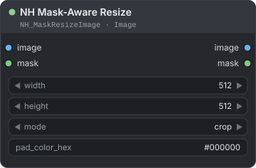
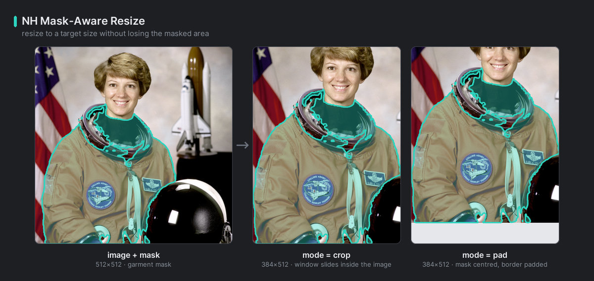
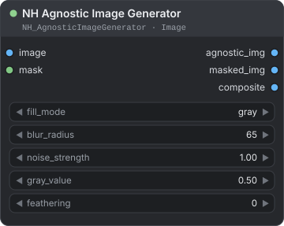
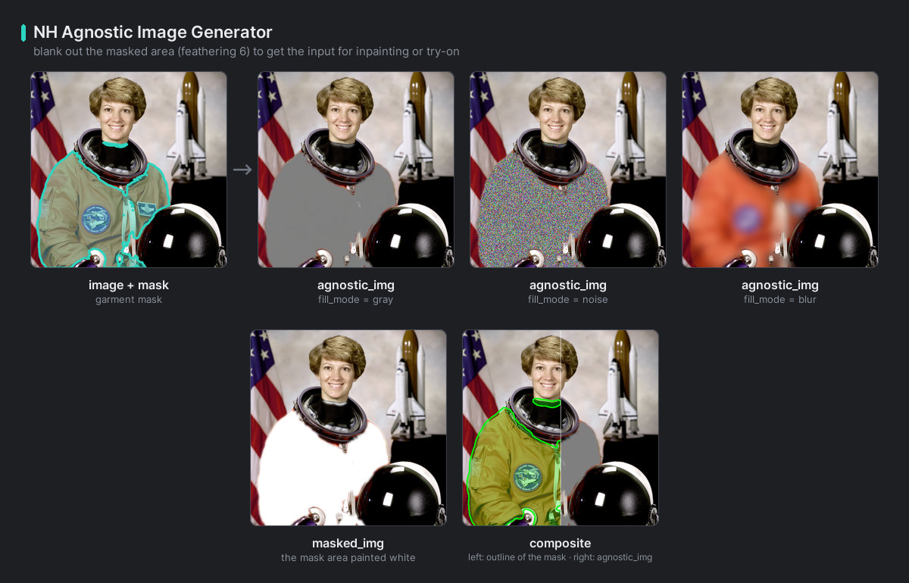
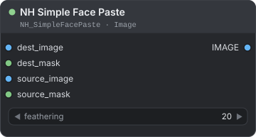

[← Về trang hướng dẫn](./README.md)

# Image — Mask-Based Retouch (chỉnh sửa theo mask)

Ba node làm việc với mask. Một node đổi kích thước ảnh về đúng kích thước đích và giữ nguyên vẹn đối tượng nằm trong mask. Một node xóa vùng mask, để model thử đồ (try-on) hoặc inpainting phải tự điền vào. Một node dán khuôn mặt nằm trong mask của ảnh này lên ảnh khác. Bạn tìm chúng trong menu node tại **NH-Nodes → Image**.

**Nội dung trang**

| Node | Dùng để |
|---|---|
| [NH Mask-Aware Resize](#nh-mask-aware-resize) | Đổi kích thước ảnh về đúng kích thước đích mà vẫn giữ trọn đối tượng trong mask |
| [NH Agnostic Image Generator](#nh-agnostic-image-generator) | Xóa vùng mask bằng màu xám, nhiễu hoặc làm mờ |
| [NH Simple Face Paste](#nh-simple-face-paste) | Dán khuôn mặt trong mask của ảnh này lên vùng mask của ảnh khác |

Một `MASK` có màu trắng (`1`) ở nơi node cần làm việc và màu đen (`0`) ở những chỗ còn lại. Bạn lấy mask từ một node phân đoạn như [SAM3 Segment (NH)](./vision.md#sam3-segment-nh) (mọi vật thể gọi được tên, hoặc một công thức như `person - bag` hay `background`), [Garment Segment (NH)](./vision.md#garment-segment-nh), [Portrait Segment (NH)](./vision.md#portrait-segment-nh) hoặc [Body Segment (NH)](./vision.md#body-segment-nh) (da, tóc hay quần áo của người trong ảnh, chỉ cần gõ tên), hoặc từ bất kỳ công cụ mask nào trong ComfyUI.

---

## NH Mask-Aware Resize

<p align="center"></p>

Đổi kích thước ảnh về đúng chiều rộng và chiều cao, và giữ trọn mọi thứ nằm trong mask. Đối tượng trong mask được phóng to hết mức kích thước đích cho phép, và ảnh được cắt hoặc thêm viền đệm (padding) xung quanh nó.

**Dùng khi** một model nhận kích thước cố định (ví dụ 832 × 1216) và khuôn mặt, trang phục hay sản phẩm mà bạn tạo mask phải nằm trọn trong đó.

| Đầu vào | Kiểu | Mặc định | Mô tả |
|---|---|---|---|
| `image` | `IMAGE` | — | Ảnh hoặc batch (lô ảnh) cần đổi kích thước. |
| `mask` | `MASK` | — | Vùng cần giữ. Các điểm ảnh lớn hơn `0.5` được tính. Mask phải cùng chiều rộng và chiều cao với `image`. Một mask duy nhất được dùng cho mọi ảnh trong batch. |
| `width` | `INT` | `512` | `64` đến `8192`, bước 8. Chiều rộng của kết quả. |
| `height` | `INT` | `512` | `64` đến `8192`, bước 8. Chiều cao của kết quả. |
| `mode` | `COMBO` | `crop` | `crop`: cắt một cửa sổ ra khỏi ảnh đã phóng. `pad`: căn giữa đối tượng và lấp khoảng trống bằng một màu. |
| `pad_color_hex` | `STRING` | `#000000` | Màu viền đệm, viết dạng `#RRGGBB`. Mọi dạng khác đều được đọc là màu đen, kể cả `#RGB` và `#RRGGBBAA`. |

| Đầu ra | Kiểu | Mô tả |
|---|---|---|
| `image` | `IMAGE` | Ảnh đã đổi kích thước, `width` × `height`. |
| `mask` | `MASK` | Mask được dịch chuyển và thu phóng theo cùng cách, nên vẫn khớp với ảnh mới. Vùng viền đệm là `0`. |

**Cách hoạt động**

1. Node tìm hộp bao quanh mask.
2. Node thu phóng toàn bộ ảnh với hệ số lớn nhất mà hộp đó vẫn nằm vừa trong `width` × `height`. Một đối tượng nhỏ có thể bị phóng rất lớn.
3. Node đặt tâm của hộp vào tâm của kết quả.
   - `crop` lấy một cửa sổ của ảnh đã phóng. Cửa sổ trượt ngược vào trong ảnh khi cần, nên mask gần mép sẽ nằm lệch tâm, nhưng không có viền đệm nào được thêm. Nếu ảnh sau khi phóng nhỏ hơn kết quả, `crop` thêm viền đệm như `pad`.
   - `pad` giữ hộp nằm chính xác ở giữa. Chỗ nào kết quả vượt ra ngoài ảnh, chỗ đó được tô bằng `pad_color_hex`.

Toàn bộ mask luôn nằm trong kết quả. Ảnh không bao giờ bị kéo giãn, và được lấy mẫu lại bằng Lanczos.

Ví dụ: mask 200 × 100 px ở góc trên bên trái của ảnh 1000 × 800 px, với kích thước đích 512 × 512. Hệ số phóng là 2.56 ở cả hai chế độ.

| Chế độ | Mask nằm ở đâu | Viền đệm |
|---|---|---|
| `crop` | Ở phía trên kết quả, trong các hàng 0 đến 255. | Không có. |
| `pad` | Ở giữa, trong các hàng 128 đến 383. | 128 hàng `pad_color_hex` phía trên ảnh. |

Với mask nằm gần giữa ảnh, hai chế độ cho cùng một ảnh. Với mask phủ toàn bộ ảnh, cả hai đều đặt ảnh vừa vào kích thước đích và lấp phần còn lại bằng viền đệm.

<p align="center"><br><em>Kết quả <code>crop</code> và <code>pad</code>, với mask được vẽ viền.</em></p>

**Ví dụ — chuẩn bị trang phục cho model có kích thước cố định**

```text
Load Image → Garment Segment (NH) → NH Mask-Aware Resize → model của bạn
```

Nối ảnh vào cả Garment Segment và `image`, và đầu ra `mask` của Garment Segment vào `mask`. Đặt `width` là `832`, `height` là `1216` và `mode` là `crop`.

**Lỗi thường gặp**

- Dùng mask có kích thước khác ảnh. Node không đổi kích thước mask, nên hộp rơi sai chỗ.
- Mong cả ảnh còn nguyên. Chỉ mask được đảm bảo. `crop` bỏ đi phần xung quanh không vừa.
- Dùng mask mềm có giá trị chỉ ở mức `0.5` trở xuống. Những điểm ảnh đó bị bỏ qua.

> **Lưu ý:** Mask rỗng được coi là "cả ảnh". Khi đó `crop` phủ kín kích thước đích và cắt phần giữa. `pad` đặt cả ảnh vừa vào kích thước đích. Không có gì bị kéo giãn.

---

## NH Agnostic Image Generator

<p align="center"></p>

Xóa vùng mask của ảnh và lấp bằng màu xám, nhiễu (noise) hoặc làm mờ mạnh, để model thử đồ hay inpainting phải tự tưởng tượng ra thứ nằm ở đó. Node cũng trả một bản sao có vùng mask tô trắng và một bản xem trước trước/sau.

**Dùng khi** bạn chuẩn bị ảnh người "agnostic" cho thử đồ ảo, nơi vùng trang phục bị loại bỏ, hoặc cần một nền trung tính cho model inpainting.

| Đầu vào | Kiểu | Mặc định | Mô tả |
|---|---|---|---|
| `image` | `IMAGE` | — | Ảnh hoặc batch cần xử lý. |
| `mask` | `MASK` | — | Vùng cần xóa. Giá trị mềm được hòa trộn một phần. Một mask duy nhất được dùng cho mọi ảnh trong batch. Chấp nhận mask 2 chiều. Mask khác kích thước sẽ được đổi về kích thước ảnh. |
| `fill_mode` | `COMBO` | `gray` | Thứ lấp vào vùng đó: `gray`, `noise` hoặc `blur`. |
| `blur_radius` | `INT` | `65` | `3` đến `255`, bước 2. Mức làm mờ cho `blur`. Giá trị chẵn được tăng lên số lẻ kế tiếp. Càng lớn càng mờ. |
| `noise_strength` | `FLOAT` | `1.0` | `0` đến `1`, bước 0.05. Dùng cho `noise`: `0` cho màu xám phẳng, `1` cho nhiễu thuần. |
| `gray_value` | `FLOAT` | `0.5` | `0` đến `1`, bước 0.01. Độ sáng của màu xám, từ đen đến trắng. `noise` được trộn với màu xám này. |
| `feathering` | `INT` | `0` | `0` đến `100`. Làm mềm biên mask bằng phép làm mờ. Càng lớn, biên càng rộng và mềm. |

| Đầu ra | Kiểu | Mô tả |
|---|---|---|
| `agnostic_img` | `IMAGE` | Ảnh với vùng mask được thay bằng phần lấp. |
| `masked_img` | `IMAGE` | Ảnh với vùng mask được tô trắng. |
| `composite` | `IMAGE` | Bản xem trước. Nửa trái là ảnh gốc với đường viền và lớp phủ màu xanh lá quanh mask, nửa phải là ảnh agnostic, và một đường trắng đánh dấu giữa ảnh. |

| `fill_mode` | Vùng mask trở thành |
|---|---|
| `gray` | Màu xám phẳng có độ sáng `gray_value`. |
| `noise` | Nhiễu ngẫu nhiên trộn với màu xám theo `noise_strength`. Nhiễu lặp lại được: ảnh *n* của một batch luôn nhận cùng một nhiễu. |
| `blur` | Một bản sao làm mờ mạnh của cả ảnh, nên màu sắc còn lại nhưng chi tiết mất. Hãy dùng `blur_radius` lớn nếu model không được thấy ảnh gốc. |

**Cách hoạt động**

- Mask hoạt động như một alpha mềm. Giá trị `0.5` hòa một nửa phần lấp với một nửa ảnh. `feathering` làm mờ alpha đó thêm nữa.
- Đường viền trong `composite` theo mức `0.5` của mask gốc.
- Một mask duy nhất được dùng lại cho mọi ảnh trong batch.

<p align="center"><br><em>Ảnh agnostic được tạo từ mask trang phục.</em></p>

**Ví dụ — đầu vào cho thử đồ**

```text
Load Image → Garment Segment (NH) → NH Agnostic Image Generator → agnostic_img → model thử đồ của bạn
```

Dùng `fill_mode` là `gray` với `gray_value` là `0.5`, và `feathering` là `8` để có biên mềm.

> **Mẹo:** Hãy mở rộng mask thêm một chút trước node này (ví dụ bằng [Mask Morphology (NH)](./mask.md#mask-morphology-nh)) để không còn mảnh trang phục cũ nào sót lại ở mép.

---

## NH Simple Face Paste

<p align="center"></p>

Cắt vùng mask ra khỏi ảnh nguồn, đổi kích thước nó cho khớp vùng mask của ảnh đích, và hòa vào với biên mềm.

**Dùng khi** bạn muốn đặt khuôn mặt này lên một ảnh khác, hoặc khôi phục khuôn mặt từ ảnh gốc sau những chỉnh sửa khác.

| Đầu vào | Kiểu | Mặc định | Mô tả |
|---|---|---|---|
| `dest_image` | `IMAGE` | — | Ảnh để dán lên. Kích thước batch của nó quyết định kích thước batch của kết quả. |
| `dest_mask` | `MASK` | — | Đánh dấu nơi đặt khuôn mặt. Chỉ hộp bao quanh mask (các điểm ảnh lớn hơn `0.5`) được dùng, cho vị trí và kích thước. Mask phải cùng kích thước với `dest_image`. |
| `source_image` | `IMAGE` | — | Ảnh cung cấp khuôn mặt. |
| `source_mask` | `MASK` | — | Đánh dấu khuôn mặt cần lấy. Hộp bao quanh nó được cắt ra, và hình dạng của nó, kể cả các giá trị mềm, quyết định thứ được dán. Mask phải cùng kích thước với `source_image`. |
| `feathering` | `INT` | `20` | `0` đến `200`. Làm mờ biên của hình dạng được dán. `0` cho biên cứng. Càng lớn biên càng mềm. |

| Đầu ra | Kiểu | Mô tả |
|---|---|---|
| `IMAGE` | `IMAGE` | Các ảnh đích với khuôn mặt đã dán vào. |

**Cách hoạt động**

1. Node cắt hộp bao quanh `source_mask` ra khỏi ảnh nguồn.
2. Node đổi kích thước phần cắt đó về đúng kích thước hộp bao quanh `dest_mask`. Tỉ lệ khung hình không được giữ: khuôn mặt bị kéo giãn cho vừa.
3. Node hòa phần cắt vào ảnh đích, dùng `source_mask` mềm làm độ đục, sau khi `feathering` đã làm mờ nó.

- **Batch.** Kết quả có kích thước batch của `dest_image`. Ảnh nguồn, mask nguồn hoặc mask đích có ít phần tử hơn sẽ được dùng lại lần lượt, nên một nguồn duy nhất có thể được dán lên cả một batch.
- **Mask rỗng.** Nếu một trong hai mask của một phần tử rỗng, ảnh đó được trả về nguyên trạng.
- Phép xử lý được thực hiện ở 8 bit, nên các giá trị được cắt về khoảng từ 0 đến 1 trước.

**Ví dụ — đặt một khuôn mặt lên nhiều ảnh**

```text
Load Image (nguồn) → Portrait Segment (NH) → NH Simple Face Paste.source_mask
Load Image (nguồn) → NH Simple Face Paste.source_image
Load Images Folder (NH) → NH Simple Face Paste.dest_image
Portrait Segment (NH) trên ảnh đích → NH Simple Face Paste.dest_mask
```

Đặt `feathering` là `20`. Vì một nguồn duy nhất được dùng lại, mọi ảnh trong batch nhận cùng một khuôn mặt.

**Lỗi thường gặp**

- Dùng các mask mà hộp bao quanh có tỉ lệ rất khác nhau. Khuôn mặt trông bị bẹp hoặc bị kéo dài.
- Đưa vào mask có kích thước khác ảnh của nó.
- Dùng mask của [Portrait Segment (NH)](./vision.md#portrait-segment-nh) trên một ảnh có nhiều khuôn mặt. Mask chứa mọi khuôn mặt, nên hộp bao quanh nó phủ cả chúng.
- Đặt `feathering` rất cao cho một khuôn mặt nhỏ. Phép làm mờ có thể nuốt mất cả hình dạng.

> **Mẹo:** Hãy làm `dest_mask` lớn hơn một chút so với khuôn mặt bạn thay, và giữ `source_mask` sát khuôn mặt. Khi đó biên mềm của mask nguồn hòa vào ảnh đích.

---

**Xem thêm:** [Vision](./vision.md) cho các node phân đoạn tạo mask, [Mask](./mask.md) cho các mask bạn có thể mở rộng, thu hẹp và làm mờ, và [VTON](./vton.md) cho node tiền xử lý thử đồ đầy đủ.

[← Về trang hướng dẫn](./README.md)
