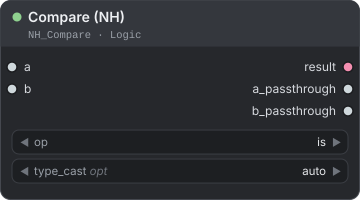
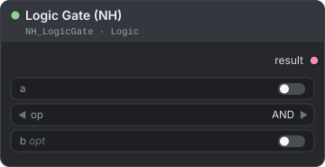
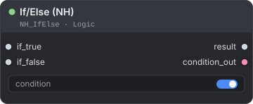
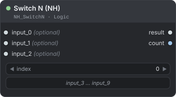
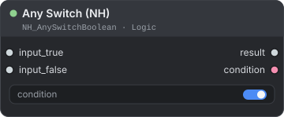
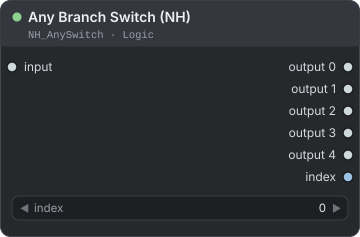
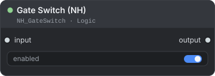
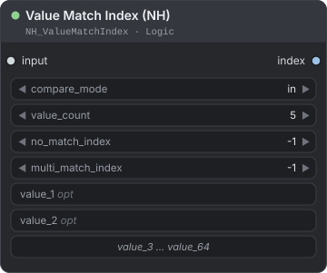
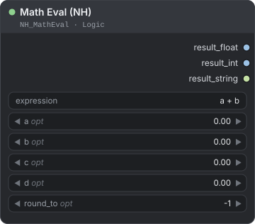
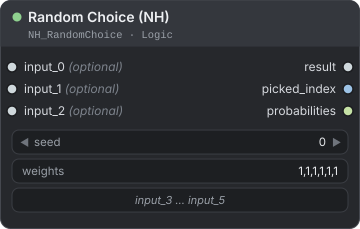

[← Về trang hướng dẫn](./README.md)

# Logic (điều kiện và rẽ nhánh)

Các node Logic giúp workflow tự ra quyết định. Bạn có thể so sánh giá trị, kết hợp các kết quả đúng/sai, chọn giữa nhiều đầu vào, đưa dữ liệu vào một trong nhiều nhánh, tính các công thức đơn giản hoặc chọn ngẫu nhiên. `If/Else`, `Switch N`, `Random Choice` và `Any Switch` dùng tính lười (chỉ chạy nhánh được chọn): ComfyUI chỉ thực thi nhánh được chọn, nên sampler nằm ở nhánh còn lại sẽ không bao giờ chạy. Bạn tìm các node này trong menu node tại **NH-Nodes → Logic**.

**Nội dung trang**

- [Nên dùng công tắc nào?](#nên-dùng-công-tắc-nào) — mỗi công tắc xử lý nhánh không được chọn ra sao
- [Compare (NH)](#compare-nh) — biến hai giá trị thành `True` hoặc `False`
- [Logic Gate (NH)](#logic-gate-nh) — kết hợp các giá trị đúng/sai bằng AND, OR, NOT, XOR, NAND, NOR
- [If/Else (NH)](#ifelse-nh) — chọn một trong hai đầu vào theo điều kiện
- [Switch N (NH)](#switch-n-nh) — chọn một trong tối đa 10 đầu vào theo số thứ tự
- [Any Switch (NH)](#any-switch-nh) — chọn một trong hai đầu vào theo điều kiện, cùng logic với If/Else
- [Any Branch Switch (NH)](#any-branch-switch-nh) — đưa một đầu vào ra một trong năm đầu ra
- [Gate Switch (NH)](#gate-switch-nh) — cho dữ liệu đi qua, hoặc chặn dữ liệu cùng mọi node phía sau
- [Value Match Index (NH)](#value-match-index-nh) — biến văn bản (ví dụ tên file) thành một con số để điều khiển công tắc
- [Math Eval (NH)](#math-eval-nh) — tính công thức với các biến `a` đến `d`
- [Random Choice (NH)](#random-choice-nh) — chọn ngẫu nhiên một trong tối đa sáu đầu vào, có trọng số

Trong các bảng, `*` nghĩa là bất kỳ kiểu dữ liệu nào.

## Nên dùng công tắc nào?

Có hai cơ chế để những phần việc không cần đến khỏi phải chạy. Với **tính lười (lazy evaluation)**, các node chỉ cấp dữ liệu cho một đầu vào không được chọn sẽ không bao giờ chạy, nên sampler ở đó không tốn thời gian. Với **chặn (blocking)**, đầu ra không được chọn mang tín hiệu chặn: mọi node phía sau nó đều bị bỏ qua, lặng lẽ và không báo lỗi, kể cả các node Save và Preview.

| Node | Chọn theo | Đầu vào → đầu ra | Phía không được chọn |
|---|---|---|---|
| If/Else, Any Switch | `True` / `False` | 2 → 1 | Không bao giờ chạy (tính lười). |
| Switch N | Số từ 0 đến 9 | tối đa 10 → 1 | Không bao giờ chạy (tính lười). |
| Random Choice | Seed và trọng số | tối đa 6 → 1 | Không bao giờ chạy (tính lười). |
| Any Branch Switch | Số từ 0 đến 4 | 1 → 5 | Các đầu ra còn lại bị chặn. |
| Gate Switch | `True` / `False` | 1 → 1 | Đầu vào không bao giờ chạy (tính lười). Khi tắt, đầu ra bị chặn. |

> **Lưu ý:** Tính lười chỉ bỏ qua những gì không ai khác cần. Nếu một node còn cấp dữ liệu cho thứ gì đó đang chạy, nó vẫn chạy.

---

## Compare (NH)

<p align="center"></p>

So sánh `a` với `b` và trả về `True` hoặc `False`. Cả hai giá trị cũng được chuyển tiếp nguyên vẹn ra đầu ra.

**Dùng khi** bạn cần một điều kiện cho If/Else hoặc Gate Switch, ví dụ "chiều rộng có lớn hơn 1024 không?" hoặc "tên file có chứa `portrait` không?".

| Đầu vào | Kiểu | Mặc định | Mô tả |
|---|---|---|---|
| `a` | `*` | — | Giá trị bên trái, kiểu bất kỳ. Hãy nối một node vào; không có widget. |
| `b` | `*` | — | Giá trị bên phải, kiểu bất kỳ. Hãy nối một node vào. |
| `op` | `COMBO` | `is` | `is`, `not`, `>`, `<`, `>=`, `<=` hoặc `in`. |
| `type_cast` *(tùy chọn)* | `COMBO` | `auto` | `auto`, `int`, `float` hoặc `string`. `in` bỏ qua giá trị này. |

| Đầu ra | Kiểu | Mô tả |
|---|---|---|
| `result` | `BOOLEAN` | `True` khi phép so sánh đúng. |
| `a_passthrough` | `*` | `a`, giữ nguyên. |
| `b_passthrough` | `*` | `b`, giữ nguyên. |

**Cách hoạt động**

- `auto` đọc cả hai giá trị thành số khi có thể (`"10"` bằng `10`). Nếu một bên không phải số, node so sánh cả hai như văn bản.
- `int` và `float` chuyển cả hai bên sang kiểu đó trước; `int` bỏ phần thập phân (3.7 thành 3). Nếu không chuyển được, `result` là `False` và console cho biết lý do.
- `string` luôn so sánh văn bản, từng ký tự một.
- `in` là phép kiểm tra thuộc về đơn giản. Nếu `b` là danh sách (list), tuple hoặc set, `a` phải là một phần tử của nó. Nếu `b` là dictionary, `a` phải là một khóa của nó. Trường hợp còn lại, `str(a)` phải xuất hiện bên trong `str(b)`, có phân biệt hoa thường. Một con số khớp với dạng văn bản của nó (`7` khớp `"7"`). Không có so khớp mờ, và `a` rỗng luôn được tìm thấy trong mọi văn bản.
- Nếu `a` hoặc `b` rỗng (`None`), `result` là `False`.

| `a` | `op` | `b` | `type_cast` | `result` | Lý do |
|---|---|---|---|---|---|
| `1920` | `>` | `1024` | `auto` | `True` | So sánh số. |
| `"10"` | `>` | `"9"` | `auto` | `True` | Cả hai được đọc thành số. |
| `"10"` | `>` | `"9"` | `string` | `False` | Theo văn bản, `"1"` đứng trước `"9"`. |
| `3.7` | `is` | `3` | `int` | `True` | `int` bỏ phần thập phân. |
| `3.7` | `is` | `3` | `auto` | `False` | 3.7 khác 3. |
| `"portrait"` | `in` | `"portrait_01.png"` | — | `True` | Chuỗi con. |
| `"PORTRAIT"` | `in` | `"portrait_01.png"` | — | `False` | Phân biệt hoa thường. |
| `13` | `in` | `"a13b"` | — | `True` | Chuỗi con. |
| `13` | `in` | `"1024x768 3"` | — | `False` | Chuỗi không chứa `13`. |
| `7` | `in` | list `[1, 7]` | — | `True` | Phần tử của list. |

**Ví dụ — chỉ chạy một bước cho ảnh rộng**

```text
Get Image Size.width → Compare (NH).a        (op: >)
Int (giá trị 1024)   → Compare (NH).b
Compare (NH).result  → If/Else (NH).condition
```

> **Mẹo:** Để so sánh với một giá trị cố định, hãy nối một trong các node primitive `Int`, `Float` hoặc `Text` của ComfyUI vào `a` hoặc `b`.

---

## Logic Gate (NH)

<p align="center"></p>

Kết hợp hai giá trị đúng/sai bằng AND, OR, NOT, XOR, NAND hoặc NOR và trả về một kết quả đúng/sai.

**Dùng khi** nhiều điều kiện cùng quyết định, ví dụ "ảnh đủ rộng VÀ chế độ chất lượng đang bật".

| Đầu vào | Kiểu | Mặc định | Mô tả |
|---|---|---|---|
| `a` | `BOOLEAN` | `False` | Giá trị thứ nhất. |
| `op` | `COMBO` | `AND` | `AND`, `OR`, `NOT`, `XOR`, `NAND` hoặc `NOR`. |
| `b` *(tùy chọn)* | `BOOLEAN` | `False` | Giá trị thứ hai. `NOT` bỏ qua giá trị này. |

| Đầu ra | Kiểu | Mô tả |
|---|---|---|
| `result` | `BOOLEAN` | Kết quả của `op`. |

| `op` | `True` khi… |
|---|---|
| `AND` | cả hai đều `True` |
| `OR` | ít nhất một giá trị là `True` |
| `NOT` | `a` là `False` (`b` bị bỏ qua) |
| `XOR` | đúng một giá trị là `True` |
| `NAND` | không phải cả hai đều `True` (ngược với AND) |
| `NOR` | cả hai đều `False` (ngược với OR) |

**Bảng chân trị** (`T` = `True`, `F` = `False`)

| `a` | `b` | AND | OR | NOT a | XOR | NAND | NOR |
|:-:|:-:|:-:|:-:|:-:|:-:|:-:|:-:|
| F | F | F | F | T | F | T | T |
| F | T | F | T | T | T | T | F |
| T | F | F | T | F | T | T | F |
| T | T | T | T | F | F | F | F |

**Ví dụ — cả hai điều kiện phải đạt**

```text
Compare (NH) "width > 1024" → Logic Gate (NH).a     (op: AND)
Boolean Switch (NH)         → Logic Gate (NH).b
Logic Gate (NH).result      → Gate Switch (NH).enabled
```

- `OR`: chạy bước sửa khuôn mặt khi bộ phát hiện tìm thấy khuôn mặt **hoặc** bạn bật ép buộc bằng một `Boolean Switch (NH)`.
- `NOT`: đưa một `Boolean Switch (NH)` tên `skip_upscale` qua `NOT` rồi vào `enabled`, nên khi bạn bật nó thì nhánh upscale bị tắt.

> **Mẹo:** `docs/logic_gate_diagram.html` là bản minh họa bằng hình của các công thức này. Hãy tải file về và mở bằng trình duyệt.

---

## If/Else (NH)

<p align="center"></p>

Trả về `if_true` khi `condition` là `True`, ngược lại trả về `if_false`. Chỉ nhánh được chọn mới được thực thi.

**Dùng khi** bạn muốn có hai phiên bản của một kết quả, ví dụ có hoặc không có bước tinh chỉnh (refine), mà không phải chạy cả hai nhánh.

| Đầu vào | Kiểu | Mặc định | Mô tả |
|---|---|---|---|
| `condition` | `BOOLEAN` | `True` | Chọn nhánh. |
| `if_true` | `*` | — | Tính lười. Dùng khi `condition` là `True`. |
| `if_false` | `*` | — | Tính lười. Dùng khi `condition` là `False`. |

| Đầu ra | Kiểu | Mô tả |
|---|---|---|
| `result` | `*` | Đầu vào được chọn, giữ nguyên. |
| `condition_out` | `BOOLEAN` | `condition`, lặp lại để nối tiếp. |

**Cách hoạt động**

- ComfyUI đánh giá `condition` trước, rồi chỉ yêu cầu nhánh được chọn. Các node chỉ cấp dữ liệu cho nhánh còn lại không bao giờ chạy, nên sampler ở đó bị bỏ qua.
- Cả hai đầu vào đều phải được nối, nhưng chỉ một trong hai được thực thi.

**Ví dụ — chỉ tinh chỉnh khi cần**

```text
Compare (NH).result            → If/Else (NH).condition
VAE Decode                     → If/Else (NH).if_false   (ảnh gốc)
KSampler thứ hai → VAE Decode  → If/Else (NH).if_true    (ảnh đã tinh chỉnh; chỉ chạy khi True)
If/Else (NH).result            → Save Image
```

> **Mẹo:** Khác với Gate Switch, If/Else luôn tạo ra một đầu ra, nên `Save Image` vẫn chạy khi điều kiện là `False`.

---

## Switch N (NH)

<p align="center"></p>

Trả về đầu vào có số slot bằng `index` (`input_0` đến `input_9`). Chỉ đầu vào được chọn mới được thực thi.

**Dùng khi** bạn xoay vòng qua nhiều prompt, model hoặc ảnh, hoặc khi một node khác chọn nhánh theo số.

| Đầu vào | Kiểu | Mặc định | Mô tả |
|---|---|---|---|
| `index` | `INT` | `0` | Slot cần dùng, từ 0 đến 9. |
| `input_0` … `input_9` *(tùy chọn)* | `*` | — | Tính lười. Chỉ nối những slot bạn cần; bỏ trống giữa chừng cũng được. |

| Đầu ra | Kiểu | Mô tả |
|---|---|---|
| `result` | `*` | Đầu vào được chọn. |
| `count` | `INT` | Số slot đã được nối. |

**Cách hoạt động**

- Chỉ slot được chọn được thực thi. Các node phía sau những slot khác không bao giờ chạy.
- Nếu slot được chọn chưa được nối, hoặc `index` nằm ngoài phạm vi (ví dụ `-1` đến từ một node khác), node dùng slot đã nối có số nhỏ nhất và in một ghi chú trong console.
- Khi không có slot nào được nối, `result` rỗng và console in cảnh báo; `count` là `0`.
- `count` đếm số slot đã nối, không phải số thứ tự slot: `input_0` và `input_5` cho kết quả `2`. Slot có node cấp dữ liệu không trả về gì vẫn được tính là đã nối.

**Ví dụ — Counter → Switch N → KSampler**

```text
Counter (NH).current → Switch N (NH).index        (Counter: start 0, step 1, max_value 2)
CLIP Text Encode A / B / C → Switch N (NH).input_0 / input_1 / input_2
Switch N (NH).result → KSampler.positive
```

Mỗi lần queue, counter tiến thêm một bước nên prompt kế tiếp được dùng, và chỉ node CLIP Text Encode của prompt đó chạy. Xem [Counter (NH)](./batch-lists.md#counter-nh).

> **Mẹo:** Value Match Index trả về số tính từ 1, nên `value_1` chọn `input_1`. Hãy nối nhánh mặc định vào `input_0`: chỉ số `-1` của trường hợp "không khớp" sẽ quay về slot đã nối có số nhỏ nhất.

---

## Any Switch (NH)

<p align="center"></p>

Công tắc đúng/sai cho mọi kiểu dữ liệu. Node trả về `input_true` hoặc `input_false` và chỉ chạy đầu vào được chọn.

**Dùng khi** bạn thích tên đầu vào của node này hơn If/Else. Logic hoàn toàn giống nhau.

| Đầu vào | Kiểu | Mặc định | Mô tả |
|---|---|---|---|
| `condition` | `BOOLEAN` | `True` | Chọn đầu vào. |
| `input_true` | `*` | — | Tính lười. Dùng khi `condition` là `True`. |
| `input_false` | `*` | — | Tính lười. Dùng khi `condition` là `False`. |

| Đầu ra | Kiểu | Mô tả |
|---|---|---|
| `result` | `*` | Đầu vào được chọn, giữ nguyên. |
| `condition` | `BOOLEAN` | `condition`, lặp lại. |

**Ví dụ — chọn giữa hai ảnh nguồn**

```text
Boolean Switch (NH).boolean → Any Switch (NH).condition
Load Image A / Load Image B → Any Switch (NH).input_true / input_false
```

Chỉ node `Load Image` được chọn mới chạy.

---

## Any Branch Switch (NH)

<p align="center"></p>

Đưa một đầu vào ra một trong năm đầu ra, `output 0` đến `output 4`. Các node nối vào những đầu ra còn lại bị bỏ qua.

**Dùng khi** một ảnh hoặc giá trị phải đi qua đúng một trong tối đa năm pipeline, chẳng hạn năm style hoặc năm bộ upscale khác nhau.

| Đầu vào | Kiểu | Mặc định | Mô tả |
|---|---|---|---|
| `input` | `*` | — | Dữ liệu cần định tuyến. Luôn được đánh giá. |
| `index` | `INT` | `0` | Đầu ra nhận dữ liệu, từ 0 đến 4. Giá trị khác được giới hạn về khoảng đó. |

| Đầu ra | Kiểu | Mô tả |
|---|---|---|
| `output 0` … `output 4` | `*` | `input` ở đầu ra được chọn; bị chặn ở các đầu ra còn lại. |
| `index` | `INT` | Chỉ số thực sự được dùng, sau khi giới hạn. |

**Cách hoạt động**

- Các đầu ra không được chọn bị chặn. Node nhận giá trị bị chặn sẽ bị bỏ qua lặng lẽ, và mọi node phía sau nó cũng vậy.
- `input` không lười: node cấp dữ liệu cho nó luôn chạy. Chỉ phần nằm sau công tắc mới bị bỏ qua.
- Node có nhiều đầu vào sẽ bị bỏ qua khi bất kỳ đầu vào nào của nó bị chặn.

**Ví dụ — định tuyến theo tên file**

```text
Value Match Index (NH).index → Any Branch Switch (NH).index
VAE Decode                   → Any Branch Switch (NH).input
output 0 / output 1 / …      → mỗi đầu ra một nhánh xử lý, mỗi nhánh kết thúc bằng Save Image riêng
```

> **Mẹo:** `-1` (không khớp) được giới hạn về `0`, nên `output 0` đóng vai trò đường mặc định.

---

## Gate Switch (NH)

<p align="center"></p>

Cho `input` đi qua khi `enabled` là `True`. Khi là `False`, node chặn dữ liệu cùng mọi node phía sau.

**Dùng khi** một công đoạn tùy chọn, như thêm một bước upscale hoặc thêm một bước lưu, chỉ nên chạy khi một điều kiện được đáp ứng.

| Đầu vào | Kiểu | Mặc định | Mô tả |
|---|---|---|---|
| `input` | `*` | — | Tính lười. Dữ liệu cần chuyển tiếp. |
| `enabled` | `BOOLEAN` | `True` | `True` cho dữ liệu đi qua; `False` chặn lại. |

| Đầu ra | Kiểu | Mô tả |
|---|---|---|
| `output` | `*` | `input` khi bật; bị chặn khi tắt. |

**Cách hoạt động**

- Khi bật: `input` được đánh giá và chuyển tiếp nguyên vẹn.
- Khi tắt: `input` không bao giờ được yêu cầu, nên các node cấp dữ liệu cho nó không chạy. Đầu ra bị chặn, nên các node phía sau cổng bị bỏ qua mà không báo lỗi.

**Ví dụ — thêm một đầu ra tùy chọn**

```text
VAE Decode                 → Save Image               (luôn chạy)
VAE Decode → Upscale Image → Gate Switch (NH).input
Boolean Switch (NH)        → Gate Switch (NH).enabled
Gate Switch (NH).output    → Save Image thứ hai       (chỉ chạy khi bật)
```

> **Mẹo:** Nếu bạn vẫn muốn lưu ảnh gốc khi bước tùy chọn tắt, hãy dùng If/Else: `if_false` mang ảnh gốc.

---

## Value Match Index (NH)

<p align="center"></p>

Tìm các giá trị bạn cấu hình trong đầu vào và trả về vị trí (tính từ 1) của giá trị duy nhất khớp.

**Dùng khi** tên file, nhãn hoặc prompt cần quyết định nhánh nào được chọn, ví dụ "tên chứa `red`" chọn nhánh 2.

| Đầu vào | Kiểu | Mặc định | Mô tả |
|---|---|---|---|
| `input` | `*` | — | Giá trị cần kiểm tra. Được chuyển thành văn bản. |
| `compare_mode` | `COMBO` | `in` | `in`: giá trị đã cấu hình phải xuất hiện bên trong đầu vào. `is`: phải bằng đúng đầu vào. |
| `value_count` | `INT` | `5` | Số ô `value_N` được dùng, từ 1 đến 64. |
| `no_match_index` | `INT` | `-1` | Trả về khi không có giá trị nào khớp (-9999 đến 9999). |
| `multi_match_index` | `INT` | `-1` | Trả về khi có nhiều hơn một giá trị khớp (-9999 đến 9999). |
| `value_1` … `value_64` *(tùy chọn)* | `STRING` | `""` | Các giá trị cần tìm. Ô trống bị bỏ qua. |

| Đầu ra | Kiểu | Mô tả |
|---|---|---|
| `index` | `INT` | Số thứ tự của giá trị khớp (1 cho `value_1`), hoặc `no_match_index` / `multi_match_index`. |

**Cách hoạt động**

- So khớp trên văn bản và có phân biệt hoa thường. Chỉ `value_count` ô đầu tiên được tính.
- Khớp đúng một giá trị thì trả về số thứ tự của nó. Không khớp thì trả về `no_match_index`. Khớp từ hai giá trị trở lên thì trả về `multi_match_index`.
- Node chỉ hiển thị `value_count` ô. Nếu bố cục có vẻ chưa cập nhật sau khi mở workflow, hãy nhấn `update values`.

Với `value_count` là 3, `value_1` là `blue`, `value_2` là `red`, `value_3` là `green`, `no_match_index` là `-1` và `multi_match_index` là `-2`:

| `input` | `compare_mode` | `index` | Lý do |
|---|---|---|---|
| `red_dress_03.png` | `in` | `2` | Chỉ `red` nằm trong tên. |
| `blue_red_mix.png` | `in` | `-2` | `blue` và `red` đều khớp. |
| `black.png` | `in` | `-1` | Không có giá trị nào khớp. |
| `red` | `is` | `2` | Khớp chính xác. |
| `red_dress` | `is` | `-1` | `is` yêu cầu toàn bộ văn bản phải khớp. |
| `Red` | `is` | `-1` | Phân biệt hoa thường. |

**Ví dụ — chọn nhánh theo tên file**

```text
Load Image Info (NH).file_name → Value Match Index (NH).input
Value Match Index (NH).index   → Switch N (NH).index
```

> **Mẹo:** Con số được so khớp như văn bản, nên với `in`, giá trị `1` cũng khớp `12` và `21`. Hãy dùng `is` khi cần khớp đúng số.

---

## Math Eval (NH)

<p align="center"></p>

Tính một biểu thức toán học có thể dùng tối đa bốn biến, `a` đến `d`, và trả kết quả dưới dạng `FLOAT`, `INT` và `STRING`.

**Dùng khi** bạn cần làm tròn kích thước về bội số của 64, nhân tỉ lệ một giá trị, hoặc tạo một con số cho node khác.

| Đầu vào | Kiểu | Mặc định | Mô tả |
|---|---|---|---|
| `expression` | `STRING` | `a + b` | Công thức, viết trên một dòng. |
| `a`, `b`, `c`, `d` *(tùy chọn)* | `FLOAT` | `0.0` | Các biến của công thức (bước nhảy 0.01). |
| `round_to` *(tùy chọn)* | `INT` | `-1` | Số chữ số thập phân cần làm tròn, từ `-1` đến `10`. `-1` giữ nguyên kết quả, không làm tròn. |

| Đầu ra | Kiểu | Mô tả |
|---|---|---|
| `result_float` | `FLOAT` | Kết quả. |
| `result_int` | `INT` | Kết quả đã cắt bỏ phần thập phân (về phía 0). |
| `result_string` | `STRING` | Kết quả dạng văn bản. |

| Thành phần | Được phép |
|---|---|
| Số | `3`, `0.5`, `1e3` |
| Biến | `a`, `b`, `c`, `d` (chỉ chữ thường) |
| Toán tử | `+` `-` `*` `/` `//` `%` `**`, dấu `+` và `-` đứng trước một số, dấu ngoặc đơn |
| Hàm | `min(a, b)`, `max(a, b)` (từ hai giá trị trở lên), `abs(x)`, `round(x)` hoặc `round(x, digits)`, `sqrt(x)`, `floor(x)`, `ceil(x)`, `clamp(value, low, high)` |

**Cách hoạt động**

- `/` là phép chia thực (10 / 4 = 2.5), `//` là chia lấy phần nguyên làm tròn xuống (10 // 4 = 2), `%` là phần dư và `**` là lũy thừa.
- Chia cho 0 bằng `/`, `//` hoặc `%` cho kết quả 0 ở phần đó của công thức và in cảnh báo trong console. Phần còn lại vẫn được tính: `a + b / 0` cho kết quả `a`.
- Biểu thức không hợp lệ làm lần chạy dừng lại với một lỗi nêu rõ biểu thức, ví dụ `Math Eval: Unknown variable 'e' (expression: 'e + 1')`. Node không bao giờ âm thầm trả về 0.
- `result_int` được lấy sau khi áp dụng `round_to`. Khi làm tròn đúng nửa, kết quả về chữ số chẵn (2.5 thành 2.0, 3.5 thành 4.0).

| `expression` | Biến | `round_to` | `result_float` | `result_int` | `result_string` |
|---|---|---|---|---|---|
| `a + b * 2` | `a` 1, `b` 3 | -1 | `7.0` | `7` | `7.0` |
| `round(a / 64) * 64` | `a` 1000 | -1 | `1024.0` | `1024` | `1024.0` |
| `ceil(a / 8) * 8` | `a` 1001 | -1 | `1008.0` | `1008` | `1008.0` |
| `clamp(a, 512, 2048)` | `a` 100 | -1 | `512.0` | `512` | `512.0` |
| `a * 9 / 16` | `a` 1920 | -1 | `1080.0` | `1080` | `1080.0` |
| `a * b / 1000000` | `a` 1024, `b` 1536 | -1 | `1.572864` | `1` | `1.572864` |
| `a / 3` | `a` 10 | 2 | `3.33` | `3` | `3.33` |
| `a` | `a` -2.7 (nối từ node khác) | -1 | `-2.7` | `-2` | `-2.7` |
| `a / b` | `a` 5, `b` 0 (có cảnh báo trong console) | -1 | `0.0` | `0` | `0.0` |

**Ví dụ — làm tròn chiều rộng về bội số của 64**

```text
Float (giá trị 1000)      → Math Eval (NH).a        (expression: round(a / 64) * 64)
Math Eval (NH).result_int → Empty Latent Image.width
```

> **Lưu ý:** Widget số không có phạm vi riêng chỉ nhận giá trị gõ vào từ 0 đến 2048 trong ComfyUI. Với số âm hoặc số lớn hơn, hãy viết số đó thẳng vào biểu thức hoặc nối một node `FLOAT`. ComfyUI không cho nối đầu ra `INT` vào đầu vào `FLOAT` như `a`.

---

## Random Choice (NH)

<p align="center"></p>

Chọn ngẫu nhiên một trong tối đa sáu đầu vào đã nối. `weights` làm một số đầu vào có khả năng được chọn cao hơn. Chỉ đầu vào được chọn mới được thực thi.

**Dùng khi** mỗi lần queue cần một style, prompt hoặc ảnh ngẫu nhiên theo xác suất do bạn đặt, và các nhánh không được chọn không tốn thời gian.

| Đầu vào | Kiểu | Mặc định | Mô tả |
|---|---|---|---|
| `seed` | `INT` | `0` | Từ 0 đến 4294967295. Cùng seed cho cùng kết quả chọn. |
| `weights` | `STRING` | `1,1,1,1,1,1` | Các trọng số cách nhau bằng dấu phẩy. Trọng số thứ *N* thuộc về `input_N`. |
| `input_0` … `input_5` *(tùy chọn)* | `*` | — | Tính lười. Nối những đầu vào bạn muốn đưa vào lượt chọn. |

| Đầu ra | Kiểu | Mô tả |
|---|---|---|
| `result` | `*` | Đầu vào được chọn. |
| `picked_index` | `INT` | Số slot được chọn (0 đến 5), hoặc `-1` khi chưa nối đầu vào nào. |
| `probabilities` | `STRING` | Xác suất của từng đầu vào đã nối theo thứ tự slot, ví dụ `75.0%, 25.0%`. |

**Cách hoạt động**

- Trọng số theo vị trí: số đầu tiên thuộc `input_0`, số thứ hai thuộc `input_1`, và cứ thế. Trọng số của đầu vào chưa nối bị bỏ qua và phần còn lại được chuẩn hóa lại để tổng bằng 100%.
- Trọng số thiếu hoặc không phải số được tính là 1. Trọng số âm được tính là 0. Đầu vào có trọng số 0 không bao giờ được chọn. Chỉ sáu trọng số đầu tiên được đọc.
- Nếu mọi đầu vào đã nối đều có trọng số 0, đầu vào đã nối có số slot cao nhất sẽ được chọn.
- Đầu vào được tính là đã nối ngay khi có dây gắn vào, kể cả khi node phía sau nó không trả về gì. Nó vẫn giữ slot và phần trọng số của mình.
- Seed được dùng đúng như giá trị đã cho, kể cả 0. Cùng seed, cùng trọng số và cùng cách nối luôn cho cùng kết quả chọn.

| `weights` | Đầu vào đã nối | `probabilities` |
|---|---|---|
| `1,1,1,1,1,1` | cả sáu | `16.7%, 16.7%, 16.7%, 16.7%, 16.7%, 16.7%` |
| `3,1` | `input_0`, `input_1` | `75.0%, 25.0%` |
| `1,1,10` | `input_1`, `input_2` | `9.1%, 90.9%` |
| `0,1,1` | `input_0`, `input_1`, `input_2` | `0.0%, 50.0%, 50.0%` |
| `2` | `input_0`, `input_1`, `input_2` | `50.0%, 25.0%, 25.0%` |

**Ví dụ — style ngẫu nhiên với tỉ lệ tùy chọn**

```text
ba nhánh LoRA → Random Choice (NH).input_0 / input_1 / input_2   (weights: 6,3,1)
Random Choice (NH).result → KSampler
```

> **Mẹo:** Widget `seed` có thiết lập `control after generate` của ComfyUI. `randomize` cho kết quả chọn mới mỗi lần queue; `fixed` lặp lại đúng kết quả cũ.

---

**Xem thêm:** [Batch & Lists](./batch-lists.md) cho `Counter (NH)`, node điều khiển công tắc mỗi lần queue một bước; [Loaders](./loaders.md) cho các loader theo index mà Value Match Index có thể điều khiển; [Utils](./utils.md) cho `Boolean Switch (NH)`; và [Text](./text.md) cho `String Operations (NH)`, node biến phép kiểm tra văn bản thành giá trị đúng/sai.

[← Về trang hướng dẫn](./README.md)
