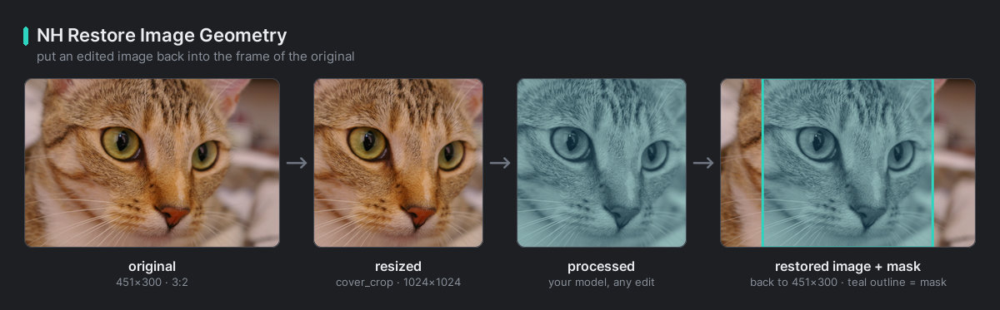
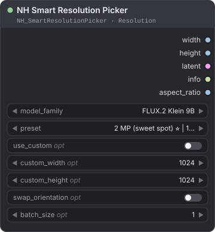
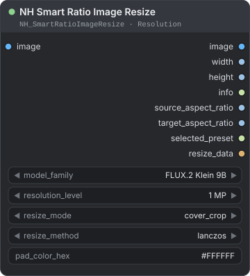
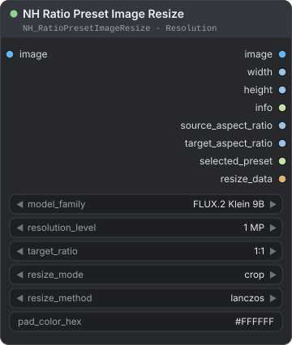
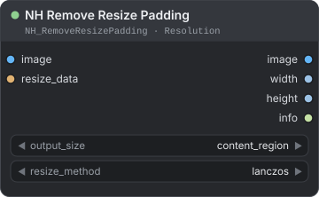
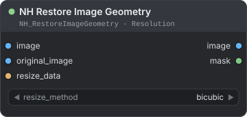

[← Về trang hướng dẫn](./README.md)

# Resolution (độ phân giải)

Các model ảnh cho kết quả tốt nhất ở những kích thước mà chúng được huấn luyện hoặc kiểm thử. Năm node trong **NH-Nodes → Resolution** lo phần việc này: một node chọn kích thước cho text-to-image, hai node đổi kích thước ảnh có sẵn về cỡ phù hợp với model, và hai node đưa kết quả trở lại khung ảnh gốc sau khi xử lý.

**Trên trang này**

- [Chọn node nào?](#chọn-node-nào)
- [Trước khi bắt đầu](#trước-khi-bắt-đầu) — họ model, mức độ phân giải, chế độ và phương pháp resize, hoàn tác resize
- [NH Smart Resolution Picker](#nh-smart-resolution-picker) — kích thước preset và latent rỗng cho text-to-image
- [NH Smart Ratio Image Resize](#nh-smart-ratio-image-resize) — đổi kích thước ảnh về preset có tỉ lệ gần nhất với ảnh
- [NH Ratio Preset Image Resize](#nh-ratio-preset-image-resize) — đổi kích thước ảnh theo tỉ lệ bạn chọn
- [NH Remove Resize Padding](#nh-remove-resize-padding) — bỏ viền đệm sau khi resize
- [NH Restore Image Geometry](#nh-restore-image-geometry) — đặt ảnh đã xử lý trở lại khung ảnh gốc

## Chọn node nào?

| Tôi muốn… | Dùng |
|---|---|
| Lấy width, height và latent rỗng cho text-to-image | [NH Smart Resolution Picker](#nh-smart-resolution-picker) |
| Đổi kích thước ảnh về preset hợp với tỉ lệ của chính ảnh đó | [NH Smart Ratio Image Resize](#nh-smart-ratio-image-resize) |
| Đổi kích thước ảnh theo tỉ lệ tôi chọn, như 16:9 hoặc 9:16 | [NH Ratio Preset Image Resize](#nh-ratio-preset-image-resize) |
| Bỏ viền đệm, hoặc quay về kích thước gốc | [NH Remove Resize Padding](#nh-remove-resize-padding) |
| Đặt ảnh đã chỉnh sửa trở lại khung ảnh gốc và giữ nguyên điểm ảnh gốc ở ngoài vùng đã cắt | [NH Restore Image Geometry](#nh-restore-image-geometry) |

## Trước khi bắt đầu

### Họ model và preset

Mọi node trên trang này đều có đầu vào `model_family`. Mỗi họ model có một danh sách **preset**: các cặp rộng × cao cho những tỉ lệ khung hình phổ biến, chia thành các mức (tier) theo kích thước tính bằng megapixel (MP).

| Họ model | Điểm tối ưu (khuyên dùng) | Các mức khác | Latent rỗng |
|---|---|---|---|
| `FLUX.2 Klein 4B` | 1 MP, 1024×1024 | 2 MP đã kiểm chứng · 3 MP cộng đồng thử · 4 MP rủi ro | 128 kênh, 1/16 kích thước |
| `FLUX.2 Klein 9B` (mặc định) | 2 MP, 1408×1408 | 1 MP và 3 MP đã kiểm chứng · 4 MP rủi ro | 128 kênh, 1/16 kích thước |
| `FLUX.2 Dev` | 2 MP, 1408×1408 | 1 MP, 3 MP và 4 MP đã kiểm chứng | 128 kênh, 1/16 kích thước |
| `Qwen-Image` | Native, 1328×1328 | 1 MP, 2 MP, 3 MP, 4 MP và HD, đều do cộng đồng thử | 16 kênh, 1/8 kích thước |
| `Z-Image` | Tier 1024 và Tier 1280 | Tier 1536 cộng đồng thử · Tier 2K ngoại suy | 16 kênh, 1/8 kích thước |

Mỗi mức mang một nhãn độ tin cậy. Mọi nhãn khác `verified` đều hiện cảnh báo ở đầu ra `info`.

- `verified` (đã kiểm chứng) — không có cảnh báo.
- `community` (cộng đồng thử) — kích thước do cộng đồng thử nghiệm, không phải thông số chính thức.
- `risk` (rủi ro) — có thể lỗi, nhất là với các biến thể distilled của model.
- `extrapolation` (ngoại suy) — nằm ngoài khoảng đã được thử.

Danh sách đầy đủ các kích thước nằm trong [`core/resolution_data.py`](../../core/resolution_data.py).

### Mức độ phân giải

`resolution_level` (từ `1 MP` đến `12 MP`) đặt diện tích mục tiêu cho hai node đổi kích thước ảnh.

- **1 MP đến 4 MP:** node dùng preset của họ model ở mức tương ứng. `Z-Image` đặt tên mức theo độ dài cạnh, nên `1 MP` dùng Tier 1024, `2 MP` dùng Tier 1280, `3 MP` dùng Tier 1536 và `4 MP` dùng Tier 2K. `Qwen-Image` dùng các mức `1 MP (preview)`, `2 MP`, `3 MP` và `4 MP`; kích thước Native và HD của nó chỉ chọn được trong [NH Smart Resolution Picker](#nh-smart-resolution-picker).
- **5 MP đến 12 MP:** không có preset. Node tự tính kích thước theo diện tích và tỉ lệ bạn yêu cầu, làm tròn về bội số của họ model (16, hoặc 32 với `Qwen-Image`) và gắn nhãn `extrapolated`. Đầu ra `info` cảnh báo rằng kích thước này có thể nằm ngoài khoảng model đã được thử.

### Chế độ resize

| Chế độ | Điều gì xảy ra | Tỉ lệ khung hình | Đánh đổi |
|---|---|---|---|
| `cover_crop` | Phóng ảnh cho phủ kín khung đích, rồi cắt (crop) phần thừa đều ở hai bên. | Giữ nguyên | Mất phần rìa ảnh. |
| `contain_pad` | Thu phóng sao cho cả ảnh nằm vừa trong khung, đặt vào giữa và tô phần còn lại bằng `pad_color_hex`. | Giữ nguyên | Có thêm viền đệm (padding). |
| `stretch` | Kéo giãn riêng chiều rộng và chiều cao đến đúng kích thước đích. | Không giữ | Ảnh bị méo, như bị ép hoặc kéo giãn. |

[NH Ratio Preset Image Resize](#nh-ratio-preset-image-resize) gọi ba chế độ này là `crop`, `pad` và `fill`.

<p align="center"><br><em>Cùng một ảnh được đổi sang 16:9 bằng <code>cover_crop</code>, <code>contain_pad</code> và <code>stretch</code>.</em></p>

### Phương pháp resize

`resize_method` là bộ lọc lấy mẫu lại (resampling). Các node đổi kích thước ảnh và [NH Remove Resize Padding](#nh-remove-resize-padding) dùng chung tám lựa chọn này; [NH Restore Image Geometry](#nh-restore-image-geometry) có danh sách ngắn riêng.

| Phương pháp | Đặc điểm |
|---|---|
| `lanczos` (mặc định) | Sắc nét, chất lượng cao. Tính bằng số thực (float), không làm tròn về 8-bit. |
| `bicubic`, `bilinear` | Mượt hơn `lanczos`. |
| `area`, `box`, `hamming` | Lấy trung bình các điểm ảnh nguồn. Hợp khi thu nhỏ mạnh. |
| `nearest`, `nearest-exact` | Sao chép điểm ảnh, không làm mượt. Giữ được cạnh cứng. |

### Hoàn tác resize

Mỗi node resize xuất ra `resize_data` (`NH_RESIZE_DATA`). Đây là bản ghi những gì lần resize đã làm: kích thước nguồn và đích, chế độ, hệ số phóng, vùng nội dung, viền đệm và phần cắt. Hãy nối nó vào node hoàn tác resize.

| Bạn đã resize bằng | Bạn muốn | Dùng |
|---|---|---|
| `contain_pad` | Ảnh không còn viền | [NH Remove Resize Padding](#nh-remove-resize-padding), `content_region` |
| `contain_pad` hoặc `stretch` | Quay về kích thước gốc | [NH Remove Resize Padding](#nh-remove-resize-padding), `original_size` |
| `cover_crop` | Kích thước gốc, với phần rìa đã bị cắt được lấy lại từ ảnh gốc | [NH Restore Image Geometry](#nh-restore-image-geometry) |
| Bất kỳ chế độ nào | Một mask cho biết nội dung mới nằm ở đâu | [NH Restore Image Geometry](#nh-restore-image-geometry), đầu ra `mask` |

Một vòng đi–về đầy đủ với `cover_crop`:

```text
Load Image → NH Smart Ratio Image Resize (cover_crop) → … xử lý của bạn … → NH Restore Image Geometry → Save Image
```

| Nối | Vào |
|---|---|
| `IMAGE` của Load Image | `image` của Smart Ratio Image Resize **và** `original_image` của Restore Image Geometry |
| `image` của Smart Ratio Image Resize | các node xử lý của bạn |
| `IMAGE` đã xử lý | `image` của Restore Image Geometry |
| `resize_data` của Smart Ratio Image Resize | `resize_data` của Restore Image Geometry |

<p align="center"><br><em>Resize, xử lý, rồi khôi phục. Mask màu trắng ở nơi nội dung đã xử lý được đặt vào.</em></p>

> **Lưu ý:** `resize_data` chỉ mô tả lần resize. Việc cắt thêm, xoay hoặc outpainting trong khâu xử lý của bạn, cùng mọi thay đổi khác mà model làm lên khung hình, không thể hoàn tác bằng nó.

---

## NH Smart Resolution Picker

<p align="center"></p>

Chọn width và height hợp với họ model của bạn, đồng thời tạo một latent rỗng đúng kích thước đó.

**Dùng khi** bạn bắt đầu workflow text-to-image và muốn có kích thước mà model xử lý tốt, hoặc khi nhiều node cần dùng chung một width và height.

| Đầu vào | Kiểu | Mặc định | Mô tả |
|---|---|---|---|
| `model_family` | COMBO | `FLUX.2 Klein 9B` | `FLUX.2 Klein 4B`, `FLUX.2 Klein 9B`, `FLUX.2 Dev`, `Qwen-Image` hoặc `Z-Image`. Đổi giá trị này sẽ làm mới danh sách `preset`. |
| `preset` | COMBO | `2 MP (sweet spot) ⭐ \| 1:1 \| 1408×1408` | Một kích thước trong danh sách của họ model, viết dạng `tier \| ratio \| width×height`. Dấu sao đánh dấu kích thước vuông được khuyên dùng. |
| `use_custom` *(tùy chọn)* | BOOLEAN | `false` | Bỏ qua `preset` và dùng `custom_width` × `custom_height`. |
| `custom_width` *(tùy chọn)* | INT | `1024` | Khoảng 64 đến 4096, bước 16. Dùng khi bật `use_custom`. |
| `custom_height` *(tùy chọn)* | INT | `1024` | Khoảng 64 đến 4096, bước 16. Dùng khi bật `use_custom`. |
| `swap_orientation` *(tùy chọn)* | BOOLEAN | `false` | Hoán đổi width và height, ví dụ từ ảnh ngang sang ảnh dọc. |
| `batch_size` *(tùy chọn)* | INT | `1` | Khoảng 1 đến 64. Số latent rỗng ở đầu ra. |

| Đầu ra | Kiểu | Mô tả |
|---|---|---|
| `width` | INT | Width cuối cùng, tính bằng pixel. |
| `height` | INT | Height cuối cùng, tính bằng pixel. |
| `latent` | LATENT | Latent rỗng (toàn số 0) có đúng hình dạng cho họ model, sẵn sàng đưa vào sampler. |
| `info` | STRING | Tóm tắt một dòng: họ model, mức, tỉ lệ, kích thước và megapixel. Có thể thêm các dòng `Warning:`, `Note:` và `Adjustment:`. |
| `aspect_ratio` | FLOAT | Width chia height. |

**Cách hoạt động**

- **Preset:** danh sách `preset` chỉ hiện các kích thước của họ model đang chọn. Một số preset, như các mức 4 MP, lớn hơn giới hạn của kích thước tùy chỉnh nêu bên dưới.
- **Kích thước tùy chỉnh:** node làm tròn mỗi cạnh về bội số gần nhất của 16 (32 với `Qwen-Image`), rồi giới hạn trong khoảng của họ model: 64 đến 2048 px với `FLUX.2 Klein`, 400 đến 2048 với `FLUX.2 Dev`, 512 đến 2560 với `Qwen-Image`, 512 đến 2048 với `Z-Image`. `info` liệt kê mọi thay đổi node đã thực hiện.
- **Cảnh báo:** mức `community`, `risk` hoặc `extrapolation`, hoặc kích thước mà node đã điều chỉnh, sẽ có dấu cảnh báo ở đầu `info`.
- **Hình dạng latent:** latent của `FLUX.2` có 128 kênh ở 1/16 kích thước ảnh. `Qwen-Image` và `Z-Image` dùng 16 kênh ở 1/8.

**Ví dụ**

```text
NH Smart Resolution Picker → latent → KSampler (latent_image)
                           → width, height → node bất kỳ cần kích thước
```

> **Mẹo:** Muốn chỉnh sửa ảnh có sẵn thay vì tạo ảnh mới, hãy dùng [NH Smart Ratio Image Resize](#nh-smart-ratio-image-resize). Node đó chọn preset dựa trên chính ảnh của bạn.

---

## NH Smart Ratio Image Resize

<p align="center"></p>

Đổi kích thước ảnh về preset có tỉ lệ khung hình gần nhất với tỉ lệ của chính ảnh.

**Dùng khi** bạn đưa ảnh vào model chỉnh sửa hoặc image-to-image và muốn có kích thước model xử lý tốt mà không phải tự chọn tỉ lệ, hoặc khi về sau bạn sẽ hoàn tác lần resize bằng `resize_data`.

| Đầu vào | Kiểu | Mặc định | Mô tả |
|---|---|---|---|
| `image` | IMAGE | — | Ảnh hoặc batch (lô ảnh) cần đổi kích thước. |
| `model_family` | COMBO | `FLUX.2 Klein 9B` | Lấy preset của họ model nào: `FLUX.2 Klein 4B`, `FLUX.2 Klein 9B`, `FLUX.2 Dev`, `Qwen-Image` hoặc `Z-Image`. |
| `resolution_level` | COMBO | `1 MP` | Kích thước đích, từ `1 MP` đến `12 MP`. Xem [Mức độ phân giải](#mức-độ-phân-giải). |
| `resize_mode` | COMBO | `cover_crop` | `cover_crop`, `contain_pad` hoặc `stretch`. Xem [Chế độ resize](#chế-độ-resize). |
| `resize_method` | COMBO | `lanczos` | Bộ lọc lấy mẫu lại. Xem [Phương pháp resize](#phương-pháp-resize). |
| `pad_color_hex` | STRING | `#FFFFFF` | Màu viền đệm cho `contain_pad`: `#RGB`, `#RRGGBB` hoặc `#RRGGBBAA`. Phần alpha đặt độ trong suốt với ảnh RGBA. Chuỗi không phải màu sẽ cho màu trắng. |

| Đầu ra | Kiểu | Mô tả |
|---|---|---|
| `image` | IMAGE | Ảnh hoặc batch đã đổi kích thước, đúng `width` × `height`. |
| `width` | INT | Width của preset đã chọn. |
| `height` | INT | Height của preset đã chọn. |
| `info` | STRING | Tóm tắt: preset, kích thước, megapixel, tỉ lệ khung hình nguồn, chế độ và phương pháp. |
| `source_aspect_ratio` | FLOAT | Width chia height của ảnh đầu vào. |
| `target_aspect_ratio` | FLOAT | Width chia height của preset đã chọn. |
| `selected_preset` | STRING | Nhãn của preset đã chọn, ví dụ `2 MP (sweet spot) \| 3:2 \| 1728×1152`. |
| `resize_data` | NH_RESIZE_DATA | Bản ghi lần resize, dành cho [NH Remove Resize Padding](#nh-remove-resize-padding) và [NH Restore Image Geometry](#nh-restore-image-geometry). |

**Cách hoạt động**

- Node so sánh width ÷ height của ảnh với mọi preset của họ model ở mức đã chọn và lấy tỉ lệ gần nhất. Nếu bằng nhau, node ưu tiên mức đáng tin hơn, rồi đến kích thước gần mức đã chọn nhất.
- Preset không phải lúc nào cũng đúng tỉ lệ. Ở 1 MP, preset `4:3` là 1152×896, nên `cover_crop` có thể cắt vài pixel ngay cả với ảnh 4:3.
- Mọi ảnh trong một batch có cùng kích thước và dùng chung một `resize_data`.
- Preset của `Qwen-Image` ở mức Native và HD không chọn được ở đây. Hãy dùng [NH Smart Resolution Picker](#nh-smart-resolution-picker) cho những kích thước đó.

**Ví dụ**

```text
Load Image → NH Smart Ratio Image Resize (FLUX.2 Klein 9B, 2 MP, cover_crop) → model chỉnh sửa → NH Restore Image Geometry → Save Image
```

Ảnh 1500×1000 trở thành preset `3:2` của mức 2 MP, tức 1728×1152.

---

## NH Ratio Preset Image Resize

<p align="center"></p>

Đổi kích thước ảnh về một preset ứng với tỉ lệ khung hình bạn chọn.

**Dùng khi** bạn cần một khung hình cố định, chẳng hạn 16:9 cho khung video hoặc 9:16 cho màn hình điện thoại, bất kể ảnh nguồn có tỉ lệ nào.

| Đầu vào | Kiểu | Mặc định | Mô tả |
|---|---|---|---|
| `image` | IMAGE | — | Ảnh hoặc batch cần đổi kích thước. |
| `model_family` | COMBO | `FLUX.2 Klein 9B` | Lấy preset của họ model nào. Cùng danh sách như trên. |
| `resolution_level` | COMBO | `1 MP` | Kích thước đích, từ `1 MP` đến `12 MP`. Xem [Mức độ phân giải](#mức-độ-phân-giải). |
| `target_ratio` | COMBO | `1:1` | `1:1`, `3:4`, `2:3`, `7:9`, `9:16`, `9:21`, `4:3`, `9:7`, `3:2`, `16:9` hoặc `21:9`. Danh sách trong node chỉ hiện các tỉ lệ mà họ model có ở mức đã chọn. |
| `resize_mode` | COMBO | `crop` | `crop`, `pad` hoặc `fill`. Đây là `cover_crop`, `contain_pad` và `stretch` dưới tên khác. |
| `resize_method` | COMBO | `lanczos` | Bộ lọc lấy mẫu lại. Xem [Phương pháp resize](#phương-pháp-resize). |
| `pad_color_hex` | STRING | `#FFFFFF` | Màu viền đệm cho `pad`. Quy tắc giống [NH Smart Ratio Image Resize](#nh-smart-ratio-image-resize). |

| Đầu ra | Kiểu | Mô tả |
|---|---|---|
| `image` | IMAGE | Ảnh hoặc batch đã đổi kích thước, đúng `width` × `height`. |
| `width` | INT | Width của preset đã chọn. |
| `height` | INT | Height của preset đã chọn. |
| `info` | STRING | Tóm tắt: tỉ lệ yêu cầu và tỉ lệ được chọn, kích thước, megapixel, chế độ và phương pháp. |
| `source_aspect_ratio` | FLOAT | Width chia height của ảnh đầu vào. |
| `target_aspect_ratio` | FLOAT | Width chia height của preset đã chọn. |
| `selected_preset` | STRING | Nhãn của preset đã chọn. |
| `resize_data` | NH_RESIZE_DATA | Bản ghi lần resize, dành cho các node hoàn tác nó. |

**Cách hoạt động**

- Nếu một workflow đã lưu yêu cầu tỉ lệ mà họ model không có ở mức đó, node dùng tỉ lệ gần nhất còn có và ghi điều này trong `info`.
- `fill` kéo giãn ảnh cho vừa khung đích, không tô màu. Muốn có viền màu, hãy dùng `pad`.
- Trên 4 MP, các kích thước được tính ra và gắn nhãn `extrapolated`. Xem [Mức độ phân giải](#mức-độ-phân-giải).

**Ví dụ**

```text
Load Image → NH Ratio Preset Image Resize (FLUX.2 Klein 9B, 2 MP, 16:9, crop) → …
```

Kết quả là 1888×1056. Với `contain_pad`, node giữ trọn bức ảnh và thêm viền màu `pad_color_hex`.

---

## NH Remove Resize Padding

<p align="center"></p>

Bỏ phần viền đệm mà lần resize đã thêm vào, và có thể đưa kết quả về kích thước gốc.

**Dùng khi** bạn đã resize bằng `contain_pad`, xử lý hoặc upscale ảnh, và giờ muốn bỏ các thanh viền.

| Đầu vào | Kiểu | Mặc định | Mô tả |
|---|---|---|---|
| `image` | IMAGE | — | Ảnh cần làm sạch. Có thể là bản đã xử lý hoặc đã upscale của kết quả resize. |
| `resize_data` | NH_RESIZE_DATA | — | `resize_data` từ node resize đã tạo ra viền đệm. |
| `output_size` | COMBO | `content_region` | `content_region` giữ phần ảnh ở kích thước riêng của nó. `original_size` đưa nó về đúng width và height của ảnh nguồn. |
| `resize_method` | COMBO | `lanczos` | Bộ lọc cho bước thu phóng mà `original_size` cần. Xem [Phương pháp resize](#phương-pháp-resize). |

| Đầu ra | Kiểu | Mô tả |
|---|---|---|
| `image` | IMAGE | Ảnh không còn viền đệm, hoặc ở kích thước gốc. |
| `width` | INT | Width của kết quả. |
| `height` | INT | Height của kết quả. |
| `info` | STRING | Node đã làm gì: có bỏ viền đệm hay không, khung cắt và kích thước đầu ra. |

**Cách hoạt động**

| Chế độ resize đã dùng | `content_region` | `original_size` |
|---|---|---|
| `contain_pad` | Cắt bỏ viền đệm. | Cắt bỏ viền đệm, rồi thu phóng ảnh về kích thước gốc. |
| `stretch` | Giữ nguyên, vì không có gì để bỏ. | Kéo giãn ngược về kích thước gốc. |
| `cover_crop` | Giữ nguyên. Phần đã bị cắt không thể khôi phục, và `info` nói rõ điều đó. | Thu phóng đều về lại khung ảnh gốc. Các rìa đã bị cắt được lấp bằng cách lặp lại điểm ảnh sát mép nhất. |

- Khung cắt tự theo kích thước ảnh nếu ảnh được upscale sau lần resize, nên kết quả upscale 2× vẫn mất đúng phần viền đệm của nó.
- Nếu `resize_data` không dùng được, ảnh đi qua nguyên vẹn và `info` ghi rõ điều đó.

**Ví dụ**

```text
Load Image → NH Smart Ratio Image Resize (contain_pad) → upscale hoặc chỉnh sửa → NH Remove Resize Padding (original_size) → Save Image
```

> **Mẹo:** Sau `cover_crop`, hãy ưu tiên [NH Restore Image Geometry](#nh-restore-image-geometry). Node đó giữ lại phần rìa thật của ảnh gốc thay vì lặp lại điểm ảnh sát mép.

---

## NH Restore Image Geometry

<p align="center"></p>

Đặt ảnh đã xử lý trở lại đúng khung của ảnh gốc, và giữ nguyên điểm ảnh gốc ở mọi nơi ảnh đã xử lý không phủ tới.

**Dùng khi** bạn đã resize bằng `cover_crop`, chạy ảnh qua một model hoặc upscaler, và muốn có kết quả đúng kích thước gốc, hoặc cần một mask để hòa trộn vùng đã xử lý vào ảnh gốc.

| Đầu vào | Kiểu | Mặc định | Mô tả |
|---|---|---|---|
| `image` | IMAGE | — | Ảnh đã xử lý. Có thể lớn hơn kết quả resize, kể cả theo hệ số không nguyên, miễn là khung hình không đổi. |
| `original_image` | IMAGE | — | Ảnh đã đi vào node resize. Kích thước phải khớp với kích thước nguồn lưu trong `resize_data`. |
| `resize_data` | NH_RESIZE_DATA | — | `resize_data` từ [NH Smart Ratio Image Resize](#nh-smart-ratio-image-resize) hoặc [NH Ratio Preset Image Resize](#nh-ratio-preset-image-resize). |
| `resize_method` | COMBO | `bicubic` | Cách lấy mẫu để đưa ảnh đã xử lý trở lại: `bicubic`, `bilinear` hoặc `nearest`. |

| Đầu ra | Kiểu | Mô tả |
|---|---|---|
| `image` | IMAGE | Ảnh ở kích thước gốc: nội dung đã xử lý nằm đúng vùng cũ, mọi nơi khác là điểm ảnh gốc. |
| `mask` | MASK | Màu trắng ở nơi nội dung đã xử lý được đặt vào, màu đen ở nơi ảnh gốc được giữ lại. |

**Cách hoạt động**

- **Kết quả bị cắt (`cover_crop`):** ảnh đã xử lý quay về đúng vùng nó từng nằm. Các rìa đã bị cắt vẫn giữ nguyên như trong `original_image`, và mask màu đen ở đó.
- **Kết quả có viền đệm (`contain_pad`):** viền đệm bị bỏ qua và chỉ phần ảnh được khôi phục, nên mask phủ toàn khung. `stretch` cũng phủ toàn khung.
- **Batch:** hai đầu vào cần cùng số ảnh trong batch, hoặc một trong hai chỉ có một ảnh, khi đó ảnh này được dùng lại. Số kênh (RGB hay RGBA) phải khớp.
- **Giới hạn:** siêu dữ liệu (metadata) này không thể hoàn tác việc cắt thêm, xoay hay nội dung mà model thêm vào ở mép. Việc khôi phục cũng không đem lại chi tiết đã mất khi thu nhỏ ảnh.
- **Lỗi:** node dừng kèm thông báo rõ ràng nếu `resize_data` không đến từ node resize của NH hoặc `original_image` sai kích thước.

**Ví dụ**

```text
Load Image → NH Smart Ratio Image Resize (cover_crop) → chỉnh sửa hoặc upscale → NH Restore Image Geometry → Save Image
```

Hãy nối thêm Load Image vào `original_image` và `resize_data` vào `resize_data`, như trong phần [Hoàn tác resize](#hoàn-tác-resize).

> **Mẹo:** Mask có cạnh cứng. Để chuyển tiếp mềm, hãy thu nhỏ rồi làm mờ nó bằng [Mask Morphology (NH)](./mask.md#mask-morphology-nh) để vùng mờ nằm gọn bên trong khu vực đã xử lý. Sau đó ghép `image` lên `original_image` bằng mask đó, ví dụ với `ImageCompositeMasked` có sẵn của ComfyUI.

---

[← Về trang hướng dẫn](./README.md)
