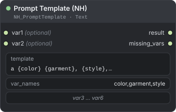
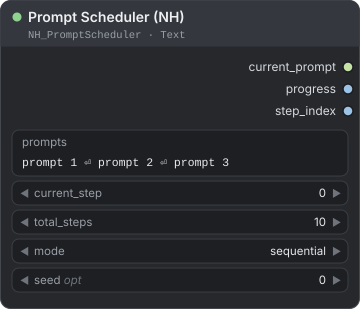
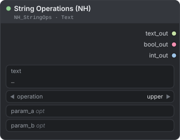
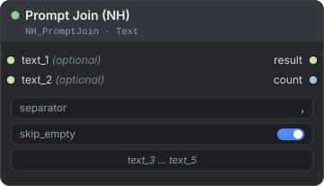
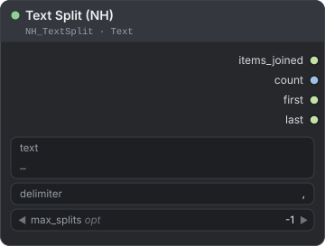
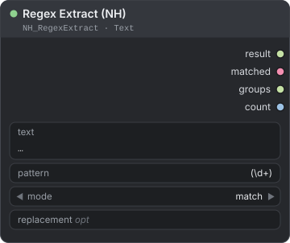
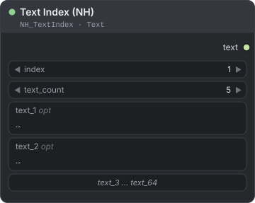
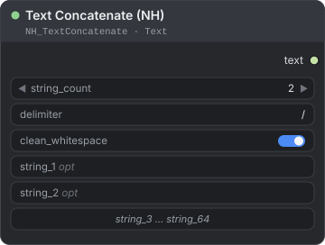
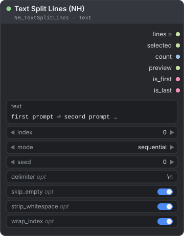
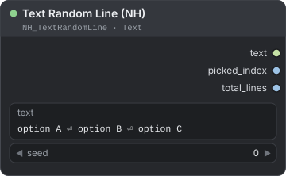

[← Về trang hướng dẫn](./README.md)

# Text (văn bản và prompt)

Các node Text tạo và biến đổi những chuỗi điều khiển prompt và tên file của bạn. Bạn có thể điền template prompt, nối và tách văn bản, chạy các phép xử lý chuỗi và biểu thức chính quy (regex), rồi chọn dòng theo vị trí hoặc ngẫu nhiên. Phần lớn node trả về `STRING`. Một số node còn trả về số đếm hoặc cờ đúng/sai để bạn đưa vào các node [Logic](./logic.md). Bạn tìm các node này trong menu node tại **NH-Nodes → Text**.

**Nội dung trang**

- [Prompt Template (NH)](#prompt-template-nh) — điền `{placeholder}` vào prompt và loại bỏ phần trống gọn gàng
- [Prompt Scheduler (NH)](#prompt-scheduler-nh) — đi lần lượt qua một danh sách prompt khi số bước tăng lên
- [String Operations (NH)](#string-operations-nh) — đổi chữ hoa/thường, xóa khoảng trắng thừa, thay thế, kiểm tra hoặc cắt chuỗi con
- [Prompt Join (NH)](#prompt-join-nh) — nối tối đa năm đoạn bằng một dấu phân tách
- [Text Split (NH)](#text-split-nh) — tách văn bản theo dấu phân tách, lấy số lượng, phần tử đầu và cuối
- [Regex Extract (NH)](#regex-extract-nh) — tìm, thay thế hoặc tách văn bản bằng biểu thức chính quy
- [Text Index (NH)](#text-index-nh) — chọn một trong tối đa 64 đoạn văn bản theo số thứ tự
- [Text Concatenate (NH)](#text-concatenate-nh) — nối tối đa 64 chuỗi, ví dụ thành đường dẫn
- [Text Split Lines (NH)](#text-split-lines-nh) — biến văn bản nhiều dòng thành danh sách chạy một lần cho mỗi dòng
- [Text Random Line (NH)](#text-random-line-nh) — chọn một dòng văn bản ngẫu nhiên

**Cách đọc các ví dụ**

- `\n` trong ví dụ đánh dấu một lần xuống dòng, còn `—` đánh dấu giá trị rỗng hoặc chưa được nối.
- Trong ô dấu phân tách của Text Split, Text Concatenate và Text Split Lines, gõ `\n` hoặc `\t` nghĩa là xuống dòng hoặc tab. Prompt Join dùng `separator` đúng như bạn gõ.
- Các lựa chọn ngẫu nhiên dùng seed đúng như giá trị đã cho, kể cả 0. Cùng seed và cùng văn bản luôn cho cùng kết quả chọn.

---

## Prompt Template (NH)

<p align="center"></p>

Điền các placeholder `{name}` trong prompt bằng tối đa sáu giá trị văn bản. Giá trị trống được loại bỏ gọn gàng, không để lại dấu phẩy thừa hay khoảng trắng thừa.

**Dùng khi** một prompt gốc phục vụ nhiều biến thể, như màu sắc, trang phục và style, và một số trường có thể để trống.

| Đầu vào | Kiểu | Mặc định | Mô tả |
|---|---|---|---|
| `template` | `STRING` | `a {color} {garment}, {style}, 8k photo` | Prompt nhiều dòng chứa các placeholder `{name}`. |
| `var_names` | `STRING` | `color,garment,style` | Tên các placeholder, cách nhau bằng dấu phẩy. Tên thứ N nhận giá trị của `varN`. |
| `var1` … `var6` *(tùy chọn)* | `STRING` | `""` | Các giá trị. Chỉ nhận kết nối: không có ô nhập văn bản, nên hãy nối một node văn bản. |

| Đầu ra | Kiểu | Mô tả |
|---|---|---|
| `result` | `STRING` | Prompt hoàn chỉnh. |
| `missing_vars` | `STRING` | Tên các placeholder bị bỏ trống, cách nhau bằng `, `. |

**Cách hoạt động**

- Placeholder có dạng `{name}` với đúng tên trong `var_names` (phân biệt hoa thường; khoảng trắng quanh tên được bỏ qua). `var1` điền tên thứ nhất, `var2` tên thứ hai, và cứ thế. Chỉ có sáu biến, nên tên thứ bảy luôn bị coi là trống.
- Văn bản trong dấu ngoặc nhọn mà không có trong `var_names` được giữ nguyên như bạn gõ và không được báo cáo.
- Biến trống hoặc chưa nối sẽ xóa placeholder của nó cùng khoảng trắng đứng trước (và khoảng trắng đứng sau khi placeholder nằm ở đầu dòng). Tên biến được thêm vào `missing_vars`.
- Sau đó mỗi dòng của kết quả được dọn gọn: `, ,` thành `,`, và dấu phẩy ở đầu hoặc cuối dòng bị bỏ. Việc này cũng dọn cả những dấu phẩy vốn đã có sẵn trong template.

Với template và tên mặc định:

| `var1` | `var2` | `var3` | `result` | `missing_vars` |
|---|---|---|---|---|
| `red` | `dress` | `studio` | `a red dress, studio, 8k photo` | — |
| `red` | `dress` | — | `a red dress, 8k photo` | `style` |
| — | `dress` | — | `a dress, 8k photo` | `color, style` |
| — | — | `studio` | `a, studio, 8k photo` | `color, garment` |

Với một biến trống ở các vị trí khác nhau:

| `template` | `var_names` | `var1` | `result` |
|---|---|---|---|
| `red dress, {style}, 8k photo` | `style` | — | `red dress, 8k photo` |
| `{style}, red dress` | `style` | — | `red dress` |
| `red dress, {style}` | `style` | — | `red dress` |
| `a {color} dress` | `color` | — | `a dress` |

**Ví dụ — prompt có các phần tùy chọn**

```text
Text "red"                  → Prompt Template (NH).var1
Text "dress"                → Prompt Template (NH).var2
Prompt Template (NH).result → CLIP Text Encode.text
```

---

## Prompt Scheduler (NH)

<p align="center"></p>

Chọn một dòng trong danh sách prompt theo số bước bạn cung cấp, và báo tiến độ.

**Dùng khi** một workflow lặp, chẳng hạn do `Counter (NH)` điều khiển, cần đi lần lượt qua các prompt: prompt đầu cho phần đầu của dãy lần queue, rồi đến prompt kế tiếp.

| Đầu vào | Kiểu | Mặc định | Mô tả |
|---|---|---|---|
| `prompts` | `STRING` | Ba dòng: `prompt 1`, `prompt 2`, `prompt 3` | Nhiều dòng, mỗi prompt một dòng. Dòng trống bị bỏ qua và mỗi dòng được xóa khoảng trắng ở hai đầu. |
| `current_step` | `INT` | `0` | Vị trí trong lịch trình, từ 0 trở lên. Thường được nối với một bộ đếm. |
| `total_steps` | `INT` | `10` | Độ dài lịch trình, từ 1 trở lên. |
| `mode` | `COMBO` | `sequential` | `sequential`, `pingpong` hoặc `random`. |
| `seed` *(tùy chọn)* | `INT` | `0` | Chỉ dùng cho `random`. |

| Đầu ra | Kiểu | Mô tả |
|---|---|---|
| `current_prompt` | `STRING` | Dòng được chọn. Rỗng khi `prompts` không có dòng nào. |
| `progress` | `FLOAT` | `current_step / total_steps`, không bao giờ vượt 1.0. |
| `step_index` | `INT` | Vị trí của dòng được chọn, đếm từ 0. |

| `mode` | Hành vi |
|---|---|
| `sequential` | Chia đều `total_steps` cho các prompt: mỗi prompt chiếm `total_steps // số prompt` bước, tối thiểu 1. Sau khối cuối cùng, node giữ nguyên prompt cuối. |
| `pingpong` | Đi tới rồi đi lùi: 1, 2, 3, 2, 1, 2, 3 và cứ thế. `total_steps` chỉ ảnh hưởng đến `progress`. |
| `random` | Chọn một dòng cho mỗi bước bằng bộ sinh số ngẫu nhiên có seed là `seed + current_step`. Cùng seed và cùng bước luôn cho cùng một dòng. |

Ba prompt (`cat`, `dog`, `bird`) và `total_steps` là 12:

```text
current_step   0    1    2    3    4    5    6    7    8    9   10   11
sequential    cat  cat  cat  cat  dog  dog  dog  dog bird bird bird bird
pingpong      cat  dog bird  dog  cat  dog bird  dog  cat  dog bird  dog
```

**Ví dụ — mỗi lần queue một prompt**

```text
Counter (NH).current                 → Prompt Scheduler (NH).current_step   (Counter: start 0, step 1, max_value 11)
Prompt Scheduler (NH).current_prompt → CLIP Text Encode.text
```

Đặt `total_steps` bằng số lần queue trong dãy, ở đây là 12.

> **Lưu ý:** Node này không đọc các bước của sampler. `current_step` chỉ là một con số do bạn cung cấp.

---

## String Operations (NH)

<p align="center"></p>

Chạy một phép xử lý văn bản, như đổi chữ hoa/thường, xóa khoảng trắng thừa, thay thế, kiểm tra hoặc cắt chuỗi con, rồi trả về văn bản, một kết quả đúng/sai và độ dài.

**Dùng khi** bạn cần làm sạch một cái tên, kiểm tra tên file (`endswith .png`), hoặc cắt một đoạn ra khỏi chuỗi.

| Đầu vào | Kiểu | Mặc định | Mô tả |
|---|---|---|---|
| `text` | `STRING` | `""` | Văn bản nhiều dòng cần xử lý. |
| `operation` | `COMBO` | `upper` | `upper`, `lower`, `strip`, `title`, `replace`, `contains`, `startswith`, `endswith`, `length` hoặc `slice`. |
| `param_a` *(tùy chọn)* | `STRING` | `""` | Chuỗi cần tìm, tiền tố hoặc hậu tố, hoặc biểu thức slice. |
| `param_b` *(tùy chọn)* | `STRING` | `""` | Chuỗi thay thế cho `replace`. |

| Đầu ra | Kiểu | Mô tả |
|---|---|---|
| `text_out` | `STRING` | Văn bản đã xử lý. |
| `bool_out` | `BOOLEAN` | Kết quả của phép kiểm tra; `True` với các phép không phải kiểm tra. |
| `int_out` | `INT` | Số ký tự. |

| `operation` | `text_out` | `bool_out` | `int_out` |
|---|---|---|---|
| `upper`, `lower`, `title` | Văn bản đã đổi | `True` | Độ dài của `text` |
| `strip` | `text` đã bỏ khoảng trắng ở hai đầu | `True` | Độ dài của kết quả |
| `replace` | Mọi `param_a` được thay bằng `param_b` | `True` | Độ dài của kết quả |
| `contains` | `text`, giữ nguyên | `True` nếu tìm thấy `param_a`, không phân biệt hoa thường | Độ dài của `text` |
| `startswith` | `text`, giữ nguyên | `True` nếu `text` bắt đầu bằng `param_a` (phân biệt hoa thường) | Độ dài của `text` |
| `endswith` | `text`, giữ nguyên | `True` nếu `text` kết thúc bằng `param_a` (phân biệt hoa thường) | Độ dài của `text` |
| `length` | `text`, giữ nguyên | `True` nếu `text` không rỗng | Độ dài của `text` |
| `slice` | Phần được chọn bởi `param_a` | `True` | Độ dài của kết quả |

**Cú pháp slice.** `param_a` có dạng `start:end`, mỗi vế có thể để trống và số âm đếm từ cuối: `2:5`, `:3`, `5:` hoặc `-3:`. Một con số đơn lẻ trả về một ký tự, đếm từ 0. Slice không hợp lệ, hoặc có bước nhảy như `1:6:2`, trả về nguyên văn bản.

| `text` | `operation` | `param_a` | `param_b` | `text_out` | `bool_out` | `int_out` |
|---|---|---|---|---|---|---|
| `  Red Dress  ` | `strip` | — | — | `Red Dress` | `True` | 9 |
| `red dress` | `upper` | — | — | `RED DRESS` | `True` | 9 |
| `red dress` | `title` | — | — | `Red Dress` | `True` | 9 |
| `red dress` | `replace` | `red` | `blue` | `blue dress` | `True` | 10 |
| `Red Dress` | `contains` | `DRESS` | — | `Red Dress` | `True` | 9 |
| `portrait_01.png` | `endswith` | `.png` | — | `portrait_01.png` | `True` | 15 |
| `portrait_01.png` | `startswith` | `Portrait` | — | `portrait_01.png` | `False` | 15 |
| `abcdefgh` | `slice` | `2:5` | — | `cde` | `True` | 3 |
| `abcdefgh` | `slice` | `-3:` | — | `fgh` | `True` | 3 |

**Ví dụ — rẽ nhánh theo đuôi file**

```text
Load Image Info (NH).file_name  → String Operations (NH).text    (operation: endswith, param_a: .png)
String Operations (NH).bool_out → If/Else (NH).condition
```

> **Mẹo:** `replace` với `param_a` rỗng sẽ chèn `param_b` vào giữa mọi ký tự: `abc` với `-` thành `-a-b-c-`.

---

## Prompt Join (NH)

<p align="center"></p>

Nối tối đa năm đoạn văn bản bằng một dấu phân tách và cho bạn biết đã nối bao nhiêu đoạn.

**Dùng khi** bạn ghép prompt từ nhiều mảnh riêng, như chủ thể, style và các tag chất lượng, và một số mảnh có thể trống.

| Đầu vào | Kiểu | Mặc định | Mô tả |
|---|---|---|---|
| `separator` | `STRING` | `", "` | Chuỗi đặt giữa các đoạn (dấu phẩy và dấu cách). Được dùng đúng như bạn gõ. |
| `skip_empty` | `BOOLEAN` | `True` | Bỏ các đoạn rỗng sau khi đã xóa khoảng trắng ở hai đầu. |
| `text_1` … `text_5` *(tùy chọn)* | `STRING` | `""` | Các đoạn văn bản. Chỉ nhận kết nối: không có ô nhập văn bản. |

| Đầu ra | Kiểu | Mô tả |
|---|---|---|
| `result` | `STRING` | Văn bản đã nối. |
| `count` | `INT` | Số đoạn đã được nối. |

**Cách hoạt động**

- Mỗi đoạn đã nối được xóa khoảng trắng ở hai đầu. Các đầu vào chưa nối luôn bị bỏ qua.
- Khi `skip_empty` bật, các đoạn rỗng bị bỏ. Khi tắt, đoạn rỗng vẫn có dấu phân tách của nó.
- Dấu phân tách không được chuyển đổi: `\n` vẫn là hai ký tự. Muốn xuống dòng thật, hãy dùng [Text Concatenate](#text-concatenate-nh).

| `separator` | `skip_empty` | Các đoạn | `result` | `count` |
|---|---|---|---|---|
| `", "` | bật | `masterpiece`, —, `8k photo` | `masterpiece, 8k photo` | 2 |
| `", "` | tắt | `masterpiece`, —, `8k photo` | `masterpiece, , 8k photo` | 3 |
| `" / "` | bật | `text_1` là `a`, `text_5` là `e` | `a / e` | 2 |

**Ví dụ — thêm tag chất lượng vào prompt**

```text
Prompt Template (NH).result → Prompt Join (NH).text_1
Text "masterpiece, 8k"      → Prompt Join (NH).text_2
Prompt Join (NH).result     → CLIP Text Encode.text
```

---

## Text Split (NH)

<p align="center"></p>

Tách văn bản theo một dấu phân tách và trả về các phần tử, số lượng, cùng phần tử đầu và phần tử cuối.

**Dùng khi** bạn nhận một danh sách viết trên một dòng, như `red, green, blue`, và cần phần tử đầu, phần tử cuối hoặc độ dài của nó.

| Đầu vào | Kiểu | Mặc định | Mô tả |
|---|---|---|---|
| `text` | `STRING` | `""` | Văn bản nhiều dòng cần tách. |
| `delimiter` | `STRING` | `", "` | Nơi cắt (dấu phẩy và dấu cách). `\n` nghĩa là xuống dòng và `\t` là tab. |
| `max_splits` *(tùy chọn)* | `INT` | `-1` | Từ -1 đến 100. -1 tách ở mọi chỗ; N cắt tối đa N lần. |

| Đầu ra | Kiểu | Mô tả |
|---|---|---|
| `items_joined` | `STRING` | Các phần tử, mỗi phần tử một dòng. |
| `count` | `INT` | Số phần tử. |
| `first` | `STRING` | Phần tử đầu tiên. |
| `last` | `STRING` | Phần tử cuối cùng. |

**Cách hoạt động**

- Dấu phân tách được so khớp chính xác, kể cả khoảng trắng. Mỗi phần tử được xóa khoảng trắng ở hai đầu và phần tử rỗng bị bỏ.
- `max_splits` N cắt tối đa N lần, nên có tối đa N + 1 phần tử và phần văn bản còn lại nằm trong phần tử cuối. `0` không cắt chỗ nào.
- Văn bản rỗng hoặc chỉ có khoảng trắng cho các đầu ra rỗng và `count` bằng 0. `delimiter` rỗng gây ra lỗi.

| `text` | `delimiter` | `max_splits` | `items_joined` | `count` | `first` | `last` |
|---|---|---|---|---|---|---|
| `red, green, blue` | `", "` | -1 | `red\ngreen\nblue` | 3 | `red` | `blue` |
| `red,green,blue` | `", "` | -1 | `red,green,blue` | 1 | `red,green,blue` | `red,green,blue` |
| `red,green,blue` | `","` | -1 | `red\ngreen\nblue` | 3 | `red` | `blue` |
| `red, green, blue, pink` | `", "` | 1 | `red\ngreen, blue, pink` | 2 | `red` | `green, blue, pink` |
| `a,, b ,,c` | `","` | -1 | `a\nb\nc` | 3 | `a` | `c` |

**Ví dụ — lấy tag đầu tiên của danh sách**

```text
Text "red, green, blue" → Text Split (NH).text
Text Split (NH).first   → CLIP Text Encode.text
```

> **Mẹo:** Nếu danh sách không có dấu cách sau dấu phẩy, hãy đặt dấu phân tách là `,` không kèm dấu cách, như ở hàng thứ ba.

---

## Regex Extract (NH)

<p align="center"></p>

Tìm, thay thế hoặc tách văn bản bằng biểu thức chính quy (regex), rồi báo kết quả, việc có khớp hay không, các nhóm bắt được và số lượng.

**Dùng khi** bạn cần lấy một con số từ tên file, viết lại một phần của chuỗi, hoặc cắt văn bản tại một mẫu.

| Đầu vào | Kiểu | Mặc định | Mô tả |
|---|---|---|---|
| `text` | `STRING` | `""` | Văn bản nhiều dòng cần tìm. |
| `pattern` | `STRING` | `(\d+)` | Biểu thức chính quy, theo cú pháp Python. |
| `mode` | `COMBO` | `match` | `match`, `findall`, `replace` hoặc `split`. |
| `replacement` *(tùy chọn)* | `STRING` | `""` | Dùng cho `replace`; `\1` và `\g<name>` chèn các nhóm. |

| Đầu ra | Kiểu | Mô tả |
|---|---|---|
| `result` | `STRING` | Kết quả chính; xem bảng các chế độ. |
| `matched` | `BOOLEAN` | `True` khi tìm thấy mẫu (với `split`, khi văn bản bị cắt). |
| `groups` | `STRING` | Các nhóm bắt được, hoặc văn bản gốc với `replace`. |
| `count` | `INT` | Số lần khớp hoặc số đoạn. |

| `mode` | Việc node làm | `result` | `groups` | `count` |
|---|---|---|---|---|
| `match` | Tìm lần khớp đầu tiên ở bất kỳ vị trí nào trong `text`, không chỉ ở đầu. | Toàn bộ chuỗi khớp | Các nhóm bắt, mỗi nhóm một dòng (toàn bộ chuỗi khớp nếu mẫu không có nhóm) | 1, hoặc 0 |
| `findall` | Tìm mọi lần khớp. | Mỗi lần khớp một dòng (nhiều nhóm: nối bằng `, `) | Giống `result` | Số lần khớp |
| `replace` | Thay mọi lần khớp bằng `replacement`. | Văn bản mới | Văn bản gốc | Số lần khớp |
| `split` | Cắt văn bản tại mỗi lần khớp, xóa khoảng trắng ở hai đầu các đoạn và bỏ đoạn rỗng. | Mỗi đoạn một dòng | Giống `result` | Số đoạn |

| `text` | `pattern` | `mode` | `result` | `groups` | `count` |
|---|---|---|---|---|---|
| `size 1024x768` | `(\d+)x(\d+)` | `match` | `1024x768` | `1024\n768` | 1 |
| `size 1024x768` | `\d+` | `match` | `1024` | `1024` | 1 |
| `no digits` | `\d+` | `match` | — (`matched` là `False`) | — | 0 |
| `a1b22c333` | `\d+` | `findall` | `1\n22\n333` | `1\n22\n333` | 3 |
| `a1b22c333` | `\d+` | `replace` với `#` | `a#b#c#` | `a1b22c333` | 3 |
| `1024x768` | `(\d+)x(\d+)` | `replace` với `\2x\1` | `768x1024` | `1024x768` | 1 |
| `red; blue ;green` | `\s*;\s*` | `split` | `red\nblue\ngreen` | `red\nblue\ngreen` | 3 |

**Ví dụ — đọc con số trong tên file**

```text
Load Image Info (NH).file_name → Regex Extract (NH).text      (pattern: (\d+), mode: match)
Regex Extract (NH).result      → con số trong tên file, dạng văn bản
```

> **Mẹo:** Thêm `(?i)` ở đầu mẫu để bỏ qua hoa thường, và `(?m)` để `^` và `$` khớp ở mỗi dòng thay vì chỉ ở hai đầu của toàn bộ văn bản.

> **Lưu ý:** Mẫu bị lỗi không làm workflow dừng lại. `result` là văn bản giữ nguyên, `matched` là `False`, `count` là 0, và console hiển thị thông báo lỗi.

---

## Text Index (NH)

<p align="center"></p>

Trả về một trong tối đa 64 đoạn văn bản bạn đã nhập, chọn theo số thứ tự tính từ 1.

**Dùng khi** bạn giữ nhiều prompt trong một node và muốn chọn một prompt theo số, ví dụ từ một bộ đếm.

| Đầu vào | Kiểu | Mặc định | Mô tả |
|---|---|---|---|
| `index` | `INT` | `1` | Đoạn văn bản cần trả về, từ 1 đến 64. |
| `text_count` | `INT` | `5` | Số ô văn bản được dùng, từ 1 đến 64. |
| `text_1` … `text_64` *(tùy chọn)* | `STRING` | `""` | Các ô văn bản nhiều dòng. Chỉ `text_count` ô đầu tiên được dùng. |

| Đầu ra | Kiểu | Mô tả |
|---|---|---|
| `text` | `STRING` | Văn bản trong ô số `index`. |

**Cách hoạt động**

- Đánh số bắt đầu từ 1, nên `index` 1 là `text_1`.
- Node chỉ hiển thị `text_count` ô. Nếu bố cục có vẻ chưa cập nhật sau khi mở workflow, hãy nhấn `update texts`.
- Nếu ô được chọn trống, hoặc `index` nằm ngoài khoảng từ 1 đến `text_count`, đầu ra bị chặn. Các node phía sau Text Index bị bỏ qua mà không báo lỗi. Nếu một sampler phía sau không chạy, hãy kiểm tra xem có ô trống hoặc `index` nằm ngoài phạm vi không.

| `index` | `text_count` | Các ô | `text` |
|---|---|---|---|
| 2 | 3 | `red`, `blue`, `green` | `blue` |
| 3 | 3 | `red`, `blue`, — | Bị chặn: các node kế tiếp bị bỏ qua |
| 4 | 3 | `red`, `blue`, `green`, `pink` | Bị chặn: `index` lớn hơn `text_count` |

**Ví dụ — mỗi lần queue một prompt**

```text
Counter (NH).current → Text Index (NH).index      (Counter: start 1, step 1, max_value 5)
Text Index (NH).text → CLIP Text Encode.text
```

> **Mẹo:** Value Match Index cũng đếm từ 1, nên đầu ra `index` của nó nối thẳng vào đây được.

---

## Text Concatenate (NH)

<p align="center"></p>

Nối tối đa 64 chuỗi bằng một dấu phân tách, bỏ qua các chuỗi rỗng.

**Dùng khi** bạn ghép đường dẫn thư mục hoặc tên file từ nhiều phần, như `renders/portraits/final`.

| Đầu vào | Kiểu | Mặc định | Mô tả |
|---|---|---|---|
| `string_count` | `INT` | `2` | Số ô chuỗi được dùng, từ 2 đến 64. |
| `delimiter` | `STRING` | `/` | Đặt giữa các chuỗi. `\n` nghĩa là xuống dòng và `\t` là tab. |
| `clean_whitespace` | `BOOLEAN` | `True` | Gộp các cụm khoảng trắng thành một dấu cách và xóa khoảng trắng ở hai đầu mỗi chuỗi. |
| `string_1` … `string_64` *(tùy chọn)* | `STRING` | `""` | Các ô một dòng. Chỉ `string_count` ô đầu tiên được dùng. |

| Đầu ra | Kiểu | Mô tả |
|---|---|---|
| `text` | `STRING` | Văn bản đã nối. |

**Cách hoạt động**

- Các chuỗi được lấy theo thứ tự, từ `string_1` đến `string_<string_count>`. Chuỗi rỗng bị bỏ qua, nên không để lại dấu phân tách thừa.
- Khi `clean_whitespace` bật, chuỗi chỉ gồm khoảng trắng được coi là rỗng. Khi tắt, các chuỗi được dùng đúng như bạn gõ.
- Node chỉ hiển thị `string_count` ô. Nếu bố cục có vẻ chưa cập nhật sau khi mở workflow, hãy nhấn `update strings`.

| `delimiter` | `clean_whitespace` | Các chuỗi | `text` |
|---|---|---|---|
| `/` | bật | `renders`, `portraits`, —, `final` (`string_count` là 4) | `renders/portraits/final` |
| `", "` | bật | `"  red   dress "`, `" studio   light "` | `red dress, studio light` |
| `\n` | bật | `a`, `b`, `c` (`string_count` là 3) | `a`, `b` và `c` trên ba dòng |
| rỗng | bật | `a`, `b`, `c` (`string_count` là 3) | `abc` |

**Ví dụ — tạo tiền tố khi lưu**

```text
Text Concatenate (NH).text → Save Image.filename_prefix      (các chuỗi: renders, portraits, final)
```

---

## Text Split Lines (NH)

<p align="center"></p>

Biến văn bản nhiều dòng thành danh sách các dòng. Hãy nối `lines` vào một đầu vào `STRING` và ComfyUI sẽ chạy các node được nối một lần cho mỗi dòng, giống xử lý theo batch nhưng áp dụng cho văn bản. Node cũng trả về một dòng được chọn ở đầu ra `selected`.

**Dùng khi** bạn muốn mỗi prompt trong danh sách ra một ảnh, hoặc muốn chọn một dòng duy nhất theo vị trí.

| Đầu vào | Kiểu | Mặc định | Mô tả |
|---|---|---|---|
| `text` | `STRING` | Ba dòng: `first prompt`, `second prompt`, `third prompt` | Văn bản nhiều dòng, mỗi mục một dòng. |
| `index` | `INT` | `0` | Dòng mà `selected` trả về, đếm từ 0. -1 chọn một dòng ngẫu nhiên bằng `seed`. Phạm vi từ -1 đến 9999. |
| `mode` | `COMBO` | `sequential` | `sequential` giữ nguyên thứ tự, `shuffle` xáo trộn theo seed, `reverse` đảo ngược thứ tự. |
| `seed` | `INT` | `0` | Từ 0 đến 4294967295. Dùng cho `shuffle` và cho `index` bằng -1. |
| `delimiter` *(tùy chọn)* | `STRING` | `\n` | Nơi cắt. `\n` nghĩa là xuống dòng và `\t` là tab. |
| `skip_empty` *(tùy chọn)* | `BOOLEAN` | `True` | Bỏ các dòng rỗng. |
| `strip_whitespace` *(tùy chọn)* | `BOOLEAN` | `True` | Xóa khoảng trắng ở hai đầu mỗi dòng. |
| `wrap_index` *(tùy chọn)* | `BOOLEAN` | `True` | Khi `index` vượt quá dòng cuối, quay vòng về đầu. Tắt: dùng dòng cuối. |

| Đầu ra | Kiểu | Mô tả |
|---|---|---|
| `lines` | `STRING` (danh sách) | Mọi dòng, theo thứ tự đã chọn. Các node nối vào đây chạy một lần cho mỗi dòng. |
| `selected` | `STRING` | Dòng được chọn bởi `index`. |
| `count` | `INT` | Số dòng. |
| `preview` | `STRING` | Mọi dòng được đánh số từ 0, có `>>>` sau dòng được chọn. |
| `is_first` | `BOOLEAN` | `True` khi `selected` là dòng đầu của danh sách đã sắp xếp. |
| `is_last` | `BOOLEAN` | `True` khi `selected` là dòng cuối của danh sách đã sắp xếp. |

**Cách hoạt động**

- Văn bản được cắt tại `delimiter`, rồi xóa khoảng trắng ở hai đầu và bỏ dòng rỗng theo `strip_whitespace` và `skip_empty`.
- Chỉ `lines` là danh sách. Các đầu ra còn lại là giá trị đơn và không tạo thêm lần chạy.
- `mode` sắp xếp lại các dòng trước, và `selected` được chọn từ danh sách đã sắp xếp. `shuffle` lặp lại được: cùng seed cho cùng thứ tự.
- Khi `wrap_index` bật, `index` 5 với 3 dòng thành 5 mod 3 = 2. Khi tắt, 5 bị giới hạn ở dòng cuối.
- Văn bản rỗng cho `count` bằng 0, `selected` rỗng và `preview` là `(empty)`.

Với `text` là `cat\ndog\nbird`:

| `index` | `mode` | `seed` | `selected` | Lý do |
|---|---|---|---|---|
| 1 | `sequential` | bất kỳ | `dog` | Dòng 1, đếm từ 0. |
| 5 | `sequential` | bất kỳ | `bird` | 5 quay vòng về dòng 2. Khi tắt `wrap_index`, nó cũng bị giới hạn ở dòng 2. |
| 0 | `reverse` | bất kỳ | `bird` | `lines` thành `bird`, `dog`, `cat`. |
| 0 | `shuffle` | 0 | `cat` | `lines` thành `cat`, `bird`, `dog`. |
| -1 | `sequential` | 0 | `dog` | Một dòng ngẫu nhiên được chọn bằng seed 0. |
| -1 | `sequential` | 1 | `cat` | Seed 1 chọn một dòng khác. |

`preview` khi `index` là 1 ở chế độ `sequential`:

```text
[0] cat
[1] dog >>>
[2] bird
```

**Ví dụ — mỗi dòng một ảnh**

```text
Text Split Lines (NH).lines → CLIP Text Encode.text → KSampler → VAE Decode → Save Image
```

Với ba dòng văn bản, ComfyUI chạy các node này ba lần và lưu ba ảnh.

---

## Text Random Line (NH)

<p align="center"></p>

Chọn một dòng ngẫu nhiên từ văn bản nhiều dòng. Cùng seed luôn cho cùng một dòng.

**Dùng khi** bạn muốn một prompt, style hoặc địa điểm ngẫu nhiên từ một danh sách và không cần gì hơn. Nếu cần sắp xếp lại, quay vòng hoặc đầu ra dạng danh sách, hãy dùng [Text Split Lines](#text-split-lines-nh).

| Đầu vào | Kiểu | Mặc định | Mô tả |
|---|---|---|---|
| `text` | `STRING` | Ba dòng: `option A`, `option B`, `option C` | Văn bản nhiều dòng, mỗi lựa chọn một dòng. Dòng trống bị bỏ qua và mỗi dòng được xóa khoảng trắng ở hai đầu. |
| `seed` | `INT` | `0` | Từ 0 đến 4294967295. Quyết định dòng được chọn. |

| Đầu ra | Kiểu | Mô tả |
|---|---|---|
| `text` | `STRING` | Dòng được chọn. Rỗng khi không có dòng nào. |
| `picked_index` | `INT` | Vị trí của dòng được chọn, đếm từ 0. -1 khi không có dòng nào. |
| `total_lines` | `INT` | Số dòng để chọn. |

Với `text` là `option A\noption B\noption C\noption D`:

| `seed` | `text` | `picked_index` | `total_lines` |
|---|---|---|---|
| 0 | `option D` | 3 | 4 |
| 1 | `option B` | 1 | 4 |
| 2 | `option A` | 0 | 4 |
| 5 | `option C` | 2 | 4 |

**Ví dụ — một địa điểm ngẫu nhiên mỗi lần queue**

```text
Text Random Line (NH).text → CLIP Text Encode.text
```

> **Mẹo:** Widget `seed` có thiết lập `control after generate` của ComfyUI. `randomize` cho một dòng mới mỗi lần queue; `fixed` lặp lại đúng dòng cũ.

---

**Xem thêm:** [Logic](./logic.md) cho các công tắc chọn giữa các đoạn văn bản và cho `Compare (NH)`, node biến một phép kiểm tra văn bản thành điều kiện; [Batch & Lists](./batch-lists.md) cho `Counter (NH)` và các node `NH_LIST` (`List Create (NH)` và các node khác) cũng tạo danh sách từ văn bản.

[← Về trang hướng dẫn](./README.md)
