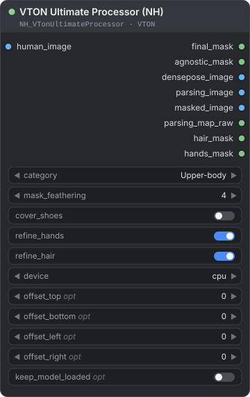
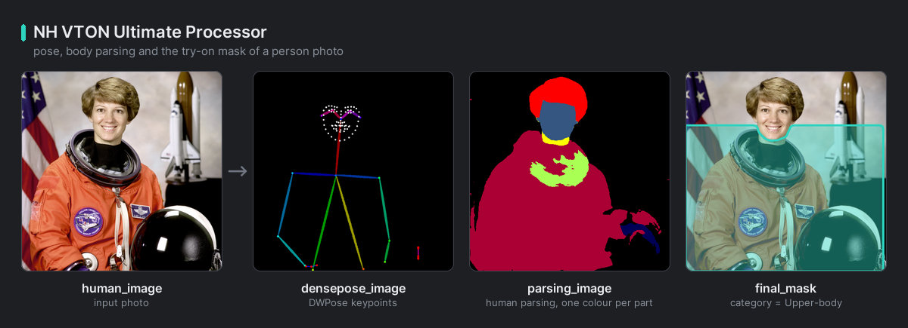

[← Về trang hướng dẫn](./README.md)

# VTON (thử đồ ảo)

Một node chuẩn bị ảnh chụp một người cho việc thử đồ ảo (virtual try-on) hoặc thay trang phục. Nó tìm vùng cần vẽ lại, phần cơ thể cần giữ, tư thế và các bộ phận cơ thể, để bạn khỏi phải tự vẽ mask. Bạn tìm thấy nó trong **NH-Nodes → VTON**.

**Trên trang này**

- [Trước khi bắt đầu](#trước-khi-bắt-đầu) — ONNX Runtime, lần tải đầu tiên, bộ nhớ, giấy phép
- [VTON Ultimate Processor (NH)](#vton-ultimate-processor-nh) — node, đầu vào và đầu ra
  - [Các category](#các-category) — mỗi category tạo mask cho phần nào
  - [Đầu ra chi tiết](#đầu-ra-chi-tiết) — bạn nhận được gì và đọc nó thế nào
  - [Điều chỉnh mask](#điều-chỉnh-mask) — offset, làm mềm cạnh, tay, tóc, giày
  - [Dùng bộ nhớ](#dùng-bộ-nhớ) — `keep_model_loaded` và VRAM
  - [Khi có sự cố](#khi-có-sự-cố)

## Trước khi bắt đầu

**1. Cài ONNX Runtime.** NH-Nodes không tự cài nó cho bạn, vì gói bản CPU sẽ ghi đè gói bản GPU đang có. Trong Python đang chạy ComfyUI, hãy cài đúng một trong hai gói sau, rồi khởi động lại ComfyUI:

```text
python -m pip install onnxruntime-gpu     # GPU NVIDIA
python -m pip install onnxruntime         # chỉ CPU
```

Node kiểm tra điều này trước tiên, trước khi tải bất kỳ thứ gì. Nếu `device` là `cuda` nhưng gói đã cài không hỗ trợ GPU, node sẽ chạy trên CPU và in một gợi ý trong console.

**2. Để lần chạy đầu tiên tải bốn model (khoảng 0.9 GB).** Lần chạy đầu tải hai model DWPose (bộ phát hiện người và model tư thế) cùng hai model phân tích bộ phận cơ thể (human parsing) từ kho Hugging Face `kg-09/kg-vton-mask`. Bản tải được cố định (pinned) vào một phiên bản xác định, nên thay đổi về sau ở nguồn không thể làm đổi thứ bạn nhận được. Các tệp được lưu vào `ComfyUI/models/ComfyUI-Vton-Mask/`, thư mục mà các bản cài trước đây đã dùng, nên những bản bạn đã có sẽ được tìm thấy. Bạn có thể thêm vị trí khác bằng khóa `vton_mask` trong `extra_model_paths.yaml` (xem ví dụ ở mục [Installation](../../README.md#installation)). Thư mục thiếu bất kỳ tệp nào trong bốn tệp sẽ không được tính: hãy chạy lại node và nó sẽ tải nốt phần còn thiếu.

**3. Chuẩn bị khoảng 3 GB VRAM** nếu bạn chạy trên `cuda`. Xem [Dùng bộ nhớ](#dùng-bộ-nhớ).

**4. Dùng ảnh chụp một người** nhìn thấy rõ. Node dùng người đầu tiên mà nó phát hiện.

> **Giấy phép:** VTON Ultimate Processor **chỉ dành cho mục đích phi thương mại**. Mã nguồn và các model phân tích bộ phận cơ thể của nó đến từ FitDiT và OOTDiffusion theo giấy phép CC BY-NC-SA 4.0. Các model DWPose gốc thuộc Apache-2.0, nhưng hãy coi cả node là phi thương mại. Mã nguồn của NH-Nodes thuộc giấy phép MIT. Hãy đọc [THIRD_PARTY_NOTICES.md](../../THIRD_PARTY_NOTICES.md) trước khi dùng cho mục đích thương mại.

---

## VTON Ultimate Processor (NH)

<p align="center"></p>

Tạo mask và các ảnh dẫn hướng cho việc thử đồ ảo từ một ảnh chụp một người.

**Dùng khi** bạn xây dựng workflow thử đồ hoặc thay trang phục và cần có vùng cần vẽ lại, cùng phần cơ thể cần giữ, mà không phải tự vẽ mask.

Các đầu vào COMBO không nêu mặc định sẽ bắt đầu ở lựa chọn đầu tiên.

| Đầu vào | Kiểu | Mặc định | Mô tả |
|---|---|---|---|
| `human_image` | IMAGE | — | Ảnh chụp một người. Node dùng màu (RGB), kênh alpha nếu có sẽ bị bỏ. Mọi ảnh trong batch (lô ảnh) đều được xử lý. |
| `category` | COMBO | `Upper-body` | `Upper-body`, `Lower-body`, `Dresses`, `Upper-body (Sleeveless)` hoặc `Lower-body (Shorts/Skirt)`. Xem [Các category](#các-category). |
| `mask_feathering` | INT | `4` | Khoảng 0 đến 50. Bán kính làm mờ, tính bằng pixel của ảnh bạn, cho cạnh của mask cuối. `0` cho cạnh cứng. |
| `cover_shoes` | BOOLEAN | `false` | Kéo dài mask xuống tận đáy ảnh, trên toàn bề ngang của người, để giày và bàn chân cũng được vẽ lại. Node cần phát hiện đủ các bộ phận cơ thể; nếu không, tùy chọn này không có tác dụng. |
| `refine_hands` | BOOLEAN | `true` | Loại hai cánh tay khỏi mask, để cánh tay gốc vẫn hiện nguyên. |
| `refine_hair` | BOOLEAN | `true` | Loại tóc khỏi mask, để phần tóc phía trước trang phục được giữ lại. |
| `device` | COMBO | `cpu` | `cpu` hoặc `cuda`. Chọn `cuda` nếu bạn có GPU NVIDIA và đã cài `onnxruntime-gpu`. |
| `offset_top` *(tùy chọn)* | INT | `0` | Khoảng -200 đến 200. Dịch cạnh trên của hình chữ nhật mask N pixel. Giá trị dương dịch xuống dưới. |
| `offset_bottom` *(tùy chọn)* | INT | `0` | Khoảng -200 đến 200. Dịch cạnh dưới. Giá trị dương dịch xuống dưới. |
| `offset_left` *(tùy chọn)* | INT | `0` | Khoảng -200 đến 200. Dịch cạnh trái. Giá trị dương dịch sang phải. |
| `offset_right` *(tùy chọn)* | INT | `0` | Khoảng -200 đến 200. Dịch cạnh phải. Giá trị dương dịch sang phải. |
| `keep_model_loaded` *(tùy chọn)* | BOOLEAN | `false` | Tắt: sau một lần chạy thực sự dùng GPU, các model được giải phóng khỏi VRAM. Bật: chúng ở lại trong bộ nhớ, giúp các lần chạy lặp lại và danh sách ảnh nhanh hơn nhiều. Xem [Dùng bộ nhớ](#dùng-bộ-nhớ). |

| Đầu ra | Kiểu | Mô tả |
|---|---|---|
| `final_mask` | MASK | Vùng cần vẽ lại, sau khi áp offset, tinh chỉnh và làm mềm cạnh. |
| `agnostic_mask` | MASK | Người không kể vùng cần vẽ lại: phần cần giữ. |
| `densepose_image` | IMAGE | Tư thế phát hiện được, vẽ thành khung xương (thân, tay và mặt) trên nền đen. |
| `parsing_image` | IMAGE | Bản đồ bộ phận cơ thể bằng màu, mỗi bộ phận một màu. |
| `masked_image` | IMAGE | Ảnh của bạn với mask cuối được tô màu trắng. |
| `parsing_map_raw` | MASK | Bản đồ bộ phận cơ thể dưới dạng số: mỗi điểm ảnh chứa nhãn của nó chia cho 19. |
| `hair_mask` | MASK | Tóc. |
| `hands_mask` | MASK | Hai cánh tay. |

Mọi đầu ra đều có kích thước bằng ảnh đầu vào, và một batch cho ra một batch.

<p align="center"><br><em>Mask cuối, bản đồ bộ phận cơ thể và hình vẽ tư thế cho một bức ảnh.</em></p>

**Cách hoạt động**

- **Kích thước làm việc.** Ảnh được phân tích trên một bản sao có cạnh dài nhất là 768 px. Model tư thế tìm các điểm khớp (keypoint) và model parsing gán nhãn cho từng điểm ảnh (tóc, mặt, quần áo, tay…). Kết quả được phóng về kích thước ảnh của bạn.
- **Hình chữ nhật rộng rãi.** Mask được dựng từ các điểm khớp và vùng quần áo đã phân tích, rồi đệm thêm lề và cắt bỏ phần đầu. Nó không phải đường viền chính xác của trang phục mà người đó đang mặc.
- **Thứ tự tinh chỉnh.** Quy tắc theo category, rồi `refine_hands`, `refine_hair`, `cover_shoes`, và cuối cùng là `mask_feathering`.
- **Batch.** Mỗi ảnh được xử lý riêng với cùng thiết lập. Nếu một ảnh không có người, node dừng lại và nêu số thứ tự của ảnh đó trong batch.

**Ví dụ**

```text
Load Image (người mẫu) → VTON Ultimate Processor (Upper-body, cuda)
    ├─ final_mask   → model thử đồ hoặc inpaint của bạn
    └─ masked_image → Preview Image (kiểm tra vùng mask)
```

Hãy xem `masked_image` trước. Vùng màu trắng là phần sẽ được vẽ lại. Nếu nó quá lớn hoặc quá nhỏ, hãy chỉnh các offset.

### Các category

| `category` | Mask phủ | Cần biết |
|---|---|---|
| `Upper-body` | Áo, áo sơ mi và áo khoác: một hình chữ nhật có đệm lề từ đường cằm hoặc đường vai (lấy chỗ cao hơn) xuống đến hông, kéo ra tới hai bàn tay. Phần đầu được cắt bỏ. | Khi `refine_hands` bật, hai cánh tay được loại ra. |
| `Lower-body` | Quần và váy: một hình chữ nhật phủ trọn bề ngang của người, từ khoảng eo (không bao giờ cao hơn giữa thân) xuống đến bàn chân. | `offset_left` và `offset_right` không có tác dụng, vì bề ngang luôn theo người. |
| `Dresses` | Đầm và jumpsuit: một hình chữ nhật rộng có đệm lề từ đường cằm hoặc đường vai xuống đến bàn chân. Phần đầu, giày và túi xách được cắt bỏ. | |
| `Upper-body (Sleeveless)` | Cùng vùng với `Upper-body`, nhưng luôn loại hai cánh tay ra. | Tay vẫn bị loại ngay cả khi `refine_hands` tắt. |
| `Lower-body (Shorts/Skirt)` | Cùng vùng với `Lower-body`, nhưng dừng ở đường đầu gối. | Nếu không phát hiện được đầu gối, nó hoạt động như `Lower-body`. |

### Đầu ra chi tiết

- **`densepose_image`** giữ tên này, nhưng thực chất là hình vẽ khung xương DWPose, không phải bản đồ DensePose.
- **`agnostic_mask`** là mọi thứ mà bộ phân tích coi là một phần của người (tóc, mặt, da, quần áo, túi), trừ đi `final_mask`.
- **`masked_image`** pha dần về màu trắng ở nơi `final_mask` mềm.
- **`parsing_map_raw`** là bản đồ bộ phận dưới dạng số. Nhân giá trị một điểm ảnh với 19 rồi làm tròn để ra nhãn: 0 nền, 1 mũ, 2 tóc, 3 kính râm, 4 áo trên, 5 váy, 6 quần, 7 đầm, 8 thắt lưng, 9 giày trái, 10 giày phải, 11 mặt, 12 chân trái, 13 chân phải, 14 tay trái, 15 tay phải, 16 túi, 17 khăn, 18 cổ.
- **`hair_mask`** là nhãn 2.
- **`hands_mask`** là các nhãn 14 và 15 (cả hai cánh tay) cộng với nhãn 3 (kính râm). Đây là vùng mà `refine_hands` loại khỏi mask cuối. Bộ phân tích không có lớp "bàn tay" riêng, nên cả cánh tay được phủ.

### Điều chỉnh mask

- **Offset.** Mỗi offset dịch một cạnh của hình chữ nhật mask theo hệ tọa độ ảnh: giá trị dương dịch cạnh sang phải hoặc xuống dưới. Để mở rộng mask về mọi phía, dùng `offset_top` và `offset_left` âm, `offset_bottom` và `offset_right` dương.
- **Offset tính theo kích thước làm việc.** Chúng được đo trên bản sao 768 px, không phải trên ảnh của bạn. Với ảnh có cạnh dài nhất 3072 px, offset 10 dịch cạnh đi 40 px.
- **`mask_feathering`** làm mờ mask đã hoàn chỉnh theo pixel của ảnh bạn, nên giá trị cao trên ảnh nhỏ sẽ làm mềm cả mask.
- **`refine_hands` và `refine_hair`** trừ hai cánh tay và tóc khỏi mask. Hãy tắt `refine_hands` nếu trang phục mới có tay dài phải che cánh tay.
- **`cover_shoes`** dành cho các category mà mask vốn đã chạm tới chân, như `Lower-body`, `Dresses` và `Lower-body (Shorts/Skirt)`.

### Dùng bộ nhớ

Bốn model cùng dùng khoảng 3 GB VRAM trên `cuda`. ONNX Runtime tự cấp phát vùng nhớ này, nên ComfyUI không thấy và không giải phóng được nó, và nút **Free memory** của ComfyUI không có tác dụng với nó. `keep_model_loaded` quyết định node làm gì với vùng nhớ đó sau mỗi lần chạy:

| `keep_model_loaded` | Model chạy trên GPU | Model chạy trên CPU |
|---|---|---|
| `false` (mặc định) | Được giải phóng sau mỗi lần chạy, nên node kế tiếp có cả GPU để dùng. Lần chạy sau nạp chúng lại, mất thêm khoảng 1.5 giây mỗi lần chạy. | Ở lại trong bộ nhớ đệm. |
| `true` | Ở lại trong VRAM nên các lần chạy lặp lại nhanh hơn nhiều. Một model lớn chạy sau có thể hết VRAM. | Ở lại trong bộ nhớ đệm. |

- **Danh sách ảnh.** ComfyUI gọi node một lần cho mỗi phần tử của danh sách, nhưng chỉ gọi một lần cho cả batch. Khi tùy chọn tắt và model chạy trên GPU, một danh sách 20 ảnh nạp model 20 lần, nên hãy bật nó cho danh sách ảnh và cho các lần chạy lặp lại.
- **"Chạy trên GPU" là điều ONNX Runtime thực sự làm**, không phải điều `device` ghi. Nếu `device` là `cuda` nhưng ONNX Runtime phải lùi về CPU (chỉ cài gói CPU, hoặc CUDA và cuDNN không khớp), các model nằm trong RAM thường, ở lại trong bộ nhớ đệm, và tùy chọn này không có tác dụng.
- Trước khi nạp model lên GPU, node nhờ ComfyUI gỡ bớt các model của chính nó để nhường chỗ. Node bỏ qua bước này khi chưa cài gói GPU của ONNX Runtime, và khi ONNX Runtime đã lùi về CPU, vì giải phóng VRAM lúc đó không giúp ích gì cho các model ấy.
- Nếu bạn đổi `device` giữa các lần chạy, các model của thiết bị cũ được giải phóng trước.

### Khi có sự cố

| Bạn thấy | Cần làm |
|---|---|
| Lỗi báo chưa cài ONNX Runtime | Cài một gói như trong [Trước khi bắt đầu](#trước-khi-bắt-đầu), rồi khởi động lại ComfyUI. |
| Chạy chậm dù `device` là `cuda` | Console cho biết lý do. Hoặc chỉ có gói ONNX Runtime bản CPU (hãy cài `onnxruntime-gpu` thay vào), hoặc gói GPU không khởi động được (kiểm tra phiên bản CUDA và cuDNN của nó có khớp với máy bạn không). |
| Lỗi báo không tìm thấy người ở một vị trí trong batch | Dùng ảnh mà người trong ảnh nhìn thấy rõ. |
| Model chạy sau bị hết VRAM | Tắt `keep_model_loaded`. |
| Danh sách ảnh chạy rất lâu | Bật `keep_model_loaded`, để model được nạp một lần thay vì một lần cho mỗi ảnh. |
| Quá trình tải dừng giữa chừng | Chạy lại node. Nó tiếp tục và giữ lại các tệp đã tải xong. |

---

[← Về trang hướng dẫn](./README.md)
